**日本語** | [English](README.en.md) | [简体中文](README.zh-CN.md)

# freecad-ja-unified

FreeCAD を「迷わない一つの画面」にまとめ、日本語で使えるようにしたもの。
作業場（ワークベンチ）の切り替えを無くし、選んだものに応じてその場で次の操作を出し、
画面の言葉を平易な日本語にそろえた。間違いを見つける「設計の検査」と、モデルを見て直す AI チャットも入れた。
コマンドラインやスクリプトから使うときの不具合も直している。FreeCAD 本家へのパッチの形で置いている（上流には送っていない）。

FreeCAD with one integrated, Japanese-first working environment: no workbench switching,
actions offered next to what you picked, plain Japanese throughout, a design check that finds
and fixes mistakes, an AI chat that works on the model, and fixes for using FreeCAD from the
command line and from scripts. Kept as patches on top of FreeCAD; not submitted upstream.

## エンジンを作ってみた

この改良版で 125cc の空冷単気筒エンジンを作り、使いやすさを試した。**スクリプトでも、画面の操作だけでも、エンジン全体を作れる。**

<p>
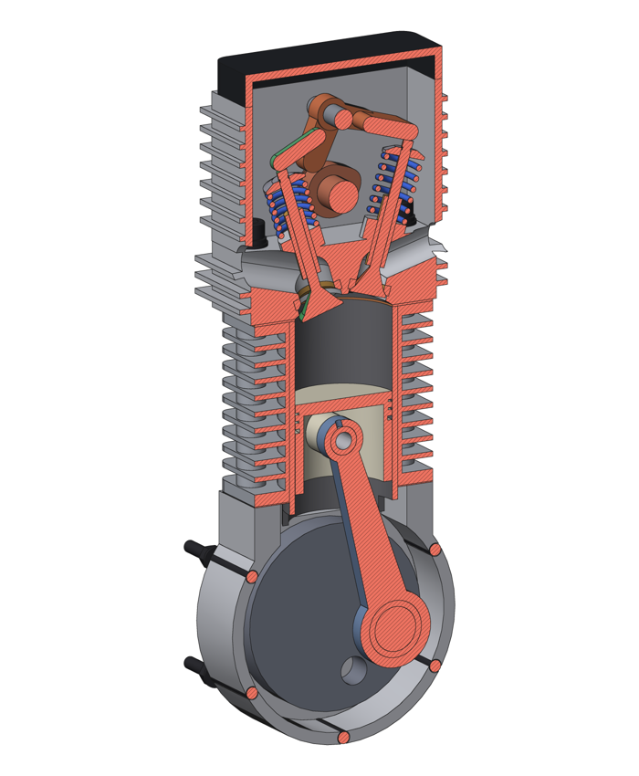
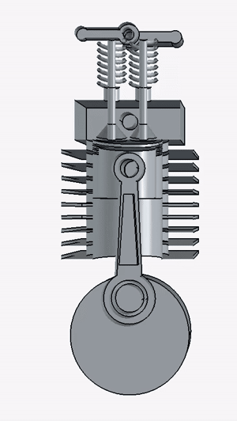
</p>

左: スクリプトで作ったエンジン全体（73 部品）。右: **マウスとキーボードだけで作った**エンジン（15 部品・17 ジョイント）を「動きを動画に」で断面のまま 0→720° 回したもの。ロッカーとバルブはクランク角の式で動き、吸気・排気が順に 1 回ずつ開く。

画面だけで作れるかは、版ごとに同じ課題で試してきた。

- 0.6.9: 6 課題中 2 つ（途中で落ちて作業が消えた）
- 0.7.3: 4 つ
- 0.7.5: 6 つすべて（部品・組立・図面）
- **0.7.8: エンジン全体**（動弁系・カムのチェーン・式で動く弁・断面の動画・開き直し）

見つかった壁は各版で直した。まだ残っているもの: まれな異常終了（ASan のビルドでも再現できていない）、など。

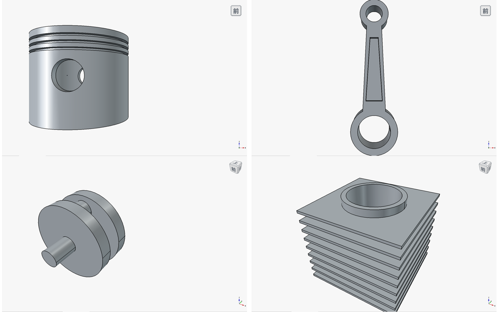

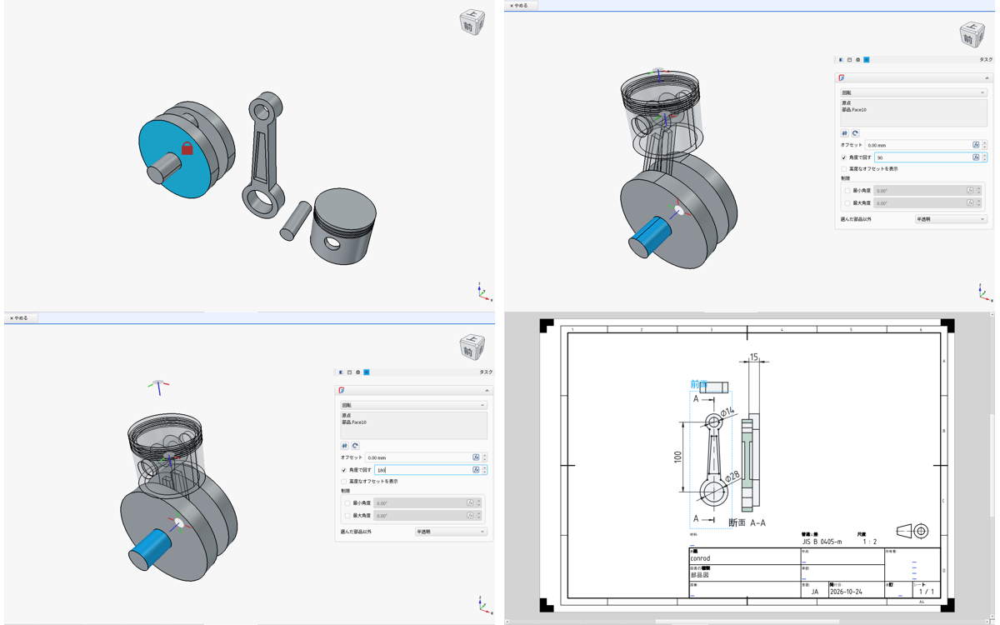

## 主な機能

画面
- 作業場の切り替えなしの一つの画面。選んだ物の横に、次にできる操作が出る（数字を打って Enter で確定）
- 磁石のようにくっつける・Excel のように揃える・面を矢印で押し引き・2 つ選ぶと自動で測る
- 組立: 穴や軸の中心で合わせる、「その場で回す」「その場ですべらせる」「角度で回す」、歯数で比を決める、動きを動画（MP4）に
- 部品の棚（JIS のねじ・アルミフレーム・会社の部品）、図面の自動の寸法と日本語の表題欄
- 設計の検査（干渉・壊れた形・成り立たないジョイントなど）と、モデルを見て直す AI チャット

コマンドライン（画面なし）
- `freecadcmd model.FCStd --render out.png --view iso`（`--section z=10 --section-color part` で断面）
- `--export-svg` / `--export-pptx`（隠れ線を消した 2D）、`--export-drawings out.pdf`（図面の PDF。`--line-width 0.25` で線の太さ、`--check-layout` で枠・表題欄へのはみ出しを知らせる）
- `--export-web model.html`（ブラウザで回して見る 3D。1 つの HTML で、ネットなし・スマホでも。`--web-simplify fasteners` でねじ類を軽く）
- `--gui-script work.py -- 引数`（画面の機能が要るスクリプトを画面なしで。出力とエラーはそのまま）
- `--interference`（干渉検査。300 部品で約 1 秒）、`--design-check`（設計の検査を JSON で。`--ignore-pairs` でわざと当てた組を外す、`--sweep` で動く部品を回しながら干渉を調べる）
- DWG（AutoCAD）を R2018 まで読み書き、Jw_cad の図面（JWW）を開く

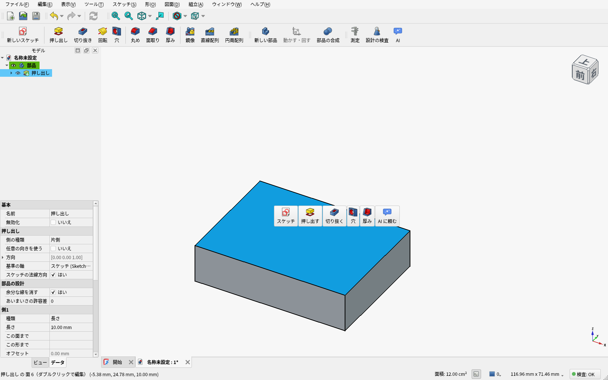

- 元にした版: FreeCAD main `b48098efa`（2026-09-26、バージョン表記 26.3.0dev）
- 同梱の OndselSolver: `4be80eef`

## ダウンロード

[Releases](https://github.com/monyuonyu/freecad-ja-unified/releases) にビルド済みのものを置いている。

- Linux: `FreeCAD_<版>-Linux-x86_64.AppImage`（実行権限を付けてそのまま起動）
- Windows: `FreeCAD_<版>-Windows-x86_64-installer.exe`（インストーラー）または `.7z`（展開して `bin/FreeCAD.exe`）

署名はしていないので、Windows では SmartScreen の警告が出る（「詳細情報」→「実行」）。

設定・マクロ・ウィンドウの配置は本家の FreeCAD と別の場所（`FreeCAD-ja-unified`）に置く。Windows のインストーラーも
本家と別の場所（`FreeCAD-ja-unified 26.3`）に入る。0.3.1 までは本家と共通だった（本家と並べて使うと設定が混ざる）。

アンインストールすると、プログラム・ショートカット・ファイルの関連付け・登録はすべて消える（Windows で確かめた）。
自分の設定は、本家と同じく既定では残る（入れ直したときに引き継ぐため）。消すときはアンインストーラーの画面で
「ユーザー設定も削除」を選ぶ。消えるのはこの版の設定だけで、本家の FreeCAD の設定には触れない。

## 画面で見る

### 最初の起動

言語・単位・見た目（ライト／ダーク）を選ぶだけ。あとから「編集 → 設定」で変えられる。

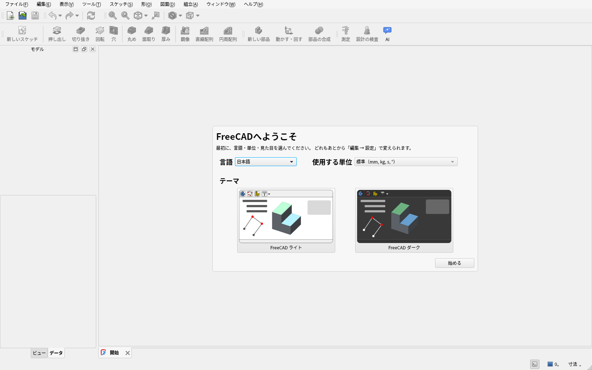

### 新しい部品 → 描く場所をクリック

スタート画面は「新しい部品」「ファイルを開く」だけ。新しい部品を押すと、そのまま描く場所を聞いてくる。
本家のように面を選んでダイアログで OK を押す必要はなく、3D 画面の平面か部品の平らな面を 1 回クリックする。

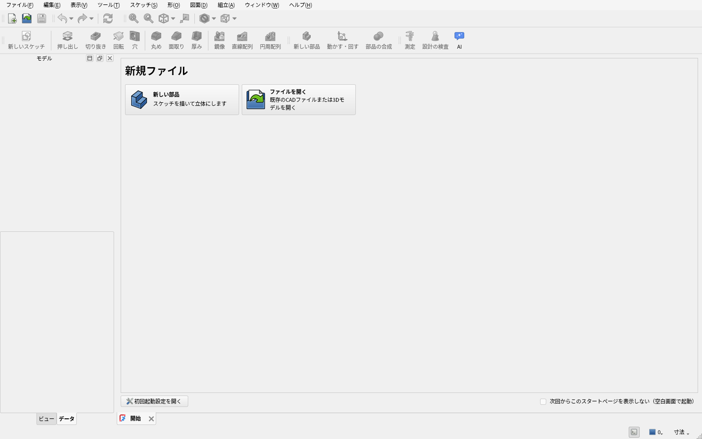

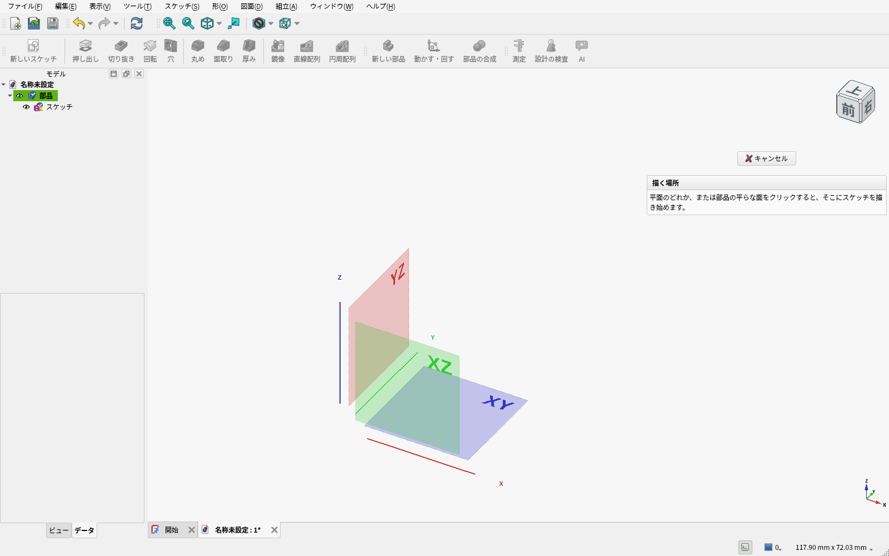

### スケッチ中はスケッチの道具だけ

スケッチを描いている間は、ツールバーがスケッチの道具に切り替わり、終われば元に戻る。
グリッドの点に吸い付くので、マウスで描いても切りのいい寸法になる。決まっていない所の数は日本語で出る。

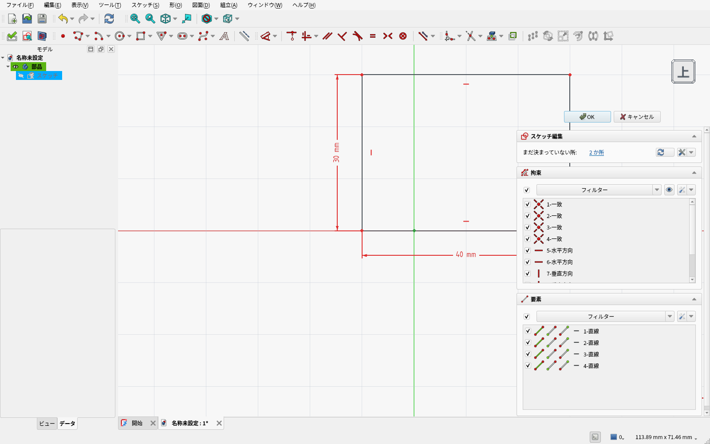

### 描いたら、次の一手が横に出る

スケッチを閉じると、その横に「押し出す・回転・編集・AI に頼む」が出る。ツールバーから探さなくてよい。
ツールバーも主な道具はアイコンの下に名前（押し出し・切り抜き・丸め…）が付いている。

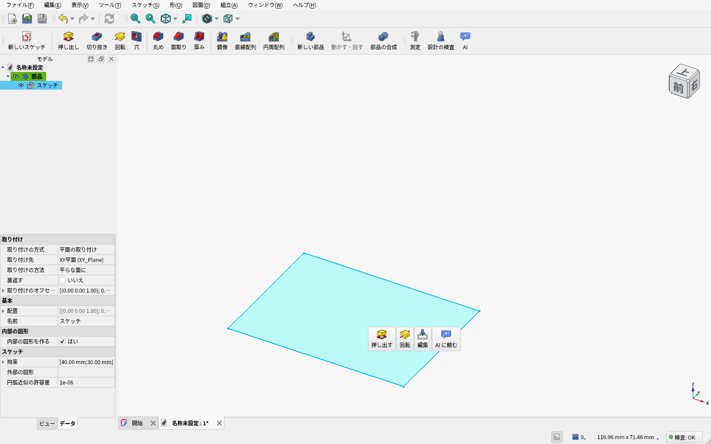

作業パネルは道具を使っている間だけ出て、終わったら消える（モデルが画面に収まるように視点も合わせる）。

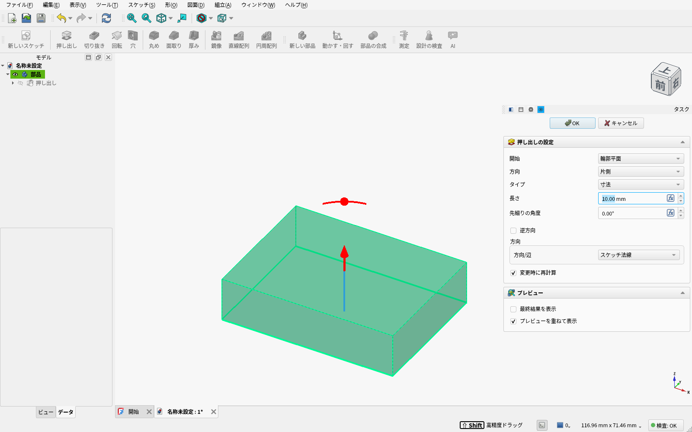

### 面をクリックすると、その面でできること

面ならスケッチ・押し出し・切り抜き・穴・厚み、辺なら丸め・面取りが出る（一番上の画像）。
「穴」は、クリックした位置にそのまま開く（本家は先にスケッチに点を描く必要がある）。
カーソルの下の物は `Preselected: Unnamed.Body.Pad.Face6` ではなく、名前と場所で出る。
面をダブルクリックすると、その面を作った手順（押し出し・丸め…）の編集が開く。


### 部品をくっつける・点から点へ動かす

部品どうしをぴったり合わせるのに、配置のダイアログや取り付け（アタッチメント）、アセンブリのジョイントは要らない。
動かしたい部品の面をクリックし、Ctrl を押しながら相手の面をクリックすると、横に「くっつける」が出る。押せば面と面が向かい合ってくっつく。
**先に選んだほうが動く**（パネルに「動かす: 部品 → 合わせ先: 部品001」と出る。「入れ替え」で逆にできる）。

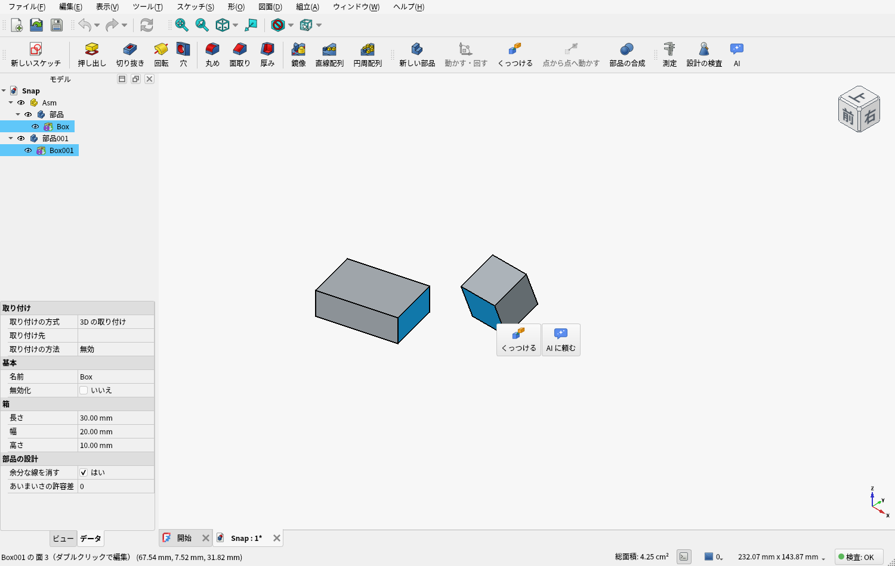

押した時点で部品が動いて見える。パネルで「向きを反転」（向かい合わせでなく同じ向きに。上の面どうしをそろえるなど）・「すき間」・
「回転」（面のまわりに 90° ずつ、または好きな角度）・「合わせる位置」（クリックした点どうし／面の中心どうし／今の位置のまま）を変えると、すぐ反映される。
OK で確定（「元に戻す」1 回で戻る）、キャンセルか Esc で元の位置に戻る。

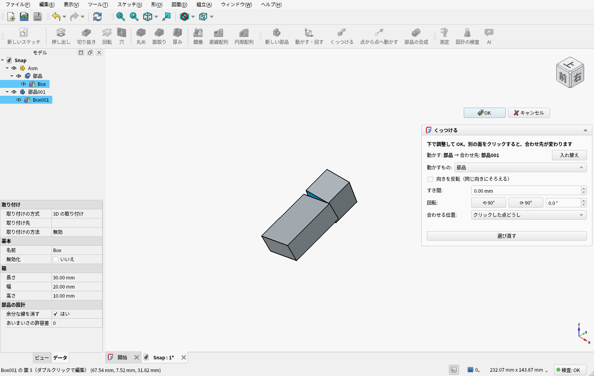

丸い面どうし（軸と穴）を選ぶと「軸をそろえる」、点と面なら「点を面に合わせる」、点（角・辺）どうしなら「点から点へ」が出る。

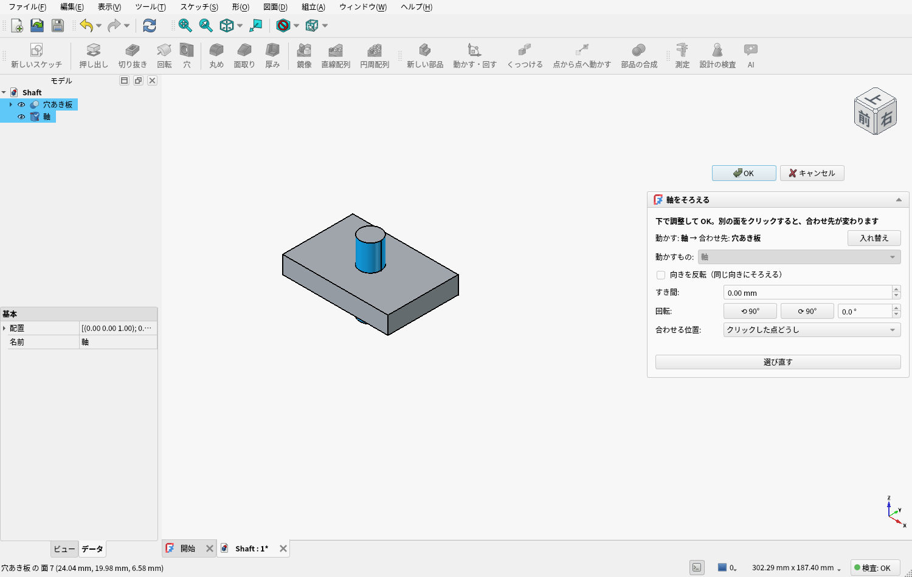

「点から点へ動かす」は、向きを変えずに動かす。動かす元の点と行き先をクリックする。カーソルは角・辺の真ん中・円の中心・面の中心に吸い付き、
印と名前（「角（頂点）」など）が出る。動く先には透けた写しが付いてくる。Ctrl を押しながら行き先をクリックするとコピー。

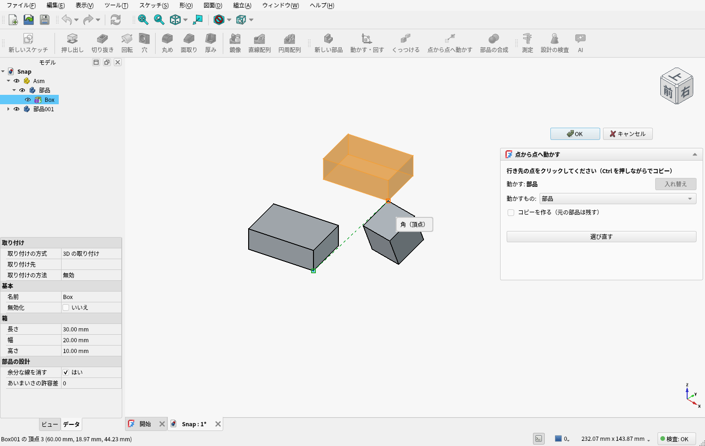

道具から始めてもよい（形 → くっつける・動かす、ツールバー、`J` で「くっつける」、`Shift+M` で「点から点へ動かす」）。そのときはパネルが次に何をクリックするかを言う。
動くのは選んだ面を持つ部品（部品・読み込んだ形・リンク）。入れ物（App::Part など）ごと動かしたいときはパネルの「動かすもの」で選ぶ。
入れ物の中・回した入れ物の中の部品でも、画面で見たとおりに合う。別の物に取り付けられた部品は、取り付けを保ってずれ（オフセット）を変えるか、取り付けを外すかを選べる。

### 設計の検査と「直す」

基板 CAD の DRC のように、モデル全体の間違いを一覧にする。失敗した手順・部品どうしの干渉・スケッチの拘束の矛盾・
浮いた部品・形を見失った図面の寸法など。行を選ぶと部品に寄って、場所に赤い印が出る。
ステータスバーには常に結果（「検査: エラー 2・警告 2」）が出る。

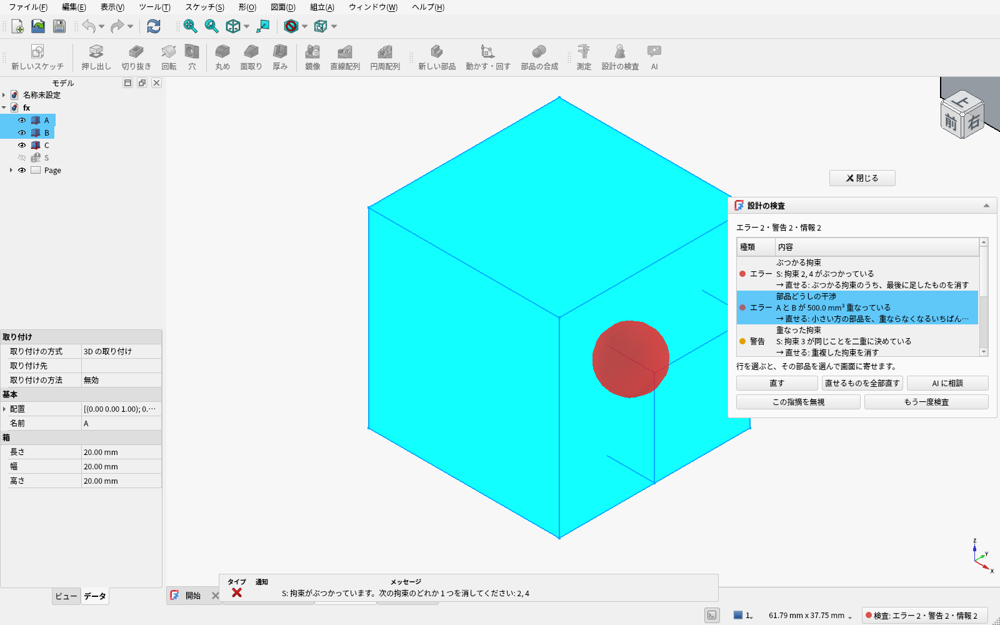

直し方がはっきりしているもの（重複・矛盾した拘束、浮いた部品、重なった部品、空の投影図）は「直す」で直る。
下は「直せるものを全部直す」を押した後。「元に戻す」1 回で全部戻る。

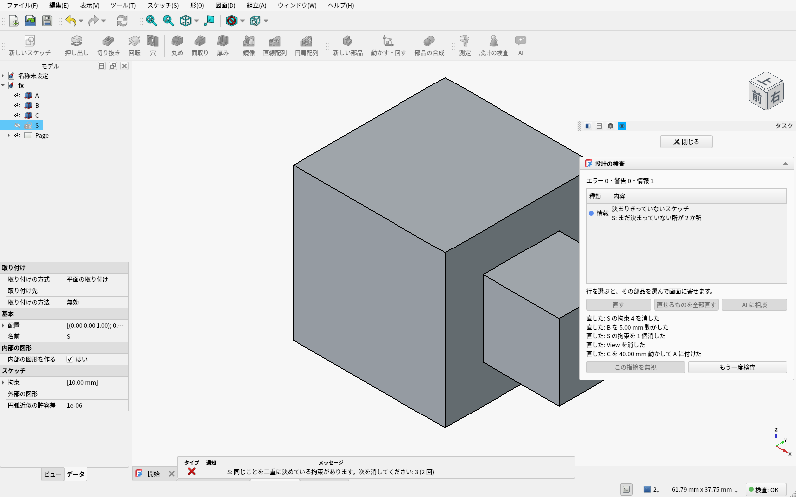

### AI に頼む

右の「AI」パネルで頼むと、AI（Claude）がモデルを見て、直して、設計の検査と画面で確かめて報告する。
面や辺を選んで「AI に頼む」を押せば、選んだ物も一緒に伝わる。AI が実行するコードは毎回表示され、
「実行する」を押したときだけ動く。1 回ごとに「元に戻す」の 1 段になる。

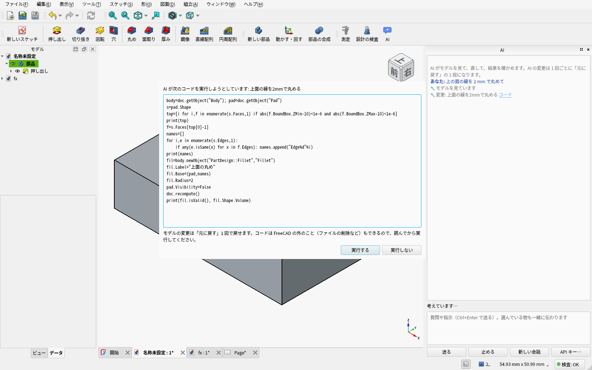

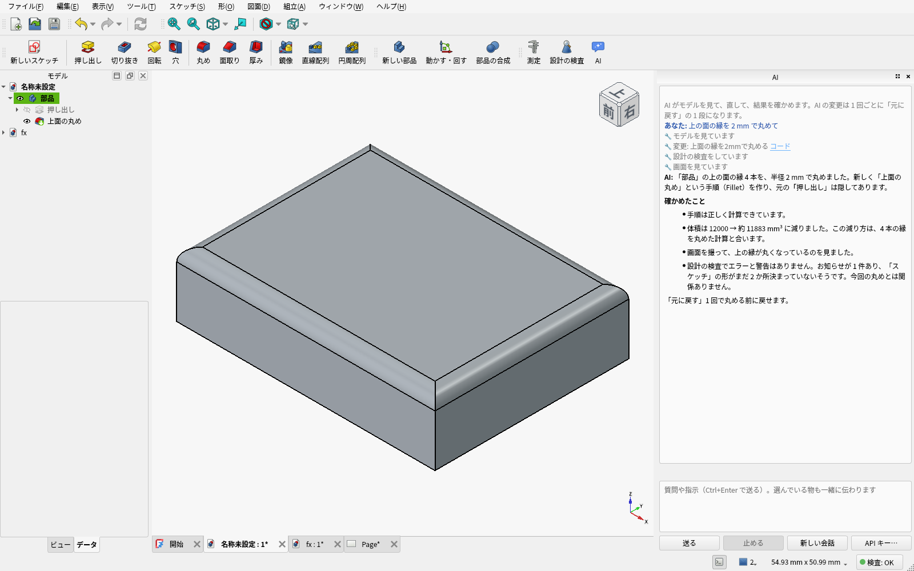

### 失敗の知らせも日本語で

本家では英語のままの失敗の文（`BRep_API: command not done` など）も、何が悪いか・どうすればよいかを日本語で出す。
拘束の番号や辺の番号が入る文も訳す。

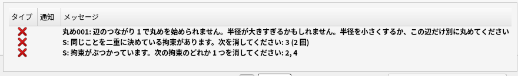

### ナビキューブ

右上の向きを変える立方体は、ふだんは立方体だけ。マウスを乗せると矢印などが現れ、
面の縁や隅に近い所を押せばその辺・角の向きになる（押しやすい）。何が起きるかはツールチップで出る。

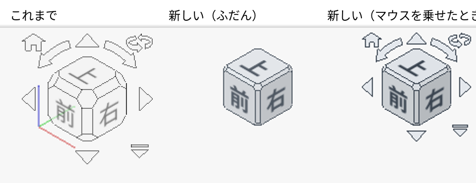

## 本家との違い（一覧）

| | 本家 FreeCAD | このパッチ |
|---|---|---|
| 作業場（ワークベンチ） | Part / PartDesign / Sketcher / Draft / TechDraw / Assembly … を切り替える | 切り替え無し。一つの画面にスケッチ・立体・図面・アセンブリ |
| 2D の作図 | Sketcher と Draft の二本立て | Sketcher に一本化（スケッチ中だけスケッチの道具を出す） |
| 図面・アセンブリ | それぞれの作業場 | 「図面」「アセンブリ」メニューに説明付きで収納 |
| 最初の一歩 | スタート画面の選択肢が多い | 「新しい部品」「開く」だけ。新しい部品はすぐスケッチ面の選択へ |
| スケッチ面の選択 | ダイアログで面を選んで OK | 3D 画面の面や基準面を1回クリック |
| 選んだあとの操作 | ツールバーから探す | 選んだものの横に候補を出す（面→スケッチ/押し出し/切り抜き/薄肉化、辺→角丸め/面取り、スケッチ→押し出し/回転/編集、部品→移動/隠す） |
| ツールバー | アイコンだけ。1600 幅でも一部が「»」の奥に隠れる | 主な道具はアイコンの下に名前（押し出し・切り抜き・丸め…）。スケッチの道具も一列に収まる |
| スケッチの吸着 | 既定では切 | グリッドの点の近くで吸着（マウスで描いても切りのいい寸法になる） |
| カーソルの下の表示 | `Preselected: Unnamed.Body.Pad.Face6` | `押し出し の 面 6` |
| 面をダブルクリック | 何も起きない | その面を作った手順（押し出し・丸め…）の編集が開く |
| 部品を面と面でくっつける・点から点へ動かす | 配置のダイアログで数値を入れる、取り付け（アタッチメント）を設定する、アセンブリのジョイントを作る、または Draft の移動（作業場の切り替えが要る） | 面を 2 つ選んで「くっつける」（向かい合わせ・同じ向き・すき間・90° 回転・中心合わせ）。丸い面どうしは「軸をそろえる」、点と面は「点を面に合わせる」、点どうしは「点から点へ」（角・辺の中点・円や面の中心に吸い付く、Ctrl でコピー）。押した時点で動いて見え、OK で確定・Esc で戻る |
| 面を選んで「穴」 | 「軸が見つかりません」で失敗（先にスケッチに点を描く必要がある） | クリックした位置に穴 |
| 図面の投影図 | 開き直すまでページの左下に出る（本家の不具合）。第一角法が既定 | ページの中央に出る。第三角法（JIS）が既定 |
| 読み込んだ立体（STEP など）に手を加える | 「アクティブな部品が必要です」のダイアログ | そのままスケッチ・丸め・押し出しができる（自動で部品にする） |
| 何も選ばずにエクスポート | 「オブジェクトを選択してください」で止まる | 見えている部品を書き出す |
| 間違い探し | 「形状を確認」は選んだ 1 つの形が壊れていないかだけ | 「設計の検査」（基板 CAD の DRC に近い）: 失敗した手順・分かれた部品・部品どうしの干渉・スケッチの拘束の矛盾・極端に短い辺・浮いた部品・形を見失った図面の寸法を一覧に。行を選ぶと部品を選んで寄せ、場所に赤い印。「わざと」は無視として文書に記録。直せるもの（重複・矛盾した拘束、浮いた部品、重なった部品、空の投影図）は「直す」ボタンで直す（元に戻す 1 回で戻る）。ステータスバーに常に結果（エラー・警告の数）。コマンドラインでも `FreeCADCmd -c "import DesignCheck; DesignCheck.main('a.FCStd')"` |
| AI に頼む | 無し | 右の「AI」パネルで、AI（Claude）がモデルを見て・直して・検査と画面で確かめる。面や辺を選んだときの候補と、設計の検査の一覧に「AI に頼む」。AI が実行するコードは既定では毎回見せて、承認してから実行（1 回ごとに元に戻す 1 段。確認を省く切り替えもある）。使うには自分の Anthropic API キーが要る（下記） |
| メニュー | 「マクロ」や開発者向けの道具が上に並ぶ | 上のメニューを 1 つ減らし、表示・ツールの上級者向けはサブメニューへ |
| 直線配列の最初の間隔 | 常に 100 mm（小さい部品だと複製が画面の外） | 並べる形の大きさの 2 倍 |
| マウス操作 | 7 種類から選ぶ | 既定は 1 種類（右ドラッグで回転、中ドラッグで移動、ホイールで拡大縮小）。選ぶ画面は出さない |
| 作業パネル | 常に場所をとる | 道具を使っている間だけ出る。終わったらモデルが見えるように視点を合わせる |
| 右クリックメニュー | 項目が多い | モデリングに要るものだけ（ほかは上のメニューに残る） |
| 設定画面 | BIM・アドオンなど使わない頁もある | 使う頁だけ |
| アドオン管理 | あり | 無し（作業場を足す仕組みのため） |

機能は消していない。普段使わないものはメニューの中に説明付きで入れてある。

## AI チャットを使うには

1. 配布物（0.3.5 から）には、AI チャットに要る部品（claude-agent-sdk・keyring・Claude Code）が最初から入っている。準備は要らない。
   自分でビルドした場合は、右の「AI」パネルの「AI の準備をする」を押す（Python の仮想環境に入れる。ネットワークが要る）
2. [console.anthropic.com](https://console.anthropic.com/) で API キーを作り、初めて送ったときに出る「API キーを入れる…」で入れる。
   あとで変える・消すときは 編集 → 設定 → 標準 → AI チャット（0.5.7 から）。
   キーは OS の鍵保管庫（Windows の資格情報マネージャー・macOS のキーチェーン・Linux の Secret Service）にしまう。
   鍵保管庫の無い環境では、本人だけが読めるファイル（FreeCAD のユーザーデータの `ai/ai-api-key`）
3. 使った分は API キーの持ち主のアカウントに請求される。このパッチにキーやログインは含まれない
4. 会社のネットワークでは、編集 → 設定 → 標準 → ネットワーク でプロキシ（既定はシステムの設定）と、通信を検査している場合は会社の証明書（PEM）を選ぶ（0.5.7 から）

AI はモデル（既定は Opus）に、文書の中身・画面の画像・設計の検査の結果を送る。
AI が実行しようとするコードは、既定では毎回表示され、「実行する」を押したときだけ動く（FreeCAD の外のことも書けるので、読んでから）。
パネルの下の「たずねずに実行する」を入れると確認を省ける（FreeCAD を閉じるまで。実行したコードはチャットと ai/ai-runs.log に残る）。

## 日本語

- メニュー・ツールバー・作業パネル・通知・設定画面の未訳を埋め、用語を平易な言葉にそろえた
  （例: Pad → 押し出し、Pocket → 切り抜き、Body → 部品、Constraint → 拘束）
- 左のプロパティ欄（項目名・分類・説明・選択肢の値）を日本語に
- 新しく作ったものの名前も日本語（部品、スケッチ、押し出し …）
- 部品の中の原点（Origin）は木の表示から隠す

日本語以外の言語では本家と同じ表示になる。

## コマンドライン・スクリプト

| | 素の FreeCAD | パッチ後 |
|---|---|---|
| スクリプトが例外で落ちる | 終了コード **0**、しかも**2回実行**される、エラーは1行だけ | 1回だけ実行、終了コード 1、トレースバックを表示 |
| `if __name__ == "__main__":` | 実行されない（モジュールとして import される） | 実行される |
| `sys.argv` | FreeCAD の引数そのまま | `FreeCADCmd a.py -- x y` → `['a.py', 'x', 'y']` |
| `sys.exit()` / `sys.exit("msg")` | 1 / メッセージが出ない | 0 / メッセージを標準エラーに |
| 例外や `sys.exit()` の直前の `print` | 消えることがある | 出る |
| 存在しないファイル | 終了コード 0 | `No such file`、終了コード 1 |
| `FreeCADCmd < a.py` | 対話モードで1行ずつ処理（`>>>` が混ざり、エラーでも 0） | 1本のスクリプトとして実行 |
| スクリプト実行時のバナー | 出る | 出ない（対話モードでは出る） |
| STEP の書き出し | OCC の統計が標準出力に2重に出る | 出ない（ログに回す） |
| アセンブリを開く | 拘束ソルバーのメッセージが標準出力に出る | 出ない |
| `Part.export([shape], "a.step")` | **空の STEP を黙って書く** | Shape を受け付ける／何も無ければ `ValueError` |
| `--output` での変換失敗 | 終了コード 0 | 終了コード 1 |
| `--help` | 名前が常に「FreeCAD」、使い方の説明なし | 実行ファイル名・例・終了コード。`--output`（`-o`）と `--hidden` を表示 |
| 設定ファイル | 何もしない実行でも毎回書き直す。並列に走らせると設定が消える | 値が変わったときだけ書く |
| `FreeCAD --hidden a.py` が失敗 | 終了コード 0 | 終了コード 1 |
| `--hidden` で視点を変えて保存 | アニメーションの途中が保存される | アニメーションしない |
| `--hidden` で旧版の設定がある | 設定移行のダイアログが見えない画面に出て**永久に止まる** | ダイアログを出さない |
| `--hidden` の実行 | 最近使ったファイル・ウィンドウ配置を書き換える | 書き換えない |
| Python の `saveImage()` | ナビゲーションキューブが写り込む | 写らない（「画像を保存」メニューと同じ） |
| 画像を出す | 画面（xvfb）と GUI が要る | `FreeCADCmd a.FCStd --render a.png --view iso`（画面も OpenGL も不要。`--render-style shaded\|hidden-lines\|lines`、`--size 1600x1200`、Python は `Part.renderImage`） |
| 干渉チェック | 部品の組を総当たり（300 部品で 106 秒） | `FreeCADCmd a.FCStd --interference`／`Part.findInterferences`（外形で絞って並列、1.2 秒） |
| 隠れ線を消した 2D 図 | TechDraw のページが要る | `--export-svg`、`--export-polygons`（面ごとの多角形 JSON）、`--export-pptx`（編集できる図形の PowerPoint）／`Part.projectVisible` |
| 視点・拡大・断面（0.5.4） | — | `--view` に名前（`iso-bottom` など下からの等角も）か向き `dx,dy,dz`、`--up x,y,z`（画面の上）、`--focus 名前,…` か `--region x0,y0,z0,x1,y1,z1`（その範囲に拡大）、`--section z=10`（z>10 を取り去る。`-x=5` は x<5、`px,py,pz,nx,ny,nz` は法線の側）で切り口を塗ってハッチング。値が `-` で始まるときは `--section=-x=5`。Python は `Part.renderImage`/`projectVisible`/`exportSvg`/`exportPptx` の `up=`・`focus=`・`region=`・`section=(点, 法線)` |
| 大きな組立の隠れ線（0.5.4） | 1200 部品で 15 分以上終わらないことがあった | 深さバッファで隠す側の候補を絞り、全コアで並列。1200 部品 3.9 秒、STL 由来 1200 部品 5.4 秒（0.5.3 は 72 秒）。`--progress`（標準エラーに進み具合）、`--max-seconds 60`（時間切れなら手前から済んだ分を書いて警告）、`--deflection`（粗くして速く） |
| 点の内外判定・光線（0.5.4） | `Shape.isInside` を 1 点ずつ（10 万点で約 52 秒） | `Part.pointsInside(shape, 点の列)`（10 万点 0.16 秒、結果は isInside と同じ）、`Part.rayCast(shapes, 原点, 向き, all=False)`（距離・何番目の形・面・点・法線） |
| STL から作った立体（0.5.4） | `makeShapeFromMesh`＋`makeSolid` は三角形だらけで、閉じていない・裏返り・重複があるとブール演算が不安定 | `Part.solidFromMesh(mesh, 0.01, report=True)`（直して縫い、同じ平面の三角形を 1 つの面に。直したこと・残った問題を返す）。ブール演算は許容差つきで `a.common(b, 0.01)`。角の丸めは `Part.filletMeshSolid(mesh, 1.0)`（平らな面どうしの角だけ。曲面部分は丸めない） |
| Jw_cad の図面（0.5.6） | 開けない | 「開く」「インポート」で `.jww`（Jw_cad の図面）と `.jws`（図形登録）を開く。同梱の [jww2dxf](https://github.com/monyuonyu/jww-tools) で DXF にしてから読む（データの版 220〜700、Jw_cad 2.x〜10.x）。Jw_cad 自身の DXF 出力と 307 図面で図形ごとに突き合わせて全部一致。単体でも `jww2dxf 図面.jww` で DXF を作れる |
| DWG/DXF の 3D ソリッド（0.5.4） | 3DSOLID・REGION・BODY は読み捨て | Part の形として読み込む（平面・円柱・円錐・球・トーラス・B スプライン。試験図面 81 個中 80 個が閉じた立体）。ブロックの中のソリッドと、AutoCAD 2013 以降が書いた DXF（ACDSDATA に入っている）はまだ読めない |
| スクリプトに引数を渡す | — | `FreeCADCmd a.py -- x y`（`--` の後ろが `sys.argv`）。`FreeCADCmd a.py x` で `x` がファイルでないときは「`script.py -- x` で渡す」と案内する |
| `Mesh.addFacets(shape.tessellate(d))` | 接した箱どうしの面を**黙って捨てる**（52 個の箱で 624 → 12 面） | 全部入れる（`check=True` のときだけ捨て、数を警告） |

## 本家から取り込んだ修正（PR 一覧）

本家 FreeCAD に出されていて、まだ本家に入っていない PR のうち、精査して取り込んだもの（作者の名前はコミットにそのまま残している）。
開いている 541 件から、この画面が使う部分の落ちる・不具合・退行を中心に絞り、中身を読み、パッチに当たることと試験を確かめた。

**落ちる（クラッシュ）**

- [#32804](https://github.com/FreeCAD/FreeCAD/pull/32804) スケッチの編集に入るとき・マウスを動かしたときに落ちる（@alfrix）
- [#32975](https://github.com/FreeCAD/FreeCAD/pull/32975) スケッチの事前選択で範囲外を読んで落ちる（@alexdremov）
- [#32989](https://github.com/FreeCAD/FreeCAD/pull/32989) スケッチの反転で落ちる（@alfrix）
- [#32970](https://github.com/FreeCAD/FreeCAD/pull/32970) 作業パネルを閉じるときに、解放済みのメモリを触って落ちる（@alexdremov）
- [#32007](https://github.com/FreeCAD/FreeCAD/pull/32007) プロパティ欄で編集中に 3D 画面をクリックするなどして落ちる（6 種類。作業パネルの 1 か所は #32970 と重なるので除いた）（@oursland）
- [#32684](https://github.com/FreeCAD/FreeCAD/pull/32684) 外部参照のファイルを開くと落ちる（@chennes）
- [#31263](https://github.com/FreeCAD/FreeCAD/pull/31263) 起動直後の SpaceMouse の操作で落ちる（@Maik-0000FF）

**形・スケッチ**

- [#32430](https://github.com/FreeCAD/FreeCAD/pull/32430) ポリラインを角丸めすると最後の点が消える（@alfrix）
- [#32759](https://github.com/FreeCAD/FreeCAD/pull/32759) 曲線どうしの点で角丸めできないとき、その理由を出す（@VishalRamKN）
- [#28238](https://github.com/FreeCAD/FreeCAD/pull/28238) 丸め・面取りが失敗したとき、原因（半径が大きすぎる・面がねじれる…）と直し方を出す（@paragforwork）

**図面**

- [#32552](https://github.com/FreeCAD/FreeCAD/pull/32552) 位置をロックしたビューが、読み込むと原点に飛ぶ（@WandererFan）
- [#32151](https://github.com/FreeCAD/FreeCAD/pull/32151) 寸法の参照の修復が、壊れた参照で失敗する（@WandererFan）

**組立**

- [#31998](https://github.com/FreeCAD/FreeCAD/pull/31998) 部品に固定ジョイントを付けるとエラー（@ryneeverett）
- [#32924](https://github.com/FreeCAD/FreeCAD/pull/32924) 親を失ったジョイントのグループを消せない（@PaddleStroke）
- [#32922](https://github.com/FreeCAD/FreeCAD/pull/32922) ラックとピニオンの誤動作（@PaddleStroke）

**表示・画面**

- [#32658](https://github.com/FreeCAD/FreeCAD/pull/32658) ライト／ダークのテーマで、結合した形の色が崩れる（@chennes）
- [#32813](https://github.com/FreeCAD/FreeCAD/pull/32813) 選択の表示の奥行きの退行（@Connor9220）
- [#32841](https://github.com/FreeCAD/FreeCAD/pull/32841) プロパティ欄の選択肢で日本語などが化ける（@maxwxyz）
- [#32996](https://github.com/FreeCAD/FreeCAD/pull/32996) キーボードでツリーを選んだときにステータスバーを更新する（@007stevendigar-lgtm）

**ファイル**

- [#32934](https://github.com/FreeCAD/FreeCAD/pull/32934) ASCII の STL（長い名前・末尾の改行なし）が読めない（@maxwxyz）

**0.3.3 で追加**

- [#32614](https://github.com/FreeCAD/FreeCAD/pull/32614) スケッチの点を少しだけ動かすと元に戻る（@Reqrefusion）
- [#30997](https://github.com/FreeCAD/FreeCAD/pull/30997) 計測を開いたまま文書を閉じると落ちる（@Amine0x0）。そのまま当てると、この版では別の見張りを上書きして後で落ちるので、合わせて直した
- [#32879](https://github.com/FreeCAD/FreeCAD/pull/32879) 厚みの結果が不正な形でも黙っている（@007stevendigar-lgtm）。厚みが大きすぎて形が変わらない場合も知らせるよう足した

### 本家に報告されていて、まだ直っていない不具合を直したもの

再現手順が付いていて、手元で再現または原因まで確かめたもの。

- [#32968](https://github.com/FreeCAD/FreeCAD/issues/32968) スケッチの寸法を式エディタで入れると、ツールを抜けたときに寸法が消える（今月の退行）
- [#32732](https://github.com/FreeCAD/FreeCAD/issues/32732) 「変数セットに保存」で単位が合わずに失敗する（macOS では落ちる）
- [#32877](https://github.com/FreeCAD/FreeCAD/issues/32877) 見えない文書を開くと、作業中の文書が奪われる（macOS では落ちる）
- [#25050](https://github.com/FreeCAD/FreeCAD/issues/25050) 部品より厚い厚みが、黙って何もしない
- 途中の手順（切り抜きなど）を消すと、後の配列が消した穴を持ったまま「正常」と表示される
- STEP で日本語などの名前が化ける（書き出しを規格どおりの書き方にし、読み込みの既定を UTF-8 にした。他の CAD の STEP も読める）
- 長さ 0 の視点の動きで、画面が固まる

メモリの誤った使い方を見張るビルド（AddressSanitizer）で本家の試験を走らせて見つけたもの（0.3.4）:

- 再計算の最中に部品を消すと、後の処理が消えた部品のメモリを読む（CAM の工具で起きる）
- マクロの編集画面が、消えたファイルについて「読み直しますか」と聞いて止まる
- Draft の選択枠の表示が、渡した点より多くの点を読む

あわせて、組立のソルバー（OndselSolver）で、Linux・macOS では組立の書き出し（ASMT）の関節の種類名が壊れる不具合を直した
（型の名前を Windows の形を前提に切り出していた。本家の試験 #32922 が Linux で落ちて分かった）。

## 0.9.3 の変更

- MuJoCo の書き出し（`--export-mjcf`）が、同じファイルでも回ごとに木の形が変わることがあった（ロッドがクランクに付く回とピストンに付く回）: ジョイントをたどる順を名前で固定

## 0.9.2 の変更

- **ふつうに閉じたのに、まれに落ちていた（終了コード 1）**: 夜のあいだ、画面の操作を乱数の順でくり返し、メモリの誤りを見張るビルド（ASan）で回して見つけた。文書と窓を閉じたあとも、裏で動いていた設計の検査が部品の重なりを測り続け、片づけの終わった OCC に触れていた。閉じるときに重なりの計算を止め、終わるのを待つ（`Part.cancelInterferences()`）。通し試験で原因の分からなかった「終了コード 1」もこれと思われる

## 0.9.1 の変更

- **MuJoCo の書き出しで、Compound の部品の重心と慣性が正しくなかった**（365 部品のうち 300 部品が仮の慣性、重心は外形の箱の中心で最大 362mm ずれた）: 部品の立体を 1 つずつ測り、平行軸の定理で足す
- 部品ごとの密度・質量を、材料以外でも渡せる: `--mjcf-density map.json`（`{"density": {"床板_*": 2700}, "mass": {"電源_*": 0.3}}`。質量を決めた部品は慣性もその質量に合わせる）、部品の `Mass`・`Density` のプロパティ

## 0.9.0 の変更

- **MuJoCo（物理シミュレーション）のひな形を書き出す**: `--export-mjcf model.xml [--mjcf-mesh]`（スクリプトからは `MjcfExport.export`）。部品ごとに、形と密度から出した質量・重心・慣性（材料の密度、無ければ 7850 kg/m³。FreeCAD の「Default」の材料は 1 kg/m³ の仮の値なので材料なしとみなす）、周りの物と当たる箱（部品どうしは当たらない。エンジンの部品の箱は重なり合い、クランクが固まった）、見た目の網（粗い STL）。組立の地面に付いた部品と組立の原点から、ジョイントをたどって回転（hinge）・すべり（slide）・玉（ball）に。ループを閉じるジョイントは `<equality connect>`、ベルトと歯車は 2 つの回転の比（歯数、無ければ半径。向きは軸から）。エンジンは 12 秒で書け、MuJoCo で回すとカム軸がクランクの半分で回る

## 0.8.9 の変更

- **動きの中の当たりを画面から**: 回転ジョイントを選ぶと帯に「当たり」。開始・終了・刻みを決めて「調べる」で、ジョイントを少しずつ回し、角度ごとに組立を解いて（式で動くバルブ・ロッカーもそのとおりに）、全部の部品の重なりを調べる。当たりをクリックするとその角度まで回して 2 つの部品を選ぶ。どの角度でも重なっている組は「いつも」と分けて出し、「この 2 つは重なってよい」でファイルに記録できる。閉じると角度は元に戻る。エンジンの模型でクランク 0→720° を 30° 刻みで約 100 秒（上死点でピストンがヘッドとバルブに食い込んでいるのが見つかった）
- コマンドからは `--sweep` の motion.json に `"joint": "その場で回す"`。スクリプトからは `DesignCheck.sweep_joint(joint, 0, 720, 30)`

## 0.8.8 の変更

LiDAR の地図（面と Mesh 約 370 個＋道筋の線）を画面なしで書き出した方の報告から。

- **BIM の WebGL 書き出し（importWebGL）が画面なしで落ちた**: 3D の画面が無いのにカメラを画面から取ろうとした（AttributeError）。ファイルにカメラが無いときは物の外形の箱を斜めから見る。色も画面なしではすべて灰色だった: ファイルに残った色（ShapeAppearance）を読む
- 面の無い形（線だけの道筋）で落ちた（ValueError）。その線も書かれず、空の線でページの描画が途中で止まっていた（RangeError）: 線を書き、空のものは空のまま
- `--export-web` が点群（Points::Feature）を、点ごとの色付きで描く（前は書かれなかった）。BIM の WebGL はインターネットから three.js を読むが、`--export-web` は 1 つの HTML だけで、ネットにつながっていない PC でも開ける

## 0.8.7 の変更

- **`--export-web` をさらに軽く**: 頂点を全体の箱を基準にした Int16、法線を Int8 で書く（誤差は箱の 65534 分の 1。4m の模型で 0.06mm）。float32 の約 4 割の大きさになる。`--web-simplify` の部品は 8 角の柱か箱で、法線を書かない（ページの側で平らに塗る）。ねじ山の無いボルトが 1 つの部品に 400 本入った模型で、簡略化しても 30MB を切らなかった
- `--web-exclude` は `ユニット[BCD]*` のような文字の集まりも使える（前から使えた。説明に足した）

## 0.8.6 の変更

- **`--export-web` の HTML が大きすぎて、会社の PC のウイルス対策に止められた**（部品約 1,000 点で 54MB、うち 3 分の 1 がボルト）: `--web-simplify fasteners` でボルト・ナット・座金・ねじを円柱（軸と頭）か箱にして、線を付けずに粗く書く（ねじ山のあるボルトで約 100 分の 1）。`--web-exclude "ボルト_*,作業者_*"` で部品やグループを外す。30MB を超えたら、重いグループの名前と一緒に知らせる

## 0.8.5 の変更

- 動く部品の干渉（`--sweep`）に `"carry"` を足した: `"carry": {"from": ["ボルト_A"], "inside": ["ハブ_A"], "margin": 3}` で、ボルトを全部まとめた部品のうち、動く部品の箱（margin だけ広げる）の中に中心がある立体だけを一緒に回す。残りは止まったまま調べる（前は、ハブを締めるボルトが止まった側に残って毎回当たり、外すとボルト全部を見なくなった）。`inside` を省くと動く部品の箱。結果の `carried` に一緒に回した立体（`ボルト_A[3]`）

## 0.8.4 の変更

部品約 1,000 点の案件で、画面なしの道具（freecadcmd-ja）を 2 日使った報告から。

- **`--gui-script` の起動時の警告（スタイルの名前・Fontconfig・OpenGL など約 55 行）が、スクリプトの出力やエラーを埋もれさせた**: 起動中の出力はファイルにためて、起動に失敗したときだけ出す（`FREECAD_GUI_SCRIPT_VERBOSE=1` で全部出す）
- `--gui-script` のエラーで、最初に目に入るのが GuiScript.py の行だった: トレースバックはスクリプトの行から始め、最後の行に「work.py line 5: FreeCADError: …」とスクリプトの何行目かを出す
- **わざと当てている組み合わせを設計の検査から外す**: `--ignore-pairs pairs.txt`（1 行に「A, B」。部品か、その入れ物の名前・ラベル。`*` `?` が使える。`#` から後はコメント）。`DesignCheck.allow_overlap(a, b)` でファイルに記録もできる。検査の窓で重なりを「無視」したときも、その組だけを外す（前は両方の部品の重なり全部を見なくなった）
- **動く部品の干渉（スイープ）**: `--sweep motion.json`（`{"moving": ["バー*"], "axis": [点 x, y, z, 向き x, y, z], "from": 0, "to": 80, "step": 5}`）で、部品を軸の回りに少しずつ回し、角度ごとに他の部品との重なりを調べる。当たった角度と相手を JSON で出し、当たれば終了コード 1。スクリプトからは `DesignCheck.sweep(...)`

## 0.8.3 の変更

会社 PC での試しと、通し試験（0.8.1）の残りから。

- **`-o 〇〇.stl` が、環境によって書けなかった**: STL の書き出し役の候補が FEM → Mesh の順に並ぶ環境で、FEM だけ試して失敗していた。候補を順に試し、書けたところで止める。どれも書けなければ「書けなかった」と出して終了コード 1
- **図面のページを消すと、三面図・断面図・寸法が木に残った**（英語の警告「error while deleting children」「Anchor deleted」、残った三面図は Delete でも消えない）: 本家の不具合（ビューの後片づけが `{}` の書式で文書名を渡していた）。中身ごと消え、元に戻すでも全部戻る
- **図面の日本語の書体が字ごとに混ざった**（「断面」の「断」だけ別の書体、PDF では韓国語の字形）: 図面の書体 osifont は漢字・かなを 161 字だけ持っていた。それを外し、日本語はすべて入っている日本語の書体（Noto Sans CJK JP・游ゴシック・メイリオなど）で書く
- 図面 PDF の書き出しで、部品が読めずに描く形が無いビューがあると、120 秒待ってから失敗していた: すぐにどのビューかを言って止める
- 式が使っているジョイントを消すとき、確かめが出なかった: 「次のオブジェクトが参照しています」と、使っている側の名前を出して聞く（つなぐ部品を消すときは今までどおり聞かない）
- 式で決まっている欄に数字を打つと、黙って無視された（数字がショートカットになり、「5」で視点が変わることもあった）: 欄が受けて「この値は式で決まっています。= か ƒx で式を変える、そこの『リセット』で外す」と出す

## 0.8.2 の変更

画面だけでエンジンを作る通し試験の 3 回目（0.8.1）から。6 課題すべて画面で作れ（成功 5・ほぼ成功 1）、0→720° はどの回し方でも理論どおり、異常終了 0 回。見つかった穴を直した。

- **ジョイントの窓を開いたまま木で別のジョイントをクリックすると、開いていた方のつながりが 2 つとも黙って消えた**: 木のクリックでは消さない
- **270° で保存して開き直し、0° にするとカムが 180° ずれたままになった**（知らせなし）: 開いたときに保存されていた角度から刻んで追う
- 帯の「その場で回す」のあと、他の部品が半透明・選べないまま残った: 選択が空になったら戻す
- 式が使っているジョイントを消して同じ名前で作り直すと、式が黙って追従しなくなった: つながりを張り直す
- 先に選んだ部品が動く「固定」でも、部品の向きを保つ（ヘッドが 180° 回って置かれた残り）。窓の「回転」の欄も実際の値を出す
- 忙しいときに欄に数字を打つと最初の 1 字が落ちた（180 が 80 に）
- 式の窓に数字を打つと名前の一覧が OK を覆った。`mod()` の案内は式全体が `mod()` のときだけ
- **スクリプトで保存した組立を画面で開くと、ジョイントの窓が開かなかった**: 開いたときにジョイントの表示を付け直す

## 0.8.1 の変更

- **設計の検査を速く**: 125 部品の部屋で 1 回目 12.9 秒 → 10.2 秒、変わっていない 2 回目以降と部品を 1 つ動かした後は約 3 秒。触れているだけの組（床の上の家具など）は重さの計算をしない（重なりは外形の箱の重なりを超えない）、まだの組は C++ で全部のコアを使って一度に、覚えておく目印を軽く。`--interference` も同じ絞り込みで速くなる
- **円筒の面に開けた穴が直径に付いてくる**: 穴のスケッチを面に付けた（見えない点で面に接する平面）。前は直径を変えても穴が元の場所に残った
- 式の窓で `mod()` の答えが負になったとき、`%` を使う案内を出す（`mod(-140; 720)` は本家の決まりで -140。0〜720 にしたいときは `(-140) % 720` = 580）

## 0.8.0 の変更

エンジンの通し試験の残り、会社での実務の試し（内材の図面とレンダー）、部屋と家具の模型づくりから。

**図面と画面なしの使い方**
- **画面なしの図面 PDF の線が太すぎた**（1:12.5 のリベットが黒くつぶれた）: 画面用の線幅（Screen Mode）が書き出しにも効いていた。紙の上の太さで書く。`--line-width 0.25` で見える線の太さを決められる（隠れ線・寸法はその半分）
- `--check-layout`: 図・注記・寸法が図面の枠からはみ出したり表題欄に重なったりしたら、どれがどちらに何 mm かを言う
- `--gui-script work.py -- 引数`: 画面の機能（図面の線幅など）が要るスクリプトを画面なしで。print はそのまま出て、エラーは行番号つきで終了コード 1。ファイルは自動で隠して開く
- `--export-web model.html`: ブラウザで回して見る 3D を 1 つの HTML に（ライブラリもネットも不要、スマホの 2 本指、部品ごとの表示切り替え、明るい/暗い）
- `--render` の向き: `iso-rear-left`・`iso-front-right` など、iso- のあとに前後・左右・上下をどの順でも
- `--focus` は「バックル EA628RA-50」のようなラベルをそのまま。全角半角・空白・-・_・× の違いや一部だけでも見つけ、無ければ近い名前を出す
- テンプレートは名前だけでよい（`Template = "A4_Landscape_ISO5457_minimal"`）
- スプレッドシートの別名が使えないときは理由を言う（L はリットル、A1 はセルの名前 など）
- `FreeCADCmd -c` に長いコードを渡すと何も言わずに落ちた（ファイル名として調べて「名前が長すぎる」）: エラーと出力をそのまま出す
- `Shape.tessellate(tol, normals=True)` で点ごとの法線（なめらかな表示が速くなる）
- 面をその面の中の向きに押し出すと、黙って壊れた形ができた: 例外にする
- AppImage に `FreeCADCmd`・`FreeCAD` の名前でも入れた
- **設計の検査**: 自動の検査は 40 部品までしか走らなかった（部屋の模型 約 150 部品で部材の干渉 70 件を見逃した）→ 400 部品まで。立体が何個もまとまった部品の重なりは立体ごとに測り、測れなかった組は「問題なし」でなく警告に。Part やグループに「1 つの品物」の印を付けると中の重なりは調べない。`--design-check [interference]`（JSON、エラーなら終了コード 1）と `DesignCheck.interferences(doc)`

**画面（組立・図面）**
- 「角度で回す」で 180° 回したロッカーが「終わる」で 0° に戻って壊れた
- 丸い面・平らな面に「固定」「すべる」で付けた部品が 180° 回って置かれた（ヘッド）: 今の向きを保つ
- 丸い上面に作ったスケッチが 180° 回って見えた: 部品の軸にそろえる
- ジョイントの ƒx の窓に式を入れると、窓を閉じるまで動かなかった
- Ctrl+K でベルトを作ると窓が出なかった（Enter が窓を閉じた）
- ジョイントの窓を開いたまま部品のファイルを閉じると、つながりが消えた
- 帯の数字の欄に焦点があると Ctrl+B（囲んで拡大）が効かなかった
- 図面の断面図をハッチの上でつかんでも動かせなかった: 面やハッチの上で引きずると図が動く
- 動画の窓で「断面」を選んだら画面にもすぐ出す。式が 720° で回るときは既定を 720°
- Ctrl+K の「断面」で断面表示の道具が出る
- 「hasher mismatch」のログ（41 分で約 45 万行）を詳しいログのときだけに
- スクリプトで文書を作ってすぐ閉じると ReferenceError・NameError が出た

## 0.7.9 の変更

エンジン全体を画面だけで作る通し試験の 2 回目（0.7.8）で、**画面だけでエンジン全体を作り切れた**（組立 15 部品・17 ジョイント、ロッカーとバルブはクランク角の式、0→720° で吸気・排気が順に 1 回ずつ開く、断面の動画、開き直し）。残った穴を直した。

- 大きく飛ばす（0→390° など）とベルトのカムが半回転ずれたまま残った: 駆動の値で 15° ずつ刻んで追う
- 「角度で回す」の欄に打つと 1 文字ごとに解かれた（300 と打つと 3° で止まる）: 打ち終えて解く
- ジョイントの角度が 360° で丸められた: 上限を外した
- 「反転」で正立にしたスライダー（バルブ）が壊れ扱い: 反転は数えて正しい操作として扱う
- 自動保存や異常終了のあと、組立の部品が選べなくなった: 開いたときに戻す
- 画面なしの図面 PDF が Windows で落ち、Linux では止まった（お知らせを出すときの Qt の警告が、お知らせ欄の鍵を自分で待った）: 出している間の警告は載せない

## 0.7.8 の変更

エンジン全体を画面だけで作る通し試験（0.7.7）から。組立は 15 部品・17 ジョイントまで画面で作れたが、動かす所で止まっていた。

- **「角度で回す」が 360° で止まった**: 720°（4 ストロークの 1 サイクル）など何度でも入る。動画も 720° まで実際の角度で回すので、クランク角の式で動くバルブが吸気・排気の順に開く
- **組立が 1 本の壊れたジョイントで黙って止まった**: 成り立たないジョイントと、ずれを状態表示に出す
- **「反転」で正立にした固定が壊れた扱いになった**（その 1 本で組立全体が止まった）: 半回転の反転は成り立つものとして扱う
- **スライダーに「距離で動かす」**: バルブの持ち上がりをクランク角の式で（「固定＋オフセットの式」の回り道が要った）
- 式でつながったロッカー・バルブが、パネルで回している間も追従する（「終わる」まで動かなかった）
- **「動きを動画に」に断面の選び方**（前後・左右・上下で切る）。クリッピングの道具の断面は、そのパネルを閉じると消えるので写らなかった。組立の文書の 3D 画面から撮る
- ジョイントの編集中に木をクリックすると参照が置き換わった

## 0.7.7 の変更

動弁系（バルブ・ばね・ロッカー・カム）とエンジン全体を画面だけで作る試験（0.7.6）と、会社の PC での試験から。

組立と動画
- **「動きを動画に」**: 回転ジョイントを選ぶと帯に「動画」。角度の範囲を回しながら、3D 画面の見えているとおり（向き・断面・色）に撮って MP4 に（同梱の ffmpeg。無ければ GIF）。720° も可。自由に動く部品があれば知らせる
- **ベルト・歯車のタイミングを保つ**: 14/28 のチェーンでつないだカムが、クランク 180° を越えると半回転ずれた（解くたびに歯車の関係を今の向きから取り直していた）。最初の関係をジョイントに保存し、1 回転単位のずれだけを許す。押してずれたカムも戻る
- 軸が裏返った答え（カムが逆さで同じ軸の上）を「成り立たない」として追い直す
- ジョイントの角度の式（ƒx）を確定できなかった（式の窓の OK まで隠していた）
- 開き直した組立で「部品を置く」「動かない／動かせる」が何もしなかった
- 組立に置いた部品の名前が「部品004〜014」だった。部品のファイル名にする
- 木でジョイントを選んでも帯が出る

帯・その他
- 帯の数値欄をクリックすると数字が全部選ばれる（「10 m60m」で 70 m の押し出しになった）。帯が出ている間に打った数字はボタンでも使う

DWG・図面の PDF（会社の PC での試験）
- **DWG の書き出しで文字が消えた**: 図面の文字を TEXT として書く。版は R2018（R14 になっていた）
- 版を上げても古い版の dxf2dwg が使われた。この版に同梱の変換器を使う
- DWG・DXF の文字と寸法を既定で読み込む
- `--export-drawings`: テンプレートの無いページが 1 枚あると全部止まった／白紙になった。そのページだけ飛ばして知らせる。テンプレートの無いページを含むファイルが開けなかった

## 0.7.6 の変更

0.7.5 で「画面だけでエンジンを作る」6 課題を通しで試し、**6 課題すべて成功**した（0.6.9 は 2、0.7.3 は 4）。P0・P1 はなし。残った P2 を直した。

- **スケッチの寸法: 置く前に打った数字がその寸法の値になる**（黙って捨てられていた。空いた所をクリックしなくてよい）
- **折れ線を始点で閉じると、軸の上の始点でも始点に合う**（「軸の上」になって輪郭が開いていた）
- **候補の帯: 数値欄に打った値を「切り抜く」なども使う**（「押し出す」以外では使われなかった）
- **組立: 小さな穴の縁を拾っても、ピンなどの丸い面となら穴の中央で合わせる**（縁の位置で 7.5 mm ずれた）
- **断面図は空いている所に置く**（ページの中央で右面図に重なっていた）
- 数値の欄はクリックで全部選ばれる（並べる個数の打ち直しに 3 回のクリックが要った）
- スケッチを閉じた後の候補の帯を、閉じ終わるまで確かめ直す（ときどき出なかった）

## 0.7.5 の変更

0.7.4 で組立・断面図・スケッチの見え方を画面だけで試した（3 課題とも成功。クランクを 0/90/180° に回すとピストンの位置が理論値どおり）。そこで見つかったことを直した。

- **「その場で回す」を付けると、その部品の自動の固定（最初に置いた部品）を外す**（残っていて角度で回らなかった）
- **「その場ですべらせる」**: 丸い面の軸に沿って地面に対してすべる（シリンダーの部品なしでピストンを動かせる）。別のファイルの部品でも、丸い面を選ぶと候補の帯に 2 つとも出る
- **「部品を置く」は、すでにある部品の右に並べて置く**（全部が原点に重なり、面を選ぶのに掘り出す必要があった）
- **図面の自動寸法**: 同じ中心間が 2 本・意味のない幅（23.64）・穴の注記が部品を横切る・表題欄に重なる、を直した。穴の大きさは各穴の横に、穴の位置は外形の辺からか穴から穴へ
- **断面図のある図面を画面なしで PDF にすると落ちた**（本家の新しい不具合。窓の無い図面の題の位置合わせ）。PDF の書き出しで出た質問の窓は自動で閉じて警告にする
- 図面のある部品のファイルで、何も選ばずに「図面を描く」が止まった
- 断面図の題を日本語に（断面 A-A）
- 状態表示で部品の内部名が化けた（「é¨å003」）。組立に置いた部品の内部名を英数字にし、画面が内部名を読む所を UTF-8 に

## 0.7.4 の変更

0.7.3 で「画面だけでエンジンを作る」試験をやり直した（6 課題中 4 つ成功。0.6.9 は 2 つ）。そこで見つかったことと、CLI の残りを直した。

組立（いちばんの壁だった所）
- **黙って壊れた位置で止まっていた**: ジョイントが成り立たないとき、部品を解く前の位置に戻し、設計の検査に「ジョイントが成り立たない: 36.25 mm 離れています」と出す（Python は `assembly.getBrokenJoints()`）
- **保存した組立を単独で開くと部品が全部消えた**: 仮の場所に自動保存された組立を「名前を付けて保存」すると、部品へのリンクが仮の場所からの相対パスのまま書かれていた。保存のたびに今の場所から作る（本家にもある不具合）
- **回転ジョイントに「角度で回す」**: 角度の欄に `Params.theta` などの式も入る。クランクを画面で回せる
- **丸い面 1 つで「その場で回す」**: 地面に対して回るジョイント。クランクを支えるためだけのケース部品が要らない
- **穴・軸の中心で合わせる**: 両側の壁を貫く穴（ピストンのピン穴）や 2 つのジャーナルは、全体の中央で合わせる（片側の面の中心で 23.3 mm・36.25 mm ずれていた）
- 歯車・ベルトに**歯数**（14 歯と 28 歯で 90° → ちょうど 45°。半径では 0.4° ずれた）
- 部品のコピー（Ctrl ドラッグ）が共有の表を複製して、コピーだけ表に追従しなくなっていた。表は共有のまま
- 組立に使われた部品のファイルで「図面を描く」が「まだ図面にする部品がありません」で止まった
- 参照を 1 つの名前で書くと原点に置かれた（スクリプト）

部品・スケッチ・図面
- スケッチは**真上から（平行投影）・手前を切り取って**始まる（ソリッドに隠れて毎回回り道が要った）
- 候補の帯の数値欄に打ってからボタンを押しても、その値を使う（Enter のときだけ使われていた）
- スケッチを選んで「まっすぐ並べる」が黙って形全体を並べた。スケッチから作った手順を並べる
- 穴: 丸い端・目の真ん中あたりをクリックすると円の中心に。円筒の外側の面（ピストンのスカート）に半径方向の穴
- 丸い面を選んだまま「新しいスケッチ」で取り付けの生の画面が出た。平面を選ぶ画面に
- 断面図: 向きのボタンを押さずに「終わる」でも、表示中の向きで作る。記号は A から自動
- モデルの木のパネルは閉じられない（✕ に当たって消えると戻すのに 4 段かかった）
- Ctrl+K を閉じたとき、開いたときの文書の窓に戻す（試験では別の文書に切り替わった。手元では再現せず、予防として）

CLI・Python
- `--export-drawings out.pdf`: 図面の PDF を画面なしで（1 枚 約 10 秒。ページが複数なら out_<ページ名>.pdf）。`DrawingPdf.export(path, out)`
- `Part.findInterferences(shapes, moving=[...])`: 動く部品の組だけ調べる（エンジン 73 部品で 1 姿勢 32 秒 → 3 秒）
- `--section-color part`（`sectionColor="part"`）: 断面を部品ごとの色で
- Midplane の非推奨の警告は 1 回だけ

## 0.7.3 の変更

- **組立の大きな駆動が、ファイルを開いた直後だけ動かなかった**（0.7.2 で直したつもりの残り）: 0.7.2 の「前に成り立った位置から刻んで近づける」は、その位置を開いている間だけ覚えていた。開いた直後にクランク角を 0→90° にすると、近づける元が無く -7 で止まっていた。覚えが無いときは、いまの部品の位置から近づける。`-t TestAssemblySolve`（開き直してからの試験を足した）
- 0.7.2 は Windows 版を作る前に止めたため、Windows ではこの版が 0.7.2 の修正を含む最初の版

## 0.7.2 の変更

125cc エンジンを作った実地試験（0.6.9）で見つかった不具合を直した。どれも 0.7.0 で同じ手順を走らせて再現してから直した（試験が 0.7.0 では落ち、0.7.2 では通る）。
画面の受け入れは [docs/ui-redesign/accept/U072](docs/ui-redesign/accept/U072)（`tests/ui/u072_check.py`）。

- **表（スプレッドシート）を変えても式が追従しなかった**（パラメトリック設計の土台）: セル「A1」に別名「k」を付けて `Params.k` と使うと、A1 を変えて再計算しても何も変わらなかった。本家の新しい「細かい再計算」が、変わったプロパティを名前だけで比べていたため（A1 と k は同じもの）。名前をプロパティに引き直して比べる。`FreeCADCmd -t TestRecompute`
- **組立で駆動の値を大きく動かすと、黙って動かなかった**（クランク角 0→90° など）: ソルバーが収束せず駆動のジョイントを「冗長」として捨て、`solve()` は 0 を返していた。解いた後に固定・回転・玉のジョイントが成り立っているかを確かめ、成り立たなければ前に成り立った位置から 15° 以下の刻みで近づける。それでも駄目なら -7 と警告。`-t TestAssemblySolve`
- **重なった輪郭の押し出しが黙って一部だけになった**（コンロッド: 2 つの目と腕）: 交わる閉じた輪郭は和を取り、内側の輪郭は穴にする（多くの CAD と同じ）。入れ子だけの輪郭は今まで通り。`-t TestPartDesignFixes`
- **スクリプトで作った鏡像・パターンが部品の最後にならなかった**（次の特徴が配列の前の形の上にでき、部品が 2 つに割れた）
- **スケッチの拘束一覧で落ちた**: 消えた拘束を指す行をダブルクリックしても落ちず、一覧を作り直す。復旧用の自動保存を 2 分ごとに（15 分では落ちたときに何も残らないことがある）。最初の設定の選択はすぐ保存する（落ちると最初の質問がまた出た）
- **組立のジョイント**: 組立をダブルクリックで有効にしなくても、文書にある 1 つの組立で始まる。小さな穴（ピン穴）の近くをクリックすると、周りの平らな面より穴（円筒面・円の辺）を選ぶ
- **スケッチ中の数字は数**: 1・3 などで視点が変わらない。選べない物をクリックしたときの「許可されていません: Unnamed.Body.Sketch001.Constraint7」を「拘束の記号はここでは選べません。線・円・点を選んでください」に
- **部品の棚**: 必要な長さが規格の表の最長を超えると、黙って最長（M8×80）を返していた。必要な長さ（5 mm 単位に切り上げ）で作り、規格外であることと寸切りボルトなどの代案を表示する

確かめたが再現しなかったもの: ホバーなしのクリック（0.7.2 では 1 回目で選ばれる。受け入れに入れた）。
残り（次の版）: 小さなスケッチへの寸法の付けやすさ（記号の重なり・値の欄がすぐ出ない・Esc で黙って消える）、ジョイントを式で動かす正式な手段・参照の書式・干渉検査の速さ・Belt の歯数・ヘッドレスの PDF（CLI）、断面の部品ごとの色。

## 0.7.1 の変更

はじめて CAD を使う人の使い勝手の試験（0.6.9、[docs/ui-redesign/usability-0.6.9/report.md](docs/ui-redesign/usability-0.6.9/report.md)）で見つかったことを直した。
受け入れは [docs/ui-redesign/accept/U071](docs/ui-redesign/accept/U071)（`tests/ui/u071_check.py`、xdotool の本物の操作で 42 項目。同じ手順を 0.7.0 で走らせた結果 `before-0.7.0.json` では 12 項目が落ちる）。

- **組立**: 「部品を置く」で、今の文書の部品（板）を組立に入れて固定し、置いた部品は固定しない（「動かせません」が出ない）。固定された部品を先に選んでも、もう一方が動く。「入れ替え」で固定された部品を動かさない（板が裏返らない）
- **同じ部品をもう 1 つ**: 組立の部品で Ctrl+C・Ctrl+V、候補の「もう 1 つ」、「格子に並べる（複製）」（横×奥の数と間隔。四隅なら 2 × 2）。木の部品をダブルクリックしても別のファイルに飛ばない。別ファイルの部品の面を選ぶと、組立の道具だけを出す
- **穴**: 1 つ目の後も面をクリックするたびに穴が増える。パネルに穴ごとの「左の辺から・下の辺から」の欄（数字で位置を決める）
- **「3 と打って Enter」**: 「同じ向きの辺も」の後も候補が残り、数字はどこにフォーカスがあっても数値欄へ（視点が「下」に変わらない）。穴の壁の継ぎ目の辺は選ばない
- **図面**: 丸めた角を穴と数えない（「4×⌀10 キリ」が消えた）。穴の大きさごとに 1 行。穴の位置の寸法（左と下の辺から）を自動で入れ、候補・検索の「穴の位置の寸法」でも入れられる。表題欄を日本語に（表題・作成・承認・尺度…）。PDF の書き出しはファイル名から始まる
- **DXF**: 図面の枠・表題欄の四角を外形にしない。閉じていない線があれば、その数と範囲を伝えて何も作らない（枠が板になって部品の線が黙って捨てられていた）
- **ねじは穴についていく**: 部品の棚で入れたねじ・座金・ナットは、穴を動かすと一緒に動く。図面の穴の中心線も
- **3D のタブ**: 文書の最後の 3D のタブを閉じると、保存を聞いて文書を閉じる。開いた文書は 3D を表に
- **見え方**: 道具のパネルを開いたときの視点の移動をアニメーションさせない（平面の 1 回目のクリックが外れない）。数値欄で長さを変えた後、はみ出したら全体が見えるように引く
- **部品の棚**: 穴より細いねじ（⌀6 の穴に M5）は通しボルトとナットにして、長さは板厚から（M5×8 → M5×25）
- **英語と小さなこと**: アイコンが見つからない警告を通知に出さない（記録だけ）。検索の目録のアイコンの場所をこの機械の場所に読み替える（ビルド機の /home/runner/… を探していた）。「Processing...」を日本語に。検索で同じ名前の道具に「— スケッチ」「— 図面」と添え、まとめのボタンの重複を出さない。STL の確認の文（「すき間なく閉じている」）、STL の名前は文書名から
- 試験: `FreeCADCmd -t TestAssemblyCopies`・`-t TestLooseOutline`・`-t TestDrawingAuto`（丸めた角・穴の位置）・`-t TestPartsShelf`（細いねじ）・`-t TestCommandSearch`（同じ名前）

残り: 再び開いた直後に図面の計算で「変更あり」の印が付くこと、ガイドの ✓ のちらつき、開始ページのカードの並び、STL 書き出し後の Ctrl+O。

## 0.7.0 の変更

画面の作り直し（[docs/ui-redesign/00-design.md](docs/ui-redesign/00-design.md)）の残りの 4 つを入れて、全段階（P0〜P10）が済んだ版。
受け入れの画面と結果は [docs/ui-redesign/accept/P11](docs/ui-redesign/accept/P11)（`tests/ui/p11_check.py`、xdotool の本物のマウスとキーで 71 項目）。

- **作った順の木の「ここまで有効」線**: 部品の最後の手順の下に青い線。線を上の手順へドラッグすると、それより下の手順は形に効かなくなり（灰色の斜体・「未反映」）、
  次に作る手順は線の所に入る。一番下へ戻す（またはダブルクリック）と全部が効く。動かすたびに元に戻す 1 段（Ctrl+Z）。右クリックに「ここに差し込む」（スケッチでも）と
  「全部の手順を有効に戻す」。中身は本家の Tip（先端）だが、「先端」という言葉は出さない
- **道具のパネルは大事な項目だけ**: 押し出しなら長さと逆方向（終わり方は「寸法」以外のときだけ）、切り抜き・回す・穴・丸め・面取り・厚み・鏡に映す・並べる（直線・円）も
  3 つまで。残りは「詳しく ▸」の中（開いたことは道具ごとに覚える）。「変更時に再計算」とプレビューの切り替えも「詳しく」へ。スケッチの寸法の小さな欄も、名前と参照は「詳しく ▸」
- **選んだ物を場所の言葉で**: 「Pad.Face6」ではなく「押し出しの上面」「穴 ⌀6 の内側の面」「押し出しの縦の辺 ×4」。その面・辺を作った手順、そこでの役目（上・下・横、内・外、押し出しの向き）、
  形の種類から決め、同じ言葉はまとめて数える。カーソルの下と選んだ物はステータスバー、選んだ物の横の候補の題、丸め・面取りのパネルの一覧に出る
- **道具の名前を用語表に**: 道具の列・スケッチの帯・候補・Ctrl+K に残っていた本家の訳を直した（押し出す・切り抜く・回す・鏡に映す・まっすぐ並べる・円に並べる・動かす・測る、
  円（中心から）・長方形・線をつなげて描く・平行・直角・点をつなぐ・はみ出しを切る、書き出す・読み込む ほか 115 個）。説明は「何が起きるか」の 1 文。古い名前でも検索で見つかる
- 「同じ向きの辺も選ぶ」が穴の壁の継ぎ目の辺まで選んでいた
- 試験: `FreeCADCmd -t TestHistoryLine`（7）・`-t TestSelectionWords`（11）・`-t TestTaskPanels`（7）・`-t TestWording`（5、本家の言葉の残りを止める）

## 0.6.9 の変更

- **面の矢印をクリックしても面が選べる**（0.6.7 の不具合）: 面の真ん中に立つ矢印が左クリックを全部受け取り、面を選べなかった（測る・くっつける・横の候補が使えなかった）。
  矢印を押してから 5 ピクセル以上動かしたときだけ面を動かし、動かさずに放したら下の面を選ぶ。矢印の根元（面の上）はつかむ所にせず、矢印も小さくした（56→36 ピクセル）。
  受け入れ（[docs/ui-redesign/accept/pushpull](docs/ui-redesign/accept/pushpull)、41 項目）に「面の真ん中のクリックで面が選ばれ、面は動かない」「矢印のドラッグで面が動く」を足した

## 0.6.8 の変更

「測定」を押さなくても測れる・押す前に結果が見える。選んだ物の横の候補（コンテキストバー）と、いつも同じ道具の列に足した。
受け入れの画面は [docs/ui-redesign/accept/measure-preview](docs/ui-redesign/accept/measure-preview)。
並行して出した版との関係: 本体のコードは 0.6.6 の配布物から入っている（残した寸法の名前を日本語にしたのは 0.6.5・0.6.7 から）。0.6.8 はその説明・受け入れの手順・画面を足した版で、パッチは 0.6.7 と同じ。

- **2 つ選ぶと、すぐ測る**（Ctrl で 2 つ。同じ部品でも別の部品でも）: 点と点は距離と ΔX・ΔY・ΔZ、点と面・辺は距離、
  平行な辺どうし・面どうしは**すき間**、平行でなければ**角度**、円・穴どうしは**中心間**と ⌀。値は候補の左に出て、
  右にはいままでの道具（「くっつける」「点から点へ」など）がそのまま並ぶ。入れ子の部品・回した部品でも全体の座標で測る
- **1 つ選んだときも小さく**: 辺の長さ、面の面積、円・穴の ⌀ と R
- **値はクリックでコピー**（数字だけ）。**「寸法を残す」**で消えない寸法（本家の測定のオブジェクト。「寸法」のグループにまとまる）を作る。元に戻す 1 段
- **道具の下見**: 道具の列か候補のボタンにマウスを 0.3 秒置くと、いま選んでいる物にその道具を使った結果を半透明で重ねる
  （足す所は緑・削る所は赤・写しは青）。丸め・面取り（選んだ辺、面なら周りの辺。数値は候補の数値欄か前回の値）、押し出し 10 mm・切り抜き（スケッチか平らな面）、
  穴（面のクリックした所に ⌀6）、鏡に映す・並べる・円く並べる（選んだ手順）、部品の鏡像。計算は形の写しで別のスレッドで行い、
  マウスが離れたら止める。1 秒で終わらないものは出さない。**文書は変えない**（物も元に戻すの段も増えない）
- 道具の説明（ツールチップ）を「何が起きるか」の 1 文に（例「選んだ辺の角を丸めます。」）
- 試験: `FreeCADCmd -t TestMeasureMath`（平面・円柱・回した部品・入れ子の部品、14 項目）、`-t TestToolPreview`（大きさと位置・文書を変えないこと・取り消し・遅いとき、13 項目）、
  画面の受け入れ `tests/ui/measure_preview_check.py`（xdotool の本物のクリックとマウスの移動）

## 0.6.7 の変更

**面を動かす（プッシュプル）と形の上の寸法**。道具を選ばずに、形そのものをつかんで直す。受け入れの画面は [docs/ui-redesign/accept/pushpull](docs/ui-redesign/accept/pushpull)。

- **面の矢印をドラッグ**: 立体の平らな面（と、ぐるりと一周する丸い面）にカーソルを載せると小さな矢印が出る。矢印をドラッグすると面がまっすぐ動き、外へは足し、内へは削る。
  動かしている間もモデルがその場で変わり、カーソルの横に距離と何が変わるか（「押し出し の長さ 5 → 10 mm」）が出る。距離は丸い数と、ほかの平らな面の高さ（「面とそろう」）に吸い付く。
  Shift で吸い付かない。放すと確定（元に戻す 1 段）、ドラッグ中の Esc で全部元どおり
- **何が変わるかは作り方から**: 押し出し・切り抜きの端の面はその長さ、穴の底は深さ、スケッチから押し出した側面はその線だけを動かすスケッチの寸法（無ければその面から新しい押し出し・切り抜き）、
  穴・丸い出っ張りの面は直径、箱・円柱はその大きさ。読み込んだ立体（STEP など）は「面を動かす」の手順になり、元の立体と面と距離を持つので後から距離を変えられる
- **数を打っても**: 面を選ぶと横の候補の先頭が「面を動かす」と距離の欄（内へはマイナス）。丸い面は「直径」の欄に新しい直径
- **形の上の寸法**: 部品や手順を選ぶと、それを決めている数（押し出しの長さとスケッチの寸法、穴の径と深さ、丸めの半径、並べる数と間隔、箱・円柱の大きさ、面を動かした距離）が、
  形の上のそれが決める所に札で出る。札をクリックして打ち直し Enter で作り直す。単位付き（10 mm、1/2 in）・計算（10+5）・`=` で始まる式も使える。何も選ばなければ札は出ない
- 試験: `FreeCADCmd -t TestPushPull`（26 件）、`FreeCADCmd -t TestDimensionLabels`（11 件）、仮想画面で xdotool のドラッグを送る `tests/ui/pushpull_check.py`（37 項目）

## 0.6.6 の変更

**部品の棚**（道具の列の「部品の棚」、Ctrl+K の「ねじ」「ボルト」「ナット」「座金」「ワッシャ」「六角穴付き」「M6」）。詳しくは [docs/parts-shelf.md](docs/parts-shelf.md)、
受け入れの画面は [docs/ui-redesign/accept/parts-shelf](docs/ui-redesign/accept/parts-shelf)。

- **ねじ・ナット・座金を JIS の名前で**: 六角穴付きボルト（JIS B 1176）・六角ボルト（B 1180、全ねじ・半ねじ）・六角ナット（B 1181）・平座金（B 1256）・
  ばね座金（B 1251）・止めねじ（B 1177、平先・くぼみ先）・六角穴付き皿ボルト（B 1194）、M3〜M12。名前は「六角穴付きボルト M6×20」
- **穴をクリックすると合うねじが入る**: 穴を選ぶと横の帯に「ねじを入れる」。太さは穴の径から（下穴・ねじ穴・キリ穴 1〜3 級・座ぐり・皿もみ）、
  長さは締める板と入るねじ穴から（同じ軸のほかの部品も見る。止まり穴の底に当たらない規格の長さ）、穴の軸の上に置く（「くっつける」と同じ計算）。
  座金・ナット・描いていない板の厚さも選べ、変えるとその場で入れ直す
- **部品表に自然に載る**: 種類と大きさごとに見えない元の形 1 つ（名前・規格・呼び・品番のプロパティ付き）と、使う所にはリンク。組立の部品表ではリンクの数が数量になる。
  設計の検査は、ねじ穴に入ったねじ山の重なりを干渉にしない
- **アルミフレーム**: 20・30・40 シリーズ、溝 6・8 の汎用の断面（公開されている一般的な寸法から。メーカーのデータは入れていない）。2 点のクリックで置き、
  1 点目の後は影がついてくる。長さを打ち込んでもよい
- **会社の部品**: FCStd・STEP のフォルダー（一覧 `shelf.csv` は無くてもよい。Excel の Shift_JIS の CSV も読める）を棚に足せる。会社全体なら環境変数 `FREECAD_PARTS_SHELF`
- **Fasteners ワークベンチを同梱**（[shaise/FreeCAD_FastenersWB](https://github.com/shaise/FreeCAD_FastenersWB) `fddd07af`、**GPL-2.0-or-later**、手を加えずに `src/Mod/Fasteners`）。
  棚のねじの形はこれで作る。Fasteners の道具 223 個も Ctrl+K と「その他の道具」から使える。リリースのビルドは、同梱されていて棚の試験（`FreeCADCmd -t TestPartsShelf`）が通ることを確かめてから載せる

## 0.6.5 の変更

**部品をつかんで動かす（磁石）**と**そろえる**。受け入れの画面は [docs/ui-redesign/accept/magnet-0.6.5](docs/ui-redesign/accept/magnet-0.6.5)
（`tests/ui/magnet_check.py`、xdotool の本物のドラッグで）。0.6.5 には 0.6.6 の部品の棚は入っていない。

- **部品をつかんで動かす**: 部品の上で左ボタンを押してドラッグすると、道具を選ばずにそのまま動く。動かさずに離せば今までどおり選ぶだけ、
  何も無い所からのドラッグは今までどおり範囲選択。上から見ているときは、つかんだ高さの水平な面の上をすべり、つかんだ点はカーソルの下にある。
  ほかの部品の上面（台・板）の上に来るとその上に載り、外れると元の高さに戻る（元の高さより下には落ちない）。真横から見ているときは画面に向いた縦の面の上を動く
- **磁石**: 面がほかの部品の面に約 12 ピクセルまで近づくと、向かい合わせにぴったりくっつく（10° までの傾きは回してそろえる）。丸い面は同じ軸に
  （ピンを穴の近くに持っていくと入る所まで入る: 止まり穴は底まで、頭のあるねじは頭が当たるまで、通し穴は反対側の面とそろうまで）。角は角に、
  面の高さ・並びはほかの部品とそろい、そろった線を点線で示す。くっついた相手の面はオレンジの枠。そのままドラッグを続けると離れる。**Alt** を押している間は磁石なし
- **Ctrl を押しながらドラッグでコピー**を置く: Body やパラメトリックな形は独立したコピー（別々に直せる）、読み込んだ STEP の形・App::Part の組・リンクはリンク
  （形を共有し、部品表では数として数えられる）
- 離すと確定（元に戻す 1 回で戻る）。ドラッグ中の **Esc** で元の位置へ。動くのは「くっつける」と同じ物（Body・形・リンク。Body の中の手順ではない。
  まとまり（App::Part）を選んでいればまとまりごと）。取り付けのある物は取り付けを保ってずらしの量を変える。位置が式で決まっている物・固定された物・
  組立で固定（ground）された物は動かさず、理由をカーソルの横に出す
- 200 個の部品のそばでも 1 回の動きは中央値 4.5 ms・95% で 9 ms（仮想画面）。ほかの部品の面は近いものから、動きの合間に読む
- **そろえる**（部品を 2 つ以上 Ctrl で選ぶと横の候補に出る。Ctrl+K の「そろえる」「整列」「揃え」「等間隔」でも）: 左・中央・右／手前・中央・奥／下・中央・上
  （軸に沿って見ているときは画面の上下左右の言葉）、**等間隔に並べる**（両端の 2 つは動かさない）、**間隔を指定**（mm）、**ぴったり並べる**（選んだ順に）。
  基準は最初に選んだ物（動かない。3D 画面に枠）か、選んだ物全体の範囲。ボタンに重ねると結果が見え、クリックで確定（元に戻す 1 回）、Esc でやめる。
  大きさは回した部品でもぴったりの箱（optimalBoundingBox）、入れ子の App::Part の中の部品もそのまま
- 本家のコマンド「Align To…」（選んだ面に視点を向ける）の訳が「整列」だったのを「選んだ面に視点を向ける」に
- 試験: `FreeCADCmd -t TestMagnetDrag`（24 項目）、`FreeCADCmd -t TestArrange`（11 項目）
- 先に出た 0.6.6 には、この機能の途中の版が入っている。0.6.6 では文書を閉じた後に別の画面へ切り替えると落ちることがある（閉じた 3D 画面を Python から触っていた）。
  0.6.5 と 0.6.7 で直した

## 0.6.4 の変更

3D 画面のマウス操作を「見ている所についていく」ように（標準の方式と、初回起動で選べるタッチパッドの方式。ほかの方式はそのまま）。
受け入れの画面は [docs/ui-redesign/accept/nav-0.6.4](docs/ui-redesign/accept/nav-0.6.4)。

- **ホイールは前後に進む**: カーソルの下の点（何も無ければ今の焦点の深さ）に向かって目が進む。進み方は残りの距離に比例するので、面に近づくほどゆっくりになり、
  面を突き抜けない（ごく近くで止まる。回し続けても少しずつ近づくだけ）。決まった拡大の限度は無く、戻すときも限りなく戻れる。正投影でも同じ点を中心に同じだけ寄る
- **回転はカーソルの下の点のまわり**: 右ドラッグを始めた所の形の点が中心になり、その点は画面の同じ所にとどまる。何も無い背景から回すと、最後に見ていた点（画面の中にあれば）、
  なければ見えている形の真ん中。遠くの決まった点のまわりを回って形が飛んでいくことは無い。回している間だけ中心に小さな印
- **移動（中ドラッグ）はつかんだ点がカーソルについてくる**。ホイール・移動・回転のあとは焦点がその深さに移るので、ビューキューブもいま見ている所のまわりで回る。
  「全体を表示」は形の中心を見る
- **既定で遠近法の表示に**（設定を保存していなければ）。目が近づく動きは遠近法でしか見えない（正投影では拡大になるだけ）ため。正投影は表示のメニューで今までどおり選べる

## 0.6.3 の変更

- **図面を描く**: 面を選んでから押すと、その面が正面図になる。穴の中心線と寸法は、穴が円に見える図に付ける（板を横から見た正面図なら、平面図の穴に）
- **組立に部品を置くパネル**: 開いている文書の下に、組立のフォルダー（保存前は最後に使ったフォルダー）の FCStd・STEP・IGES を並べる。クリックで開いて中の部品を一覧に出す
- 0.6.2 の Linux の AppImage（公開したもの）で、画面の作り直しの受け入れの手順 P0〜P10 を全部通した

## 0.6.2 の変更

画面の作り直しの P5・P6（一部）・P9・P10 と、残りの直し（[設計の 13 章に状況](docs/ui-redesign/00-design.md)）。受け入れの画面は [docs/ui-redesign/accept](docs/ui-redesign/accept)。
**0.6.1 には Windows 版がありません。Windows では 0.6.2 を使ってください。**

- **設定を「したいこと」で**（☰ → 設定・右上の歯車）: 基本（単位・桁・スタート画面・本家のメニュー）、操作（マウスの方式。タッチパッドも）、図面（投影法・桁）、
  ファイル（DXF の質問・前の版を残す・復旧用の保存）、ネットワークとアカウント（0.5.7 のネットワークと AI キーのページをそのまま）、AI。変えるとすぐ効く。
  「詳しい設定（すべて）」で本家の全ページ。探す欄で「プロキシ」「JIS」「タッチパッド」がその分類に着く。AI パネルの「たずねずに実行」は常には出さず、設定 → AI に
  （今までどおり FreeCAD を閉じるまで）。初回起動でマウスの方式も聞く
- **組立**: 部品を置くパネルの「ファイルを開く」で STEP・IGES も置ける。組立の中で 2 つの丸い面を選ぶと、横に「差し込む（回ってすべる）」「回るだけ」「固定でつなぐ」。
  ジョイントの名前を動き方で（回るだけ（回転）など）。設計の検査はすき間ばめのピンを「浮き」にしない
- **目的別の書き出し**（☰ → 読み込み・書き出し・印刷）: 3D プリント用（3MF・STL、細かさ、穴・裏返り・3 枚以上の面の辺・離れた塊を調べた結果、「直してから書き出す」を 1 つの画面で）、
  ほかの CAD へ（STEP）、2D（図面の DXF・PDF。無ければ先に図面を作る）、画像、すべての形式
- **開いた後の案内**: DXF・DWG・JWW を開くと「この図形でできること」（押し出して立体にする・スケッチにして直す・ほかの形式で保存）、STL などのメッシュを開くと
  「このメッシュでできること」（調べて直す・立体にする・3D プリント用に書き出す）の帯
- **左側**: 作った順の木には今の文書だけ。詳しいプロパティは畳み、右クリックの「詳しいプロパティ」で出す。道具のパネルを開くと、モデルをパネルに重ならない所に見せる
- **スケッチの寸法をその場で打つ**: 寸法をダブルクリックすると、カーソルの横に枠の無い小さな欄（数字が選ばれた状態。Enter で決定、Esc でそのまま）
- 製品名の無い STEP の部品が、読み込み方によっては「Open CASCADE STEP translator 8.0 1」のままだったのを直した（0.6.0 の直しの漏れ。0.6.0 の AppImage で受け入れの手順を通して見つけた）
- **FreeCADCmd で日本語を print しても止まらない**: Windows の昔のコードページ（cp1252・cp932）の端末や、Linux の C ロケールで、出せない文字が
  UnicodeEncodeError になっていた。出せない文字は置き換え、Windows では UTF-8 で書く（端末のときは端末を UTF-8 に切り替える）。Windows の試験に cp1252 で日本語を出す確認を足した
  （0.6.1 の Windows 版は、この不具合でネットワークの試験の説明文が出せずに止まった）

## 0.6.1 の変更

**0.6.1 には Windows 版がありません（Windows では 0.6.2 を）。**

画面の作り直し（[設計](docs/ui-redesign/00-design.md)）の P1〜P4・P7・P8。**モードを無くした一つの画面**になった。
受け入れの画面は [docs/ui-redesign/accept](docs/ui-redesign/accept)（P1〜P4・P7・P8。`tests/ui/p*_walkthrough.py` を仮想画面で動かして撮る）。

- **道具の検索（Ctrl+K・右上の欄・☰ → 道具を探す）**: 全モジュールの全コマンド（1158 個。読み込んでいない BIM・FEM・CAM・メッシュなども）を、
  日本語名・英語名・別名（Pad・押出・キリ・STL 直す…）・説明で探す。今の選択で使える物・普段のモジュールの物を先に、行ごとに「どこにあるか」。
  読み込んでいないモジュールの道具は選んだときに読み込む（画面は変わらない）。合う物が無いときは最後の行で AI に聞く。
  目録（CommandCatalog.json）はビルドのときに画面なしの FreeCAD で全作業場を読み込んで作る（`FreeCADCmd -t TestCommandSearch`）
- **本家のメニューバーとツールバーを外した**: メニューは「☰」1 つ（新しい部品・組立・図面、開く・保存、読み込み・書き出し、検索、その他の道具、
  本家の編集・表示・ツール・マクロ・ウィンドウ・ヘルプは中に）。その右に元に戻す・やり直し・検索・AI・設定。
  **いつも同じ道具の列**（スケッチ・押し出し・切り抜き・回転・穴・丸め・面取り・厚み・鏡像・配列・動かす・くっつける・測定・図面を描く・部品を置く・
  その他の道具）は、スケッチ中も図面のページでも組立でも変わらない。1 文字の近道（S・E・C・H・F・M・D）は文字の欄・日本語入力の変換中・
  スケッチ中には効かない。設定 → 標準 → 画面 で本家のメニューとツールバーに戻せる
- **その他の道具**: 全モジュールの道具を種類ごと（部品づくり・形の加工・メッシュ・2D の作図・図面…、専門の道具箱: 建築・加工・解析・ロボット…）に、
  本家のメニューの並びで。はじめて使うときに読み込む。統合版で届かなくなっていた操作（missing-operations の付録 639 個）は全部、検索かここで届く
- **右クリック**: 手順を選ぶと「元のスケッチを編集」「ここに差し込む（ここまで有効に）」「手順を移動」
- **その場の手順**: スケッチを描く間・道具のパネルの間は、道具の列の下に帯（何をしているか・その手順の道具に名前・✓ 終わる・✕ やめる）。
  本家のスケッチャーのツールバーとパネルの OK/キャンセルは出さない。✕ はスケッチで描いた物も含めて始める前に戻す。
  手順の途中で道具の列を押すと、手順を終えてからその道具に進む
- **選んだ物の横の候補を表に**（ContextRules.py、`FreeCADCmd -t TestContextRules`）: 面・円柱の面・直線の辺・円の辺・点・部品・別の部品の 2 面・
  2 つの部品・メッシュ（調べて直す・立体にする）・DXF の線（輪郭を押し出す・スケッチにする）・図面の円（直径・半径）・図面の線・図・ページ（PDF）。
  先頭の数値の要る道具に**数値欄**: 面を選んで 12 と打って Enter で、パネルを開かずに 12 mm 押し出す（ボタンで詳しいパネル）。
  「同じ向きの辺も選ぶ」「同じ大きさの円も選ぶ」。最後は「AI に頼む」と「…」（これに使える道具を全部）
- **スタート画面**: 「何をつくりますか」（新しい部品・新しい組立・図面を描く・ファイルを開く）と検索欄。右に「はじめての人へ（5 分）」:
  穴あきの板・寸法をあとから変える・STEP を組み立てる・JIS の図面、の 4 つ。見本をその場で作り、手順を右に出して、やったところに ✓ が付く
- **図面を描く**: 1 回押すと、A4 の表題欄付きの用紙（JIS のときの既定）に三面図・穴の中心線・穴の寸法（同じ穴をまとめて「4×⌀6 キリ」）・
  外形と厚みの寸法・表題欄（名前・尺度・日付・普通公差 JIS B 0405-m）まで（`FreeCADCmd -t TestDrawingAuto`）
- スタートの画面が「ヘルプ」メニューが上の段に無いと落ちていたのを直した（本家の Start の不具合）
- ネットワークの設定でプロキシを適用すると画面が固まるのを直した（自動検出をしない・確認は裏で 5 秒まで・結果を日本語で）
- AI チャット: キーの前後の空白・改行・引用符を取り除く、ログイン用のトークン（sk-ant-oat…）を入れても使える、断られたときに何を確かめるかを日本語で出す

## 0.6.0 の変更

画面の作り直し（設計は [docs/ui-redesign/00-design.md](docs/ui-redesign/00-design.md)。「モードを設けない」「本家の画面は消すつもりで置き換える」）の最初の段階 P0
「行き止まりを無くす」。いつもの仕事が英語のダイアログや本家の考え方で止まっていた所を、何も聞かずに正しく進むようにした。
受け入れの画面は [docs/ui-redesign/accept/P0](docs/ui-redesign/accept/P0)（`tests/ui/p0_walkthrough.py` を仮想画面で動かして撮る）。

- **STL の書き出し**: 名前を `plate.stl` にして保存すると「No FEM mesh for export selected」（英語）で何もできなかった。
  拡張子を受け持つ形式が複数あるときは、その形式そのもの（STL Mesh）を選ぶ。FEM の書き出しが選ばれるのは FEM の形式を選んだときだけ
- **組立に部品を置く**: 「The current document must be saved…」「ground しますか？」（英語）で止まらない。保存していない組立は
  利用者のデータの `Unsaved` に黙って仮に保存し（未保存のまま。保存すると場所を聞く）、保存していない STEP の部品は組立の中に写して置く。
  最初に置いた部品は自動で「動かない」に（設定で変えられる）
- **DXF**: 開くたびの読み込み方のダイアログを出さない（個別のパート形状。設定 → Draft → DXF で変えられる）。
  開いた図面の線を選んで「押し出し」を押すと、「アクティブな部品が必要です」で止まらず、選んだ線を含む閉じた輪郭（1 本ずつ別の物になった線でも）を
  新しい部品のスケッチにして押し出す。中身の読めない DXF は「読める図形がありませんでした」と言う
- **三面図**: 正面図が今の 3D の向き（等角）になってページからはみ出していた。部品の一番広い平らな面を正面にし（上は上のまま）、
  平面図・右側面図も最初から付け、3 つが用紙に収まる標準の尺度（10:1〜1:1000）を選ぶ
- 図面で線を選んだときのステータスバーを「前面 の 辺 3」のように（今までは「Unnamed.ProjItem.Edge3」）
- 製品名の無い STEP（FreeCAD などが書いたもの）の部品と文書を、「Open CASCADE STEP translator 8.0 1」「名称未設定」でなくファイル名で
- **言葉をそろえた**（用語表どおり、176 か所）: 加算ロフト → ロフトで足す、加算プリミティブ → 足す形（箱・円柱など）、マルチ変換 → 並べ方の組み合わせ、
  データム → 基準、接地 → 動かない、アセンブリを求解 → つながりを計算し直す、投影グループ → 三面図、照合番号 → 部品番号、
  並行拘束（誤字）→ 平行拘束、「AI に相談」→「AI に頼む」、アセンブリ → 組立

## 0.5.8 の変更

- **部品どうしをクリックだけでくっつける・動かす道具**（形 → くっつける・動かす、ツールバー、選んだものの横の候補）。
  配置のダイアログ・取り付け（アタッチメント）・アセンブリのジョイントを使わずに、部品をぴったり合わせられる。
  - 「くっつける」（`J`）: 動かす部品の面 → 相手の面。面どうしが向かい合ってくっつく。向きを反転・すき間・回転（90° ずつ／自由な角度）・合わせる位置（クリックした点／中心／今の位置のまま）
  - 「軸をそろえる」: 丸い面や円どうしの軸を 1 本に（軸を穴に通す）
  - 「点を面に合わせる」: 部品を回さずに、点が面に乗るまでまっすぐ動かす
  - 「点から点へ動かす」（`Shift+M`）: 角・辺の真ん中・円の中心・面の中心に吸い付く（印と名前が出る）。透けた写しがカーソルに付いてくる。Ctrl でコピー
  - Ctrl で 2 つ選ぶと、合う道具だけが横の候補に出る。先に選んだほうが動き、パネルに「動かす → 合わせ先」と「入れ替え」
  - 押した時点で動いて見え、パネルで変えるとすぐ反映。OK で確定（元に戻す 1 回）、キャンセル・Esc で元どおり
  - 部品（PartDesign の Body）・Part の形・読み込んだ STEP・App::Part・リンクのどれでも。入れ物の中や回した入れ物の中でも全体の座標で計算する。
    入れ物ごと動かすこともできる。リンクの中身（リンク先）は動かさない
  - 取り付けられた部品は、取り付けを保ってずれ（オフセット）を変えるか、取り付けを外すかを選ぶ（パラメトリックな取り付けを黙って壊さない）
  - 位置の計算は画面と分けて `SnapMath.py` に置き、画面なしで試験する（`FreeCADCmd -t TestSnapMath`、19 項目: 箱・円柱・入れ子の App::Part・回した部品・リンク・STEP・取り付け）

## 0.5.7 の変更

- **Windows: `FreeCADCmd` に日本語のパスを渡すと止まっていたのを直した**。`freecadcmd.exe script.py -- 'C:\…\日本語のフォルダ\天板.jww'` が、スクリプトが走る前に
  `Unknown exception while processing file` で止まっていた。コマンドラインを ANSI コードページ（日本語版は CP932）のまま UTF-8 として読んでいたため。
  Windows ではコマンドラインを UTF-16 で受け取って UTF-8 に直すようにした（画面ありの `FreeCAD.exe` はもともとそうしていた）。
  `--` の後ろの引数（`sys.argv`）、開くファイル・スクリプト自体のパス、`-c` のコードのどれに日本語があってもよい。Linux は変わらない
- コマンドラインのファイルの処理で Python のエラーが起きたとき、「Unknown exception」でなくエラーの中身（とトレースバック）を出す
- リリースの手順で、作った Windows 版に日本語のパスを PowerShell と cmd から渡す試験（`tests/windows_argv_smoke.ps1`）を通ってから載せるようにした。
  公開済みの版にも当てられる（Actions の「Windows argv smoke test」）。`import ssl` も確かめる。0.5.6 では 6 項目すべて落ちる（ssl は RAND_pseudo_bytes のエラー）
- **Windows: AI チャットが「Claude に接続できない: cannot import name 'RAND_pseudo_bytes' from '_ssl'」で使えなかったのを直した**。
  Windows 版は、本家の手順のまま Python 3.11 用の `ssl.py`（Windows の証明書の不具合の回避策入り）を Python 3.13 に上書きしていて、
  FreeCAD の Python で `import ssl` そのものが失敗していた。上書きをやめた（回避策は Python 3.10 から Python 自身に入っている）。
  配布物を作るときに、AI チャットの部品（ssl・claude-agent-sdk・同梱の claude）が全部読めることを AI に接続せずに確かめ、だめなら載せない
- **プロキシと会社の証明書の設定**（編集 → 設定 → 標準 → ネットワーク）。FreeCAD 全体で使う。既定はシステムの設定で、
  Windows のプロキシ（インターネット オプション。例外も）を AI チャットの claude にも渡す。手動のプロキシ・プロキシを使わない、も選べる。
  通信を検査している会社のネットワークでは、会社の証明書のファイル（PEM）を選ぶ。環境変数 `HTTPS_PROXY`・`NO_PROXY`・`SSL_CERT_FILE` なども引き継ぐ。
  プロキシや証明書でつながらないときは、AI チャットに「プロキシ経由で接続できない: …」「証明書を確かめられないので接続できない: …」と、どこを確かめればよいかを出す。
  つながらずにやり直している間は、そのことをパネルに出す（黙って待たない）。自動構成スクリプト（PAC）だけのプロキシは読めないので、手動で入れる
- AI チャットの「API キー…」ボタンを常に出すのをやめた。キーが要るときだけ「API キーを入れる…」を出し、変える・消すのは 編集 → 設定 → 標準 → AI チャット に
- 同梱の jww2dxf を jww-tools v0.1.2 に（`--check` の最後に全図面で比べやすい `check total` の行。変換の結果は同じ）

## 0.5.6 の変更

- **Jw_cad の図面（`.jww`・`.jws`）を開けるようにした**。「開く」「インポート」で選ぶだけ。新しく作った変換器 [jww-tools](https://github.com/monyuonyu/jww-tools) の `jww2dxf` を同梱し、DXF にしてから読み込む
  - 線・円・円弧・楕円・点・文字・寸法・ソリッド・ブロック・画像、レイヤグループとレイヤ（名前付きの画層に）、線種・線色・線幅
  - Jw_cad 10.03.7 自身の DXF 出力（`JWW2DXFConv.dll`）と 307 図面（データの版 220〜700）で図形ごとに突き合わせ、線 152,625・円弧 10,001・点 2,313・文字 22,116・ソリッド 1,085・画像 16 がすべて一致
  - 座標は Jw_cad の DXF 出力と同じ（用紙の左下が原点、書込レイヤグループの縮尺で実寸）
  - DOS 版の `.jwc` はまだ読めない

## 0.5.5 の変更

- DWG/DXF の 3D ソリッド: 1 枚の閉じた面だけでできた立体（ドーナツ形・球）が、立体でなく面として取り込まれていたのを直した。試験図面の 3D ソリッド 81 個がすべて閉じた立体になる

## 0.5.4 の変更

社外の実機の組立（機密のため合成データで再現）を 1 日 FreeCADCmd で使った同僚の要望から:
- 隠れ線の 2D 書き出し（`--export-svg` など・`Part.projectVisible`）が大きな組立で終わらない: 面ごとに、外形が重なる全部の面と切り抜きをしていた。
  深さバッファで「その面の上に見えている面」だけを相手にし、面・辺・三角形分割を全コアで並列に。結果は 0.5.3 と同じ（見える面積の差 0.001 % 以下）で、
  合成の 1200 部品が 17.7 → 3.9 秒、STL から作った 1200 部品が 72 → 5.4 秒。三角形だけの形（STL 由来）はメッシュとして扱い、同じ平面の三角形は 1 つの面に、
  三角形の間の線は描かない。`--progress`・`--max-seconds`（`maxSeconds=`、時間切れは手前の面から済んだ分と警告）・`--deflection`
- 画像・2D 書き出しの視点: 向きをベクトルで、画面の上の向き（`up`）、下からの等角（`iso-bottom` ほか 7 つ）、範囲や部品に拡大（`region`・`focus`）、
  断面（`section`。切り口を色で塗りハッチング。SVG はパターン、PowerPoint は柄の塗り）。重なった部品の同じ面が画像で黒く潰れていたのも直した
- `Part.pointsInside`・`Part.rayCast`（たくさんの点の内外判定と光線の当たり。上の表）
- `Part.solidFromMesh`・`Part.filletMeshSolid`（STL から作った立体をブール演算・断面・丸めに使える形に。上の表）
- DWG/DXF の 3DSOLID・REGION・BODY を読み込む（ACIS の SAT を自前で読む `AcisSat`。上の表）
- `FreeCADCmd a.py 値` で値がファイルでないときに `--` の使い方を案内する

## 0.5.3 の変更

- スケッチのソルバーが、同じスケッチでも解けたり解けなかったりする（未知数をメモリ上の番地の順に並べていた。
  矛盾した拘束を持つスケッチで、解ける・失敗・「冗長」の結果が回ごとに変わり、文書を 2 回再計算すると形が変わった。CAM の試験ファイル Drilling_1 で見つけた）

## 0.5.2 の変更

FreeCAD 全体のバグ探し（372 個のファイルを、メモリ破壊の検査つきのビルドと、往復・2 回目・体積の恒等式などの「静かな間違い」の確かめに通した）で見つかった 14 件を直した:
- 落ちる・固まる: `Shape.check(True)` が端点の無い辺で落ちる、OFF 形式のメッシュを読むと止まらない
- 静かに変わる: FCStd に保存すると小さな数値が 0 になる、3MF で小さな座標が消える・座標が丸まる、メッシュの体積が単精度で誤差が大きい、
  IGES の書き出しで面の境界の情報が抜けて面積が変わる、DXF の書き出しで App::Link が書かれない、交差した 4 隅の DXF SOLID が壊れた面になる、
  R14 の DXF の単位、TechDraw の Draft・Arch のビューが選んでいない文書で別の文書の物を読み書きする
- 0.5.0 で足した機能: 隠れ線の 2D 書き出しで重なった面が両方消える、画像・2D 書き出しが元の形のメッシュを書き換える

## 0.5.1 の変更

会社の実図面（R2018）と 2,113 部品のモデルで 0.5.0 を試してもらった結果を受けて:
- 2D 書き出し: PowerPoint・SVG・JSON で部品の階層ごとにグループにする（組立の木、`Group` プロパティ、`"a/b/c"` の指定）。
  `Part.exportPptx`／`Part.exportSvg` を追加（形・色・グループを渡せる）。辺は `--export-edges none|outline|all`（PowerPoint は既定で面の輪郭だけ）。
  画面なしでも FCStd に保存された色を使う
- DWG: AutoCAD が省いた全ゼロのページがあると 3D ソリッドの中身が空になっていた、64KB を超える 3D ソリッドを DXF 経由で R2000 に書くと消えていた、
  日本語の配置名・図面情報・パスが DXF 経由で化けて警告が出ていた、R2018 から R2000 に書くとヘッダの文字列が 1 文字になっていたのを直した

## 0.5.0 の変更

- DWG: **R2004・R2010・R2013・R2018 の DWG を書けるようにした**（これまでは R2000 まで）。
  試験用の 149 図面を各版に書いて ACadSharp で読み直し、読めない図面 0・消えた図形 0・種類が変わった図形 0（DXF 経由でも同じ）。
  AutoCAD が同じ版で保存したものとも図形ごとに突き合わせた
  - 3D ソリッド（ACIS）: R2013 以降の置き場所（AcDs）を読み書きし、古い図面や DXF から R2013 以降に書いても形が消えない
  - DXF → DWG（dxf2dwg）で R2010 以降に書くと図形の 2 割近くが消えていたのを直した
  - FreeCAD の DWG 書き出しは従来どおり R2000（どの AutoCAD でも開ける）。新しい版は同梱の `dxf2dwg --as r2018` で
- コマンドライン: 画像を 1 行で出す（`--render`、画面も OpenGL も不要）、速い干渉チェック（`--interference`）、
  隠れ線を消した 2D 図の書き出し（SVG・面ごとの多角形・PowerPoint）。「コマンドライン・スクリプト」の表を参照
- Mesh: `addFacets` が接した部品の面を黙って捨て、STL に穴が開いていたのを直した

## 0.4.1 の変更

- DWG: 同じ図面を AutoCAD 自身が版を変えて保存したものと突き合わせ、R2000 に書くときの変換を AutoCAD に合わせた。
  example_2004〜2018 は R2000 に書いた全図形が AutoCAD の R2000 保存と一致（DXF 経由でも同じ）
  - 色: ByBlock の図形が ByLayer になっていた、RGB の色の代わりの色番号を AutoCAD と同じにした、色の表を今の AutoCAD の値に
  - R14 の図面: 図形の線種（CONTINUOUS など）が ByLayer になっていた、線の太さが 0.00mm になっていた、標準の名前を AutoCAD と同じに
  - グラデーションのハッチングは最初の色の塗りつぶしに、MTEXT の改行は \P で（DXF でも）
- DWG: 表（TABLE）を読み書きできるようにした（DXF 経由でも消えない）。R2010 以降の表スタイルを全部読む
- DWG: 中身を解読できない独自アプリの図形（建築アドオンなど）を、古い版や DXF に書くとき AutoCAD と同じプロキシ図形として元のデータごと残す
- DWG: DXF 経由で表スタイル名・寸法スタイル名・ハッチングの名前が変わっていた、R14 の DXF で新しい種類の図形が落ちていたのを直した

## 0.4.0 の変更

- DWG の読み書き: LibreDWG（`dwg2dxf` / `dxf2dwg`）を同梱し、ファイル → 開く／取り込み／書き出しで DWG を扱えるようにした。
  読みは R13〜R2018（AutoCAD 2018〜2025 の AC1032 を含む）、書きは開いた図面の版（R2000 以前）で書く。
  LibreDWG 0.14.8601 に、独立した実装（ACadSharp）と 149 図面で突き合わせて見つけた読み書きの不具合の修正を当てている
  （`patches/libredwg`。表・複数行属性・文字コード・R2000 への書き出しなど）。自分で変換器を設定している場合はそちらを使う
- AI チャット: やり取りの回数の上限（80 回）で止まった時は、黙らずに「続けて」で続けられると知らせる
- AI チャット: 120 秒で終わらないコードは止めて、その回の変更を取り消す（FreeCAD が固まらないように）。最後の式の値を表示できなくても、済んだ変更は取り消さない

## 0.3.6 の変更

- Windows のインストーラーで入れた時に、AI チャットの部品（ai-runtime）が入っていなかったのを直した（0.3.5 の 7z には入っている）
- AI チャット: 「たずねずに実行する」の切り替え（既定は切。入れる時に注意が出る。保存しないので、FreeCAD を閉じると毎回たずねる形に戻る。
  実行したコードはチャットに残る）。承認の窓に「実行して、以後はたずねない」
- AI チャット: AI のコードの sys.exit で FreeCAD が落ちて固まったのを直した（ほかの誤りと同じく、その回の変更を取り消して知らせる）
- AI チャット: AI が実行したコードと結果を、ユーザーデータの ai/ai-runs.log に残す
- AI の道具の不具合（AI 自身の試験で見つかったもの）: エラーの時にほかの文書の変更も取り消し、開いていた文書に戻す。
  何も変えなかった回は「元に戻す」の段を作らない。増えた物・消えた物を名前でなく出来事で数える。
  Python で作ったパターンが部品の最後にある時は Tip を進める。get_document の種類の欄が手順の設定（Length など）で上書きされていた
- 設計の検査: 形に使われていない手順（Tip より後）、形の無い部品、調べていない見えない部品を知らせる。
  拘束がぶつかっている間は「決まっていない所」を出さない。拘束の番号が 1 から数えたものだと書く
- 日本語: 原点の中の点を「原点の点」に（入れ物の原点と、どちらも「原点」だった）

## 0.3.5 の変更

- AI チャットに要る部品を配布物に同梱した。インストールしてすぐ、ネットワークからの準備なしで AI パネルが使える（AI との会話そのものにはネットワークが要る）
- AI チャットで失敗したとき（キーが無効など）の説明を分かりやすくした

## 当て方とビルド

```sh
git clone https://github.com/FreeCAD/FreeCAD.git
cd FreeCAD && git checkout b48098efa && cd ..
./apply.sh FreeCAD

# ビルド（Linux、pixi を使う公式の手順）。FEM/CAM/Robot は時間短縮のため外している
cd FreeCAD
pixi install
pixi run cmake --preset conda-linux-release -DBUILD_FEM=OFF -DBUILD_CAM=OFF -DBUILD_ROBOT=OFF
pixi run cmake --build build/release -j4      # 2 コア 4 スレッドのノートで約 2 時間
pixi run cmake --install build/release        # .pixi/envs/default/bin に FreeCADCmd と FreeCAD
```

## 試験

```sh
XDG_CONFIG_HOME=$(mktemp -d) XDG_DATA_HOME=$(mktemp -d) \
  tests/run.sh <FreeCADCmd のパス> <FreeCAD のパス>
```

設定フォルダは必ず一時フォルダに向けること（本物の設定を汚さないため）。GUI の項目には `xvfb-run` が要る。
素の FreeCAD 1.1.3 では 4/17、パッチ後は全項目（31）合格。
FreeCAD 自身の試験（`FreeCADCmd -t 0`、C++ の Base/App/Part/Gui の試験）もパッチ後にすべて通ることを確かめている。

## LibreDWG（DWG の変換器）

`tools/build_libredwg.sh <出力先> [linux|win64]` で、本家の LibreDWG 0.14.8601 に `patches/libredwg` を当てて
`dwg2dxf` / `dxf2dwg` を作る（Windows 用は MinGW-w64 のクロスビルド、DLL 不要）。リリースの手順もこれを使う。

## jww-tools（Jw_cad の変換器）

`tools/build_jww2dxf.sh <出力先> [linux|win64]` で、[jww-tools](https://github.com/monyuonyu/jww-tools) の決まった版（タグとコミットを確かめる）から
`jww2dxf` を作る（静的リンク。Windows 用は MinGW-w64 のクロスビルド、DLL 不要）。リリースの手順もこれを使い、LibreDWG と同じ所に置いて同梱する。

## リリースの作り方

パッチの書き出しは `tools/export_patches.sh`（FreeCAD の clone の unified-ui から patches/ を作り直す）。


GitHub Actions の「Build release」（`.github/workflows/release.yml`）をタグ名を入れて手で実行する。
元の版にパッチを当て、本家と同じ `package/bundle` の手順で Linux と Windows を作ってリリースに載せる（数時間かかる）。


## ライセンス

パッチは FreeCAD と同じ LGPL-2.1-or-later（`LICENSE`）。
同梱の Fasteners ワークベンチ（`src/Mod/Fasteners`、Shai Seger 氏ほか）は GPL-2.0-or-later（同じフォルダーの `LICENSE`）。FreeCAD とは別のモジュールとして配っている。
