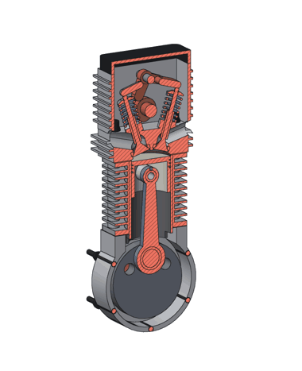

[English](README.md) | [日本語](README.ja.md) | **简体中文**

> 译自 [README.ja.md](README.ja.md)（日文版为原文），对应提交 `513d863`。

# freecad-ja-unified

把 FreeCAD 整合成“不会迷路的单一界面”，并让它能用日语使用。
取消了工作台的切换，选中对象后就在旁边给出下一步操作，
界面用语统一为浅显的日语。还加入了找出错误的“设计检查”，以及能查看并修改模型的 AI 聊天。
从命令行或脚本使用时的问题也一并修复了。所有改动都以 FreeCAD 上游的补丁形式保存（没有提交到上游）。

本软件的界面是日语。本页中需要在屏幕上找到的日语标签，会用引号保留原文并附上中文含义。

## 用它做了一台发动机

用本版本制作了一台 125cc 风冷单缸发动机，以测试界面的易用性。

<p>


</p>

整台发动机（73 个零件）由脚本制作；剖视用 `--render --section`，动画与「动作转视频」同一机制。
随后每个版本用相同的 6 项任务，测试**只用界面**（鼠标和键盘）能否做出主要零件、装配和图纸：

- 0.6.9：6 项中 2 项（中途崩溃丢失了工作）
- 0.7.3：4 项
- **0.7.5：全部 6 项**（零崩溃）

每个版本都修复了遇到的障碍（装配静默损坏、已保存装配的零件丢失、草图被实体遮挡等）。
目标是整台发动机既能用脚本也能只用界面制作；气门机构（气门、弹簧、摇臂、凸轮）和整体装配仍在只用界面的测试中。


## 主要功能

界面
- 无需切换工作台的统一界面；在所选对象旁给出下一步操作（输入数字后回车）
- 磁吸贴合、类似 Excel 的对齐、用箭头推拉面、选两个对象自动测量
- 装配：在孔和轴的中点对齐、「原地转动」「原地滑动」「按角度转动」、按齿数设定传动比、动作转视频（MP4）
- 零件架（JIS 紧固件、铝型材、公司零件）、图纸自动尺寸与日文标题栏
- 设计检查（干涉、损坏的形状、不成立的关节等）以及可操作模型的 AI 聊天

命令行（无界面）
- `freecadcmd model.FCStd --render out.png --view iso`（剖视用 `--section z=10 --section-color part`）
- `--export-svg` / `--export-pptx`（消隐 2D）、`--export-drawings out.pdf`（图纸 PDF）
- `--interference`（300 个零件约 1 秒）
- 读写 DWG（AutoCAD，最高 R2018），打开 Jw_cad 图纸（JWW）


- 基于的版本：FreeCAD main `b48098efa`（2026-09-26，版本号 26.3.0dev）
- 随附的 OndselSolver：`4be80eef`

## 下载

[Releases](https://github.com/monyuonyu/freecad-ja-unified/releases) 中提供已构建好的版本。

- Linux：`FreeCAD_<版本>-Linux-x86_64.AppImage`（加上执行权限后直接运行）
- Windows：`FreeCAD_<版本>-Windows-x86_64-installer.exe`（安装程序）或 `.7z`（解压后运行 `bin/FreeCAD.exe`）

没有做代码签名，所以 Windows 会弹出 SmartScreen 警告（点“更多信息”→“仍要运行”）。

设置、宏和窗口布局保存在与上游 FreeCAD 不同的位置（`FreeCAD-ja-unified`）。Windows 安装程序也会
安装到与上游不同的位置（`FreeCAD-ja-unified 26.3`）。0.3.1 及以前与上游共用（与上游并用时设置会混在一起）。

卸载时，程序、快捷方式、文件关联和注册信息都会被删除（已在 Windows 上确认）。
用户自己的设置与上游一样默认保留（便于重新安装后继续使用）。要删除时，在卸载程序界面中勾选
“ユーザー設定も削除”（同时删除用户设置）。只会删除本版本的设置，不会动上游 FreeCAD 的设置。

## 界面一览

### 首次启动

只需选择语言、单位和外观（浅色／深色）。之后可以在“編集 → 設定”（编辑 → 首选项）中修改。


### 新建零件 → 点击要绘制的位置

开始界面只有“新しい部品”（新建零件）和“ファイルを開く”（打开文件）。点击新建零件后，会直接询问在哪里绘制。
不需要像上游那样在对话框里选面再点 OK，只要在 3D 视图中点一下平面或零件上的平整面即可。


### 绘制草图时只显示草图工具

绘制草图期间，工具栏会切换为草图工具，结束后恢复原样。
会吸附到网格点上，所以即使用鼠标随手画，尺寸也是整齐的数值。剩余的自由度数量以日语显示。


### 画完之后，下一步就出现在旁边

关闭草图后，旁边会出现“押し出す・回転・編集・AI に頼む”（拉伸、旋转、编辑、交给 AI）。不必在工具栏里找。
工具栏上的主要工具在图标下方也标有名称（押し出し“凸台”、切り抜き“凹槽”、丸め“圆角”…）。


任务面板只在使用工具时出现，用完就消失（同时调整视角，让模型完整显示在画面中）。


### 点击一个面，显示对该面能做的操作

面会给出草图、凸台、凹槽、孔、抽壳；边会给出圆角、倒角（见最上方的图）。
“穴”（孔）会直接开在点击的位置（上游需要先在草图里画一个点）。
光标下的对象以名称和位置显示，而不是 `Preselected: Unnamed.Body.Pad.Face6`。
双击一个面，会打开生成该面的特征（凸台、圆角…）的编辑。


### 把零件贴合在一起、从点移动到点

让零件彼此贴合，不再需要“放置”对话框、附着（Attachment）或装配约束。
点击要移动的零件的一个面，再按住 Ctrl 点击另一个零件的面，旁边就会出现“くっつける”（贴合）：两个面相对贴在一起。
**先选的那个会移动**（面板显示“移动 → 对齐目标”，“入れ替え”可以交换）。


按下后零件立即移动。面板中的翻转（同向而不是相对）、间隙、旋转（每次 90° 或任意角度）、对齐位置（点击的点 / 中心 / 保持沿面的位置）会立即生效。
OK 确定（一次撤销即可还原），取消或 Esc 恢复原位。


两个圆柱面会给出“軸をそろえる”（对齐轴线，如把轴插入孔），点和面给出“点を面に合わせる”，两个点给出“点から点へ”。


“点から点へ動かす”（从点移动到点）不改变方向：点击基点，再点击目标点。光标会吸附到顶点、边的中点、圆心和面的中心，并显示标记和名称；半透明的副本跟随光标；按住 Ctrl 为复制。


这些工具也可以从“形”菜单、工具栏、`J`（贴合）和 `Shift+M`（从点移动到点）启动。移动的是所选元素所属的零件（Body、形状、导入的 STEP、链接），
也可以在面板中选择外层的容器；嵌套和旋转的容器按全局坐标计算。已附着的零件可以保持附着只改偏移，或解除附着，由你选择。

### 设计检查与“直す”（修复）

类似 PCB 设计软件中的 DRC，列出整个模型中的错误：失败的特征、零件之间的干涉、草图约束的冲突、
悬空的零件、工程图中丢失了几何的尺寸等。选中一行会缩放到对应零件，并在出问题的位置显示红色标记。
状态栏始终显示检查结果（“検査: エラー 2・警告 2”，即“检查：错误 2、警告 2”）。


修复方法明确的问题（重复或冲突的约束、悬空的零件、重叠的零件、空的投影视图）可以用“直す”（修复）一键修复。
下图是按下“直せるものを全部直す”（修复所有可修复的问题）之后的结果。“撤销”一次即可全部恢复。


### 交给 AI

在右侧的“AI”面板中提出请求，AI（Claude）会查看模型、进行修改，再用设计检查和画面确认，然后汇报结果。
选中面或边后点“AI に頼む”（交给 AI），选中的对象也会一并传过去。AI 要执行的代码每次都会显示出来，
只有点“実行する”（执行）时才会运行。每执行一次就是“撤销”的一步。


### 失败提示也是日语

在上游仍是英文的失败信息（如 `BRep_API: command not done`）也会用日语说明哪里出了问题、该怎么办。
含有约束编号或边编号的信息也会翻译。


### 导航立方体

右上角用来改变视角的立方体，平时只显示立方体本身。鼠标移上去后才出现箭头等控件，
点击靠近面边缘或角落的位置，就会转到那条边或那个角的方向（更容易点中）。将会发生什么由工具提示说明。


## 与上游的差异（一览）

| | 上游 FreeCAD | 本补丁 |
|---|---|---|
| 工作台 | 在 Part / PartDesign / Sketcher / Draft / TechDraw / Assembly … 之间切换 | 无需切换。草图、实体、工程图、装配都在同一个界面 |
| 2D 绘图 | Sketcher 与 Draft 两套并存 | 统一为 Sketcher（只在绘制草图时显示草图工具） |
| 工程图、装配 | 各自有独立的工作台 | 收在“図面”（工程图）和“アセンブリ”（装配）菜单中，并附说明 |
| 第一步 | 开始界面选项很多 | 只有“新建零件”和“打开”。新建零件后直接进入选择草图平面 |
| 选择草图平面 | 在对话框中选面后点 OK | 在 3D 视图中点一下面或基准平面 |
| 选中后的操作 | 去工具栏里找 | 在选中对象旁给出候选操作（面→草图/凸台/凹槽/抽壳，边→圆角/倒角，草图→凸台/旋转/编辑，零件→移动/隐藏） |
| 工具栏 | 只有图标。即使 1600 宽也有一部分藏在“»”里 | 主要工具在图标下方标有名称（凸台、凹槽、圆角…）。草图工具也能排成一行 |
| 草图吸附 | 默认关闭 | 靠近网格点时吸附（用鼠标画也能得到整齐的尺寸） |
| 光标下的显示 | `Preselected: Unnamed.Body.Pad.Face6` | `押し出し の 面 6`（“凸台的面 6”） |
| 双击面 | 没有反应 | 打开生成该面的特征（凸台、圆角…）的编辑 |
| 让零件面对面贴合、从点移动到点 | 在“放置”对话框输入数值、设置附着、创建装配约束，或使用 Draft 的移动（需要切换工作台） | 选两个面 →“贴合”（相对/同向、间隙、90° 旋转、中心对齐）。圆柱面 →“对齐轴线”，点 + 面 →“点到面”，两个点 →“从点到点”（吸附顶点、边中点、圆心和面中心；Ctrl 复制）。实时预览，OK 确定，Esc 还原 |
| 选中面后点“孔” | 以“找不到轴”失败（需要先在草图里画点） | 在点击的位置开孔 |
| 工程图的投影视图 | 在重新打开文件之前会出现在图纸左下角（上游的缺陷）。默认第一角投影 | 出现在图纸中央。默认第三角投影（JIS） |
| 修改导入的实体（STEP 等） | 弹出“需要活动的实体（Body）”对话框 | 可直接绘制草图、倒圆角、拉伸（自动转为零件） |
| 不选任何对象就导出 | 停在“请选择对象” | 导出所有可见的零件 |
| 查找错误 | “检查几何”只检查所选的一个形状是否损坏 | “設計の検査”（设计检查，接近 PCB 设计软件的 DRC）：列出失败的特征、分裂的零件、零件之间的干涉、草图约束的冲突、极短的边、悬空的零件、丢失了几何的工程图尺寸。选中一行会选中并缩放到该零件，并在位置上显示红色标记。“有意为之”的问题可以标记为忽略并记录在文档中。可修复的问题（重复或冲突的约束、悬空的零件、重叠的零件、空的投影视图）用“修复”按钮修复（撤销一次即可恢复）。状态栏始终显示结果（错误和警告的数量）。命令行中也可使用：`FreeCADCmd -c "import DesignCheck; DesignCheck.main('a.FCStd')"` |
| 交给 AI | 无 | 在右侧的“AI”面板中，AI（Claude）查看模型、修改模型，并用检查和画面确认。选中面或边时的候选操作以及设计检查的列表中都有“交给 AI”。默认情况下 AI 要执行的代码每次都会显示，批准后才执行（每次为一步撤销。也有跳过确认的开关）。使用时需要你自己的 Anthropic API 密钥（见下文） |
| 菜单 | “宏”和面向开发者的工具排在顶部菜单 | 顶部菜单减少一个，视图和工具中面向高级用户的项目移到子菜单 |
| 线性阵列的初始间距 | 固定 100 mm（零件较小时副本会跑到画面外） | 被阵列形状尺寸的 2 倍 |
| 鼠标操作 | 从 7 种方式中选择 | 默认只有 1 种（右键拖动旋转，中键拖动平移，滚轮缩放）。不显示选择界面 |
| 任务面板 | 始终占用空间 | 只在使用工具时出现。结束后调整视角，让模型可见 |
| 右键菜单 | 项目很多 | 只保留建模需要的（其余仍在顶部菜单中） |
| 首选项界面 | 包含 BIM、插件等用不到的页面 | 只保留会用到的页面 |
| 插件管理器 | 有 | 无（它是用来添加工作台的机制） |

没有删除任何功能。平时不常用的功能都附上说明放在菜单里。

## 使用 AI 聊天

1. 发布包（自 0.3.5 起）已经包含 AI 聊天所需的组件（claude-agent-sdk、keyring、Claude Code），无需准备。
   如果是自己构建的，请在右侧“AI”面板中点击“AI の準備をする”（准备 AI）（会安装到 Python 虚拟环境中，需要联网）
2. 在 [console.anthropic.com](https://console.anthropic.com/) 创建 API 密钥，在第一次发送时出现的“API キーを入れる…”（输入 API 密钥…）中输入。
   之后要更改或删除：编辑 → 设置 → 標準 → AI チャット（自 0.5.7 起）。
   密钥保存在操作系统的密钥库中（Windows 凭据管理器、macOS 钥匙串、Linux Secret Service）。
   在没有密钥库的环境中，保存在只有本人可读的文件中（FreeCAD 用户数据中的 `ai/ai-api-key`）
3. 使用费用计入 API 密钥所有者的账户。本补丁不包含任何密钥或登录信息
4. 在公司网络中，请在 编辑 → 设置 → 標準 → ネットワーク 中设置代理（默认使用系统设置）；如果网络会检查 TLS，再选择公司的证书（PEM）（自 0.5.7 起）

AI 会把文档内容、画面图像和设计检查的结果发送给模型（默认为 Opus）。
AI 要执行的代码默认每次都会显示，只有点“実行する”（执行）时才会运行（代码也可以做 FreeCAD 以外的事情，请先读一遍）。
勾选面板下方的“たずねずに実行する”（不询问直接执行）可以跳过确认（直到关闭 FreeCAD 为止。执行过的代码会保留在聊天记录和 ai/ai-runs.log 中）。

## 日语

- 补全了菜单、工具栏、任务面板、通知和首选项中未翻译的部分，并把术语统一为浅显的说法
  （例：Pad → 押し出し，Pocket → 切り抜き，Body → 部品，Constraint → 拘束）
- 左侧的属性栏（属性名、分组、说明、选项值）改为日语
- 新建对象的名称也是日语（部品、スケッチ、押し出し …）
- 零件中的原点（Origin）在树中隐藏

在日语以外的语言下，显示与上游相同。

## 命令行与脚本

| | 原版 FreeCAD | 打补丁后 |
|---|---|---|
| 脚本因异常而终止 | 退出码为 **0**，而且会**执行两次**，错误只有一行 | 只执行一次，退出码 1，显示完整的回溯 |
| `if __name__ == "__main__":` | 不执行（脚本被当作模块 import） | 执行 |
| `sys.argv` | 原样是 FreeCAD 自己的参数 | `FreeCADCmd a.py -- x y` → `['a.py', 'x', 'y']` |
| `sys.exit()` / `sys.exit("msg")` | 1 / 不输出消息 | 0 / 消息输出到标准错误 |
| 异常或 `sys.exit()` 之前的 `print` | 有时会丢失 | 会输出 |
| 不存在的文件 | 退出码 0 | `No such file`，退出码 1 |
| `FreeCADCmd < a.py` | 以交互模式逐行处理（混入 `>>>`，出错也返回 0） | 作为一个完整脚本执行 |
| 执行脚本时的横幅 | 显示 | 不显示（交互模式下显示） |
| 导出 STEP | OCC 的统计信息在标准输出中出现两次 | 不输出（转到日志） |
| 打开装配 | 约束求解器的信息输出到标准输出 | 不输出 |
| `Part.export([shape], "a.step")` | **悄无声息地写出空的 STEP** | 接受 Shape／没有内容时抛出 `ValueError` |
| `--output` 转换失败 | 退出码 0 | 退出码 1 |
| `--help` | 名称总是“FreeCAD”，没有用法说明 | 显示可执行文件名、示例和退出码。显示 `--output`（`-o`）和 `--hidden` |
| 设置文件 | 即使什么都不做每次也会重写。并行运行时设置会丢失 | 只在值改变时写入 |
| `FreeCAD --hidden a.py` 失败 | 退出码 0 | 退出码 1 |
| 用 `--hidden` 改变视角后保存 | 保存的是动画进行到一半的画面 | 不播放动画 |
| 用 `--hidden` 且存在旧版本的设置 | 设置迁移对话框出现在看不见的屏幕上，**永远卡住** | 不显示对话框 |
| 以 `--hidden` 运行 | 会改写最近使用的文件和窗口布局 | 不改写 |
| Python 的 `saveImage()` | 导航立方体会被拍进图像 | 不会（与“保存图像”菜单相同） |
| 输出图像 | 需要显示环境（xvfb）和 GUI | `FreeCADCmd a.FCStd --render a.png --view iso`（不需要显示环境和 OpenGL。`--render-style shaded\|hidden-lines\|lines`、`--size 1600x1200`，Python 中为 `Part.renderImage`） |
| 干涉检查 | 对零件两两穷举（300 个零件需 106 秒） | `FreeCADCmd a.FCStd --interference`／`Part.findInterferences`（先用包围盒筛选并并行处理，1.2 秒） |
| 消隐后的 2D 图 | 需要 TechDraw 图纸页 | `--export-svg`、`--export-polygons`（按面的多边形 JSON）、`--export-pptx`（图形可编辑的 PowerPoint）／`Part.projectVisible` |
| `Mesh.addFacets(shape.tessellate(d))` | **悄无声息地丢弃**相互接触的盒子之间的面（52 个盒子时 624 → 12 个面） | 全部加入（只有 `check=True` 时才丢弃，并警告数量） |

## 从上游引入的修复（PR 列表）

已提交到上游 FreeCAD 但尚未合并的 PR 中，经过审查后引入的部分（作者姓名原样保留在提交中）。
从 541 个开放的 PR 中，以本界面用到部分的崩溃、缺陷和回退为主进行筛选，阅读了改动内容，并确认能在补丁之上应用且通过测试。

**崩溃**

- [#32804](https://github.com/FreeCAD/FreeCAD/pull/32804) 进入草图编辑或移动鼠标时崩溃（@alfrix）
- [#32975](https://github.com/FreeCAD/FreeCAD/pull/32975) 草图预选时越界读取导致崩溃（@alexdremov）
- [#32989](https://github.com/FreeCAD/FreeCAD/pull/32989) 镜像草图时崩溃（@alfrix）
- [#32970](https://github.com/FreeCAD/FreeCAD/pull/32970) 关闭任务面板时访问已释放的内存而崩溃（@alexdremov）
- [#32007](https://github.com/FreeCAD/FreeCAD/pull/32007) 在属性栏编辑时点击 3D 视图等操作导致崩溃（6 种。任务面板中的 1 处与 #32970 重复，已排除）（@oursland）
- [#32684](https://github.com/FreeCAD/FreeCAD/pull/32684) 打开外部引用的文件时崩溃（@chennes）
- [#31263](https://github.com/FreeCAD/FreeCAD/pull/31263) 刚启动时操作 SpaceMouse 导致崩溃（@Maik-0000FF）

**形状与草图**

- [#32430](https://github.com/FreeCAD/FreeCAD/pull/32430) 对多段线倒圆角时最后一个点消失（@alfrix）
- [#32759](https://github.com/FreeCAD/FreeCAD/pull/32759) 无法在曲线之间的点上倒圆角时，给出原因（@VishalRamKN）
- [#28238](https://github.com/FreeCAD/FreeCAD/pull/28238) 圆角、倒角失败时，给出原因（半径过大、面会扭曲…）和解决办法（@paragforwork）

**工程图**

- [#32552](https://github.com/FreeCAD/FreeCAD/pull/32552) 锁定位置的视图在加载后跳到原点（@WandererFan）
- [#32151](https://github.com/FreeCAD/FreeCAD/pull/32151) 修复尺寸引用时遇到损坏的引用会失败（@WandererFan）

**装配**

- [#31998](https://github.com/FreeCAD/FreeCAD/pull/31998) 给零件添加固定关节时出错（@ryneeverett）
- [#32924](https://github.com/FreeCAD/FreeCAD/pull/32924) 失去父对象的关节组无法删除（@PaddleStroke）
- [#32922](https://github.com/FreeCAD/FreeCAD/pull/32922) 齿条齿轮动作异常（@PaddleStroke）

**显示与界面**

- [#32658](https://github.com/FreeCAD/FreeCAD/pull/32658) 浅色／深色主题下，合并后形状的颜色错乱（@chennes）
- [#32813](https://github.com/FreeCAD/FreeCAD/pull/32813) 选中高亮显示的深度出现回退（@Connor9220）
- [#32841](https://github.com/FreeCAD/FreeCAD/pull/32841) 属性栏的选项中日语等文字乱码（@maxwxyz）
- [#32996](https://github.com/FreeCAD/FreeCAD/pull/32996) 用键盘在树中选择时更新状态栏（@007stevendigar-lgtm）

**文件**

- [#32934](https://github.com/FreeCAD/FreeCAD/pull/32934) 无法读取 ASCII 格式的 STL（名称较长、末尾没有换行）（@maxwxyz）

**0.3.3 中新增**

- [#32614](https://github.com/FreeCAD/FreeCAD/pull/32614) 草图中的点只移动一点点就会弹回原处（@Reqrefusion）
- [#30997](https://github.com/FreeCAD/FreeCAD/pull/30997) 在测量工具打开时关闭文档会崩溃（@Amine0x0）。直接应用的话，在本版本中会覆盖另一个观察者，之后导致崩溃，因此一并修复了
- [#32879](https://github.com/FreeCAD/FreeCAD/pull/32879) 抽壳结果是无效形状时没有任何提示（@007stevendigar-lgtm）。另外补充了厚度过大导致形状不变时的提示

### 已向上游报告但尚未修复、由我们修复的问题

附有复现步骤，并在本地复现或查明原因的问题。

- [#32968](https://github.com/FreeCAD/FreeCAD/issues/32968) 用表达式编辑器输入草图尺寸后，退出工具时尺寸消失（本月出现的回退）
- [#32732](https://github.com/FreeCAD/FreeCAD/issues/32732) “保存到变量集”因单位不匹配而失败（在 macOS 上会崩溃）
- [#32877](https://github.com/FreeCAD/FreeCAD/issues/32877) 打开不可见的文档时，当前正在处理的文档被抢走（在 macOS 上会崩溃）
- [#25050](https://github.com/FreeCAD/FreeCAD/issues/25050) 比零件还厚的抽壳厚度会悄无声息地什么也不做
- 删除中间的特征（如凹槽）后，后面的阵列仍带着被删除的孔，却显示为“正常”
- STEP 中日语等名称乱码（导出改为符合标准的写法，导入默认使用 UTF-8。其他 CAD 生成的 STEP 也能读取）
- 长度为 0 的视角移动会导致画面卡死

用检测内存错误使用的构建（AddressSanitizer）运行上游测试时发现的问题（0.3.4）：

- 在重新计算过程中删除零件，后续处理会读取已删除零件的内存（CAM 的刀具会触发）
- 宏编辑器对已删除的文件询问“是否重新加载”而卡住
- Draft 的选择框显示读取的点数多于传入的点数

此外还修复了装配求解器（OndselSolver）中，在 Linux 和 macOS 上导出装配（ASMT）时关节类型名损坏的问题
（截取类型名时以 Windows 的格式为前提。是在上游测试 #32922 于 Linux 上失败时发现的）。

## 0.7.7 的变更

根据只用界面制作气门机构与整台发动机的测试（0.7.6）以及公司电脑上的测试：

- 「动作转视频」：选中旋转关节时候选栏出现「视频」；按角度范围转动关节，按 3D 视图所见（方向、剖切、颜色）录成 MP4（随附 ffmpeg，否则 GIF），可达 720°；会提示可自由移动的零件
- 齿轮与皮带保持正时（14/28 链条带动的凸轮在曲轴超过 180° 后偏差半圈：每次求解都重新取齿轮关系）；轴翻转的解视为不成立
- 关节角度的公式可以确定；重新打开的装配中「放置零件」和接地有效；放入的零件以文件名命名；在树中选中关节也会显示候选栏；候选栏数值框可直接覆盖输入
- DWG 导出保留文字并写为 R2018（原为 R14 且文字丢失）；升级后使用本版本附带的转换器；默认读取 DWG/DXF 的文字和尺寸；`--export-drawings` 跳过没有图框的页面并给出警告

## 0.7.6 的变更

在 0.7.5 上通测了"只用界面制作发动机"的 6 项任务：**6 项全部完成**（0.6.9 为 2 项，0.7.3 为 4 项），无 P0/P1。修复了剩余的 P2：放置草图尺寸时输入的数字即为其数值；在轴上的起点闭合折线时会与起点重合；候选栏中所有需要数值的工具都使用输入的数值；圆面与孔的边缘一起选中时在孔壁上建立关节；新的剖视图放在空白处；点击数值栏会全选；关闭草图后会再次检查候选栏。

## 0.7.5 的变更

根据 0.7.4 的界面测试（装配、剖视图、草图全部完成；曲轴转到 0/90/180° 时活塞位置与理论一致）：「原地转动」会解除该零件的固定；新增「原地滑动」（对地的滑动关节），链接的零件选中圆面时候选栏也会显示；「放置零件」把零件放在已有零件的右侧而不是原点；图纸自动尺寸不再重复、不再测无意义的值或横穿零件；带标题的剖视图在无界面导出 PDF 时不再崩溃（上游的新问题）；有图纸的零件文件中「绘制图纸」可用；剖视图标题可翻译；放入装配的零件内部名为英文数字，界面按 UTF-8 读取名称（不再显示「é¨å003」）。

## 0.7.4 的变更

在 0.7.3 上重新进行了"只用界面制作发动机"的测试（6 项中完成 4 项；0.6.9 为 2 项），修复了发现的问题和 CLI 的剩余项目。

- 装配：关节无法成立时把零件放回求解前的位置，设计检查会指出哪个关节、偏差多少（`assembly.getBrokenJoints()`）；在临时文件夹自动保存后"另存为"到别处的装配，其链接仍按旧文件夹写入相对路径，单独打开时零件全部丢失（上游也有）——已修复；旋转关节可"按角度转动"（可用 `Params.theta` 等表达式驱动曲轴）；选择一个圆面即可"原地转动"（对地的旋转关节）；穿过两侧壁的孔或两个轴颈取整体中点对齐；齿轮和皮带可输入齿数；复制零件时共享的表格保持共享；被装配引用的零件文件也能"绘制图纸"
- 零件与图纸：草图以正交投影并带剖切打开；在候选栏输入数值后按按钮也会使用该值；选中草图做阵列时阵列由该草图生成的步骤；孔会吸附到圆端中心，并可沿径向打在圆柱面上；选中圆面时新建草图不再弹出原始附着面板；剖视图使用显示的方向并自动使用下一个字母；模型面板不能被关闭
- CLI：`--export-drawings out.pdf`（无界面输出图纸 PDF）、`findInterferences(moving=...)`（每个姿态 32 秒 → 3 秒）、`--section-color part`、Midplane 警告每次会话只出现一次

## 0.7.3 的变更

- **刚打开文件时，大幅改变装配的驱动值不动**（0.7.2 修复的遗留）：0.7.2 的“从上次成立的位置逐步接近”只在内存中记住该位置，刚打开文件就把曲轴角从 0 改到 90° 时没有起点，以 -7 停止。没有记录时，从零件当前的位置开始接近。`-t TestAssemblySolve`（增加了重新打开后的测试）
- 0.7.2 在构建 Windows 版之前中止，因此在 Windows 上本版是第一个包含 0.7.2 修复的版本

## 0.7.2 的变更

修复发动机实地测试（0.6.9）发现的问题，每项先在 0.7.0 上复现（测试在 0.7.0 失败、在 0.7.2 通过）。

- 电子表格中带别名的单元格修改后，引用它的表达式会更新（细粒度重算只比较属性名）
- 装配中驱动值大幅变化（曲柄 0→90°）时分步逼近，不再悄悄丢弃驱动约束
- 同一草图中相交的闭合轮廓取并集（内部轮廓为孔），不再只拉伸出一部分
- 脚本创建的镜像/阵列会成为实体的末端
- 草图约束列表不再因残留行崩溃；每 2 分钟自动保存恢复数据
- 关节工具无需先激活装配；小孔优先于周围平面被选中
- 绘制草图时数字键不再切换视图；不可选的对象用文字说明
- 零件库：超过标准表最长长度的螺栓按需要长度生成并提示

## 0.7.1 的变更

修复 0.6.9 初学者可用性测试（[docs/ui-redesign/usability-0.6.9/report.md](docs/ui-redesign/usability-0.6.9/report.md)）发现的问题；验收见 [docs/ui-redesign/accept/U071](docs/ui-redesign/accept/U071)（42 项，0.7.0 上同样步骤有 12 项失败）。

- 装配：当前文件的零件放入装配并固定，新放入的零件不固定；吸附/交换时固定零件不动、不翻转
- 复制零件：Ctrl+C/V、“再一个”、“网格排列”（四角为 2×2）；树中双击不再跳到零件文件
- 孔：继续点击面即可加孔，并可输入距左边、下边的位置
- 输入数值：“同方向的边”后候选栏保留，数字进入数值框，不再切换视图；不选孔的接缝边
- 工程图：圆角不算孔；自动标注孔位置；日文标题栏；PDF 默认文件名
- DXF：图框和标题栏不作为轮廓；未闭合的线会提示
- 螺钉、垫圈、螺母和工程图中心线随孔移动
- 关闭最后一个 3D 标签时询问保存并关闭文件；打开文件时显示 3D
- 其他：面板打开时视图不做动画、缺图标不再通知、"Processing..." 已翻译、同名搜索结果注明所属

## 0.7.0 的变更

完成界面重建（[docs/ui-redesign/00-design.md](docs/ui-redesign/00-design.md)）剩下的四项，所有阶段（P0–P10）都已完成。
验收截图与结果：[docs/ui-redesign/accept/P11](docs/ui-redesign/accept/P11)（`tests/ui/p11_check.py`，用真实的鼠标与键盘事件检查 71 项）。

- **历史树中的“有效到此”线**：零件最后一步下方的蓝线。拖到较早的步骤上，下面的步骤不再生效（灰色斜体、“未生效”），新步骤插入到线的位置；拖回最下方（或双击）即全部生效。每次一步撤销。右键菜单有“插入到此”和“全部步骤恢复生效”。内部是 Body 的 Tip，但界面不出现这个词
- **工具面板只显示重要项**：凸台只显示长度与反向等，最多三项；其余放在“详细 ▸”中，并按工具记住展开状态。草图尺寸输入框也一样
- **用文字描述所选对象**：如“凸台的上面”“孔 ⌀6 的内侧面”“凸台的竖边 ×4”，显示在状态栏、所选对象旁的候选栏标题和圆角/倒角列表中
- **工具名称统一为术语表的用词**（115 个），旧名称仍可搜索
- 测试：`FreeCADCmd -t TestHistoryLine`、`-t TestSelectionWords`、`-t TestTaskPanels`、`-t TestWording`

## 0.6.9 的变更

- **点击推拉箭头处也能选中面**（0.6.7 的缺陷）：悬停时面中央的箭头吃掉了所有左键点击，导致无法选中面（测量、吸附、旁边的候补都用不了）。
  现在只有按住箭头拖动超过 5 像素才移动面；不拖动直接松开则选中下面的面。箭头根部不再作为把手，箭头也变小了（56 → 36 像素）。
  验收（[docs/ui-redesign/accept/pushpull](docs/ui-redesign/accept/pushpull)，41 项）新增「点击面中央即选中该面且不移动」「拖动箭头才移动面」

## 0.6.8 的变更

不按“测量”也能测量，按下工具之前就能看到结果——加在选中对象旁的候选栏和固定的工具列上。
截图：[docs/ui-redesign/accept/measure-preview](docs/ui-redesign/accept/measure-preview)。
与并行发布版本的关系：代码自 0.6.6 的发行包起已包含（保留尺寸的日文名称自 0.6.5 和 0.6.7 起）。0.6.8 补充了说明、验收步骤和截图，补丁与 0.6.7 相同。

- **选中两个对象立即测量**（Ctrl，同一零件或不同零件均可）：点与点的距离及 ΔX/ΔY/ΔZ，点到面/边的距离，平行的边或面之间的**间隙**，
  不平行时的**角度**，两个圆或孔的**中心距**和 ⌀。数值显示在候选栏左侧，右侧仍是原来的工具（贴合、点到点等）。嵌套和旋转的零件按全局坐标测量
- **选中一个对象时以小字显示**：边的长度、面的面积、圆或孔的 ⌀ 和 R
- **点击数值即可复制**（仅数字）；**「寸法を残す」（保留尺寸）** 创建持久的测量对象（归入“尺寸”组），撤销一步即可
- **悬停预览工具**：鼠标在工具列或候选栏的按钮上停留 0.3 秒，即以半透明方式在当前选择上显示该工具的结果（绿色为增加、红色为去除、蓝色为副本）：
  圆角/倒角（选中的边或面的边；数值取候选栏的输入或上次的值）、草图或平面的拉伸 10 mm/挖槽、点击处的 ⌀6 孔、所选特征的镜像/线性阵列/环形阵列、Part 镜像。
  在形状副本上于线程中计算，鼠标离开即取消，超过 1 秒则不显示；**绝不修改文档**
- 工具提示改为一句平实的说明
- 测试：`FreeCADCmd -t TestMeasureMath`（平面、圆柱、旋转与嵌套零件）、`-t TestToolPreview`（大小与位置、不修改文档、取消、过慢），
  GUI 验收 `tests/ui/measure_preview_check.py`（用 xdotool 发送真实的点击与鼠标移动）

## 0.6.7 的变更

**拖动面（推拉）与模型上的尺寸** —— 不必先选工具，直接抓住形状来修改。验收截图见 [docs/ui-redesign/accept/pushpull](docs/ui-redesign/accept/pushpull)。

- **拖动面上的箭头**：鼠标停在实体的平面（或整圈的圆柱面）上会出现小箭头，拖动它面就沿法向移动：向外加材料，向内去材料。拖动时模型实时变化，光标旁显示距离和改变的内容；
  距离会吸附到整数和其他平面的高度（齐平），按住 Shift 不吸附。松开即确定（撤销一步），拖动中按 Esc 全部还原
- **改什么取决于面是怎么做的**：凸台/凹槽的端面 → 长度，孔底 → 深度，由草图拉伸的侧面 → 只移动那条线的草图尺寸（没有则从该面新建凸台/凹槽），孔与圆凸台 → 直径，长方体/圆柱 → 尺寸。
  导入的实体（STEP 等）生成「推拉」步骤，保留原实体、面和距离，之后可再改
- **也可以输入数值**：选中面后，旁边候选的第一个是「面を動かす」和距离栏（向内为负）；圆柱面是「直径」栏
- **模型上的尺寸**：选中零件或步骤，驱动它的数值（凸台长度与草图尺寸、孔径与深度、圆角半径、阵列数量与间距、长方体/圆柱尺寸、推拉距离）以标签显示在相应位置；点击后输入，回车即重算。
  支持单位（10 mm、1/2 in）、算式和以 `=` 开头的表达式。未选中任何东西时不显示
- 测试：`FreeCADCmd -t TestPushPull`（26 项）、`FreeCADCmd -t TestDimensionLabels`（11 项），以及在虚拟屏幕上用 xdotool 真实拖动的 `tests/ui/pushpull_check.py`（37 项）

## 0.6.6 的变更

**零件架**（工具栏的「部品の棚」，Ctrl+K 输入 ねじ・ボルト・ナット・座金・ワッシャ・M6 等）。详见 [docs/parts-shelf.md](docs/parts-shelf.md)，
验收截图见 [docs/ui-redesign/accept/parts-shelf](docs/ui-redesign/accept/parts-shelf)。

- **按 JIS 名称的螺钉、螺母、垫圈**，M3–M12：内六角圆柱头螺钉（JIS B 1176）、六角螺栓（B 1180）、六角螺母（B 1181）、平垫圈（B 1256）、弹簧垫圈（B 1251）、
  紧定螺钉（B 1177）、内六角沉头螺钉（B 1194）。名称如「六角穴付きボルト M6×20」
- **点击孔即插入合适的螺钉**（选中孔后旁边的「ねじを入れる」）：规格由孔径决定（底孔、螺纹孔、JIS B 1001 通孔 1–3 级、沉孔、锪孔），长度由夹紧的板与螺纹孔决定
  （同轴的其他零件也计入，不会顶到盲孔底），与孔同轴放置。可选垫圈、螺母与未建模板的厚度，修改后即时重新插入
- **自然进入物料清单**：每种规格一个隐藏的原件（带名称、标准、规格、品号属性），使用处为链接，装配的 BOM 以链接数为数量。设计检查不把螺纹啮合的重叠算作干涉
- **铝型材**：20/30/40 系列、槽 6/8 的通用截面（来自公开的通用尺寸，不含厂商数据），点击两点放置（第一点后有预览），也可输入长度
- **公司零件**：可加入 FCStd/STEP 文件夹（索引 `shelf.csv` 可选，也能读 Excel 的 Shift_JIS CSV）；全公司可用环境变量 `FREECAD_PARTS_SHELF`
- **内置 Fasteners 工作台**（[shaise/FreeCAD_FastenersWB](https://github.com/shaise/FreeCAD_FastenersWB) `fddd07af`，**GPL-2.0-or-later**，未修改，位于 `src/Mod/Fasteners`）。
  零件架用它生成螺钉形状；其 223 个工具也可从 Ctrl+K 与「その他の道具」使用。发布构建会确认已内置且 `FreeCADCmd -t TestPartsShelf` 通过

## 0.6.5 的变更

**拖动零件（磁铁）**与**对齐**。截图：[docs/ui-redesign/accept/magnet-0.6.5](docs/ui-redesign/accept/magnet-0.6.5)（`tests/ui/magnet_check.py`，用 xdotool 真实拖动）。0.6.5 不含 0.6.6 的零件架。

- **按住零件拖动**：无需选择工具即可移动。不移动松开仍只是选择；从空白处拖动仍是框选。从上方看时零件在抓取点所在的水平面上滑动，抓取点始终在光标下；
  移到其他零件顶面（台、板）上方时会放到其上，离开后回到原来的高度（不会低于起始高度）。从正侧面看时在朝向屏幕的竖直面上移动
- **磁铁**：零件的面接近其他零件的面约 12 像素以内时面对面贴合（最多旋转 10° 使其平行）。圆柱面对准同一轴线（销靠近孔时插入到能插入的位置：盲孔到底、
  带头螺钉到头部接触、通孔与另一侧齐平）。角对角，面与其他零件对齐并以虚线显示；贴合的目标面以橙色框显示。继续拖动即可脱开。按住 **Alt** 不吸附
- **按住 Ctrl 拖动放置副本**：Body 和参数化形状为独立副本；导入的 STEP 形状、App::Part 组合、链接则为链接（共享形状，在零件表中计数）
- 松开即确定（撤销一次即可恢复），拖动中按 **Esc** 回到原位。移动的对象与“贴合”相同（Body、形状、链接；若选中了容器则整体移动）。
  有附着的对象保持附着、改变偏移；由表达式决定位置、被锁定或在装配中固定的零件不移动，并在光标旁说明原因
- 在 200 个零件旁每次移动中位数 4.5 ms、95% 为 9 ms；其他零件的面在移动间隙由近到远读取
- **对齐**（Ctrl 选择两个以上零件时出现在旁边的候选中，Ctrl+K 也可）：左/中/右、前/中/后、下/中/上（沿轴观察时使用屏幕方向的词）、**等间距排列**（两端不动）、
  **指定间距**、**紧贴排列**（按选择顺序）。基准为第一个选择的零件（在 3D 视图中加框）或全部所选的范围。悬停按钮可预览，点击确定（撤销一次），Esc 取消
- 测试：`FreeCADCmd -t TestMagnetDrag`（24 项）、`FreeCADCmd -t TestArrange`（11 项）
- 先发布的 0.6.6 含有此功能的早期版本，关闭文档后切换到其他视图时可能崩溃（从 Python 使用了已关闭的 3D 视图）；已在 0.6.5 和 0.6.7 修复

## 0.6.4 的变更

3D 视图跟随你正在看的位置（默认的鼠标方式和首次启动可选的触控板方式；其他方式不变）。截图：[docs/ui-redesign/accept/nav-0.6.4](docs/ui-redesign/accept/nav-0.6.4)。

- **滚轮前后移动**：视点朝光标下的点（没有则朝当前焦点深度）前进。步长与剩余距离成正比，越靠近表面越慢，不会穿过表面。没有固定的缩放限度；正交相机围绕同一点缩放
- **围绕光标下的点旋转**：拖动开始处的点保持在屏幕上不动。从空白背景开始旋转时，围绕最后看过的点（在视图内时），否则围绕可见几何的中心，绝不围绕远处的固定点。旋转时显示小的中心标记
- **平移**时抓住的点跟随光标；滚轮/平移/旋转后焦点随之移动，视图立方体围绕正在看的位置旋转。“适合全部”看向模型中心
- **默认使用透视投影**（未保存设置时）：视点的移动只有在透视中才看得出来。正交投影仍可在视图菜单中选择

## 0.6.3 的变更

- “绘制图纸”：先选中的面作为主视图；孔的中心线和标注放在孔显示为圆的视图上
- 装配的放置零件面板列出装配所在文件夹中的 FCStd/STEP/IGES 文件，点击即可打开

## 0.6.2 的变更

界面重做的 P5、P6（部分）、P9、P10。**0.6.1 没有 Windows 版，Windows 请使用 0.6.2。**

- 按用途分类的设置（基本、鼠标与按键（含触控板）、图纸、文件、网络与账户、AI），修改即时生效，可搜索；首次启动询问鼠标方式
- 装配：可放入 STEP/IGES 零件；选中两个圆柱面时提供“插入”“铰链”“刚性连接”；间隙配合的销不再被判为悬空
- 按用途导出：3D 打印（3MF/STL，网格检查与“修复后导出”）、其他 CAD（STEP）、2D（图纸的 DXF/PDF）、图片
- 打开 DXF/DWG/JWW 或网格后，显示可执行操作的提示条
- 树只显示当前文档，详细属性默认折叠，任务面板打开时模型显示在面板旁
- 草图尺寸在光标旁的小输入框中直接修改
- 修复：部分导入路径下无产品名的 STEP 零件名称；FreeCADCmd 在 Windows 旧代码页或 C 区域设置下打印日文时不再报错

## 0.6.1 的变更

**0.6.1 没有 Windows 版（请使用 0.6.2）。**

界面重做的 P1–P4、P7、P8：没有模式的单一窗口。验收截图见 [docs/ui-redesign/accept](docs/ui-redesign/accept)。

- 工具搜索（Ctrl+K）：可按中日英名称、别名和说明找到所有模块的全部命令（1158 个，含尚未加载的模块），选中时才加载模块；找不到时交给 AI
- 用一个“☰”菜单和一行始终不变的工具栏取代上游的菜单栏和工具栏；单键快捷键在输入文字或输入法组字时不会触发
- “其他工具”：按类别列出所有工具，专业工具箱（BIM、CAM、FEM…）首次使用时加载
- 草图和任务面板显示为同一窗口中的步骤条（✓ 完成 / ✕ 取消）
- 选中对象旁的候选按规则表给出，并带数值输入框
- 开始页：四种开始方式、搜索框、四个带示例的入门教程
- “绘制图纸”：一次生成带标题栏的 A4 三视图、中心线、孔标注和尺寸
- 修复：开始页在没有顶层帮助菜单时崩溃；应用网络代理设置时界面卡死；AI 聊天的密钥处理

## 0.6.0 的变更

界面重做（设计见 [docs/ui-redesign/00-design.md](docs/ui-redesign/00-design.md)：不设模式，替换而不是叠加上游界面）的第一阶段 P0「消除死路」。
验收截图见 [docs/ui-redesign/accept/P0](docs/ui-redesign/accept/P0)。

- 另存为 `plate.stl` 时会选中 FEM 导出器并报英文错误；现在按扩展名选择该格式本身
- 向装配中放入零件时不再弹出“必须先保存”“是否固定第一个零件”：未保存的装配先临时保存，未保存的 STEP 零件复制进装配，第一个零件自动固定
- 打开 DXF 不再询问导入方式；选中图纸的线条后拉伸，会把所在的闭合轮廓变成新零件的草图；无法读取的 DXF 会给出提示
- 三视图以最大的平面为主视图，自动加上俯视图和右视图，并选择能放进图纸的标准比例
- 图纸中选中的边在状态栏显示用户可见的名称；没有产品名的 STEP 以文件名命名；术语按词汇表统一

## 0.5.0 的变更

- DWG：**现在可以写出 R2004、R2010、R2013、R2018 的 DWG**（此前最高为 R2000）。
  把 149 个测试图纸写成各个版本，再用 ACadSharp 读回：无法读取的图纸 0、丢失的图元 0、类型改变的图元 0（经由 DXF 也一样）。
  也与 AutoCAD 以相同版本保存的文件逐个图元进行了比对
  - 3D 实体（ACIS）：读写 R2013 及以后的存放位置（AcDs），从旧图纸或 DXF 写成 R2013 及以后的版本时形状不会丢失
  - 修复了 DXF → DWG（dxf2dwg）写成 R2010 及以后版本时丢失近两成图元的问题
  - FreeCAD 自身的 DWG 导出仍为 R2000（任何 AutoCAD 都能打开）。新版本请使用随附的 `dxf2dwg --as r2018`
- 命令行：一行命令输出图像（`--render`，不需要显示环境和 OpenGL）、快速干涉检查（`--interference`）、
  导出消隐后的 2D 图（SVG、按面的多边形、PowerPoint）。参见“命令行与脚本”的表格
- Mesh：修复了 `addFacets` 悄无声息地丢弃相互接触零件之间的面、导致 STL 出现破洞的问题

## 0.4.1 的变更

- DWG：与 AutoCAD 自己用不同版本保存的同一图纸进行比对，使写成 R2000 时的转换与 AutoCAD 一致。
  example_2004〜2018 写成 R2000 的所有图元都与 AutoCAD 的 R2000 保存结果一致（经由 DXF 也一样）
  - 颜色：ByBlock 的图元变成了 ByLayer；代替 RGB 颜色的颜色编号改为与 AutoCAD 相同；颜色表改用当前 AutoCAD 的值
  - R14 图纸：图元的线型（CONTINUOUS 等）变成了 ByLayer、线宽变成了 0.00mm；标准名称改为与 AutoCAD 相同
  - 渐变填充改为第一种颜色的实心填充，MTEXT 的换行使用 \P（DXF 中也一样）
- DWG：支持读写表格（TABLE）（经由 DXF 也不会丢失）。读取 R2010 及以后的全部表格样式
- DWG：无法解析内容的第三方应用程序图元（建筑插件等），在写成旧版本或 DXF 时，与 AutoCAD 一样作为代理图元连同原始数据一起保留
- DWG：修复了经由 DXF 时表格样式名、标注样式名、填充图案名被改变，以及 R14 的 DXF 中新类型图元丢失的问题

## 0.4.0 的变更

- DWG 读写：随附 LibreDWG（`dwg2dxf` / `dxf2dwg`），可以通过“文件 → 打开／导入／导出”处理 DWG。
  读取支持 R13〜R2018（包括 AutoCAD 2018〜2025 的 AC1032），写出时使用所打开图纸的版本（R2000 及以前）。
  在 LibreDWG 0.14.8601 上应用了修复补丁，这些读写缺陷是通过与独立实现（ACadSharp）在 149 个图纸上比对发现的
  （`patches/libredwg`：表格、多行属性、字符编码、写成 R2000 等）。如果自己设置了转换器，则使用自己设置的
- AI 聊天：因交互次数上限（80 次）而停止时，不再沉默，而是提示可以用“続けて”（继续）接着进行
- AI 聊天：120 秒内没有结束的代码会被中止，并撤销本次的修改（避免 FreeCAD 卡死）。即使无法显示最后一个表达式的值，也不会撤销已完成的修改

## 0.3.6 的变更

- 修复了使用 Windows 安装程序安装时缺少 AI 聊天组件（ai-runtime）的问题（0.3.5 的 7z 中包含）
- AI 聊天：新增“たずねずに実行する”（不询问直接执行）开关（默认关闭。开启时会显示提醒。不会保存，关闭 FreeCAD 后恢复为每次询问。
  执行过的代码会保留在聊天中）。批准窗口中新增“実行して、以後はたずねない”（执行，以后不再询问）
- AI 聊天：修复了 AI 代码中的 sys.exit 导致 FreeCAD 崩溃卡死的问题（与其他错误一样，撤销本次的修改并给出提示）
- AI 聊天：把 AI 执行的代码及结果记录到用户数据中的 ai/ai-runs.log
- AI 工具的缺陷（由 AI 自身的测试发现）：出错时也撤销对其他文档的修改，并回到原先打开的文档。
  什么都没改的那次不再产生“撤销”步骤。新增和删除的对象按事件计数而不是按名称。
  用 Python 创建的阵列位于零件最后时推进 Tip。get_document 的类型字段被特征的设置（如 Length）覆盖的问题
- 设计检查：提示未被形状使用的特征（Tip 之后的）、没有形状的零件、未被检查的隐藏零件。
  约束冲突期间不显示“剩余自由度”。注明约束编号从 1 开始计数
- 日语：原点中的点改称“原点の点”（原点的点）（此前它和容器的原点都叫“原点”）

## 0.3.5 的变更

- 把 AI 聊天所需的组件打包进发布包。安装后无需联网准备即可使用 AI 面板（与 AI 的对话本身仍需联网）
- AI 聊天失败时（密钥无效等）的说明更易懂

## 应用补丁与构建

```sh
git clone https://github.com/FreeCAD/FreeCAD.git
cd FreeCAD && git checkout b48098efa && cd ..
./apply.sh FreeCAD

# ビルド（Linux、pixi を使う公式の手順）。FEM/CAM/Robot は時間短縮のため外している
cd FreeCAD
pixi install
pixi run cmake --preset conda-linux-release -DBUILD_FEM=OFF -DBUILD_CAM=OFF -DBUILD_ROBOT=OFF
pixi run cmake --build build/release -j4      # 2 コア 4 スレッドのノートで約 2 時間
pixi run cmake --install build/release        # .pixi/envs/default/bin に FreeCADCmd と FreeCAD
```

（命令中注释的意思：在 Linux 上按使用 pixi 的官方步骤构建，为节省时间关闭了 FEM/CAM/Robot；在 2 核 4 线程的笔记本上构建约需 2 小时；安装后 FreeCADCmd 和 FreeCAD 位于 .pixi/envs/default/bin。）

## 测试

```sh
XDG_CONFIG_HOME=$(mktemp -d) XDG_DATA_HOME=$(mktemp -d) \
  tests/run.sh <FreeCADCmd のパス> <FreeCAD のパス>
```

（`<FreeCADCmd のパス>` 和 `<FreeCAD のパス>` 分别是 FreeCADCmd 和 FreeCAD 的路径。）

务必把设置文件夹指向临时目录（以免弄脏真实的设置）。GUI 相关的项目需要 `xvfb-run`。
原版 FreeCAD 1.1.3 通过 4/17，打补丁后全部项目（31）通过。
也确认了 FreeCAD 自身的测试（`FreeCADCmd -t 0`，以及 Base/App/Part/Gui 的 C++ 测试）在打补丁后全部通过。

## jww-tools（Jw_cad 转换器）

从 0.5.6 起，“文件 → 打开／导入”也能打开 Jw_cad 图纸（`.jww`）和图形登录文件（`.jws`），使用随附的
[jww-tools](https://github.com/monyuonyu/jww-tools) 中的 `jww2dxf`（已在 307 张图纸上与 Jw_cad 自身的 DXF 导出逐个图形比对）。
`tools/build_jww2dxf.sh <输出目录> [linux|win64]` 从固定版本的 jww-tools 构建它（静态链接；Windows 版为 MinGW-w64 交叉编译）。发布流程也使用它。

## LibreDWG（DWG 转换器）

`tools/build_libredwg.sh <输出目录> [linux|win64]` 会在上游 LibreDWG 0.14.8601 上应用 `patches/libredwg`，
生成 `dwg2dxf` / `dxf2dwg`（Windows 版为 MinGW-w64 交叉编译，不需要 DLL）。发布流程也使用它。

## 制作发布版

补丁用 `tools/export_patches.sh` 导出（从 FreeCAD 克隆中的 unified-ui 重新生成 patches/）。


手动运行 GitHub Actions 的“Build release”（`.github/workflows/release.yml`），输入标签名。
它会在基础版本上应用补丁，按与上游相同的 `package/bundle` 流程构建 Linux 和 Windows 版，并上传到发布页（需要数小时）。


## 许可证

补丁与 FreeCAD 相同，采用 LGPL-2.1-or-later（`LICENSE`）。
内置的 Fasteners 工作台（`src/Mod/Fasteners`，作者 Shai Seger 等）采用 GPL-2.0-or-later（该文件夹中的 `LICENSE`），作为独立模块分发。
