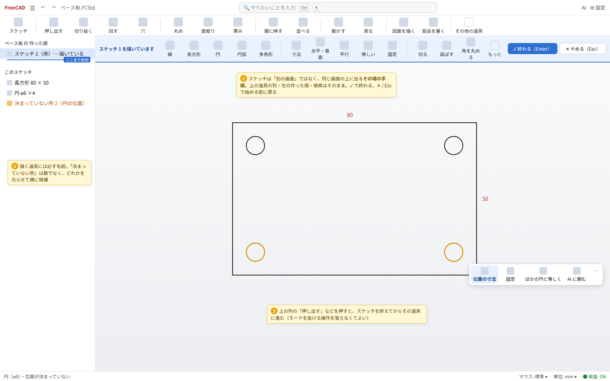
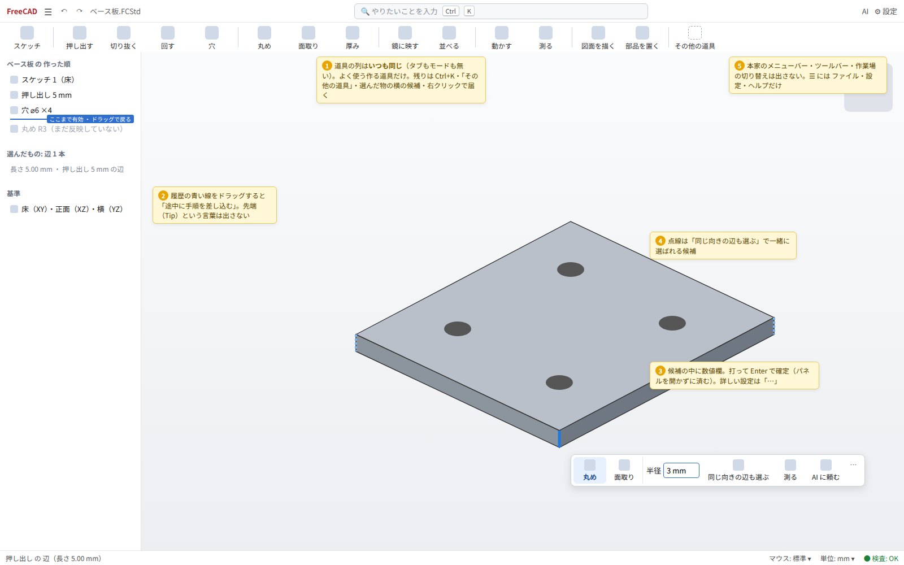
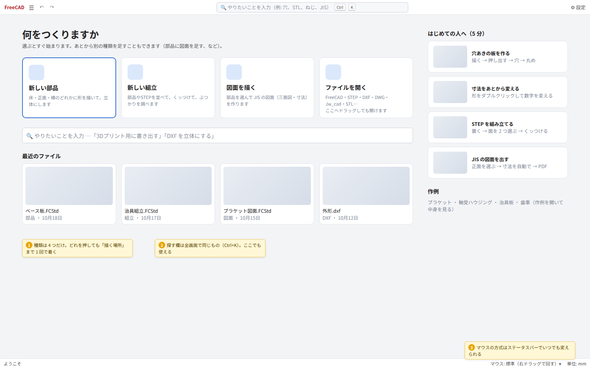
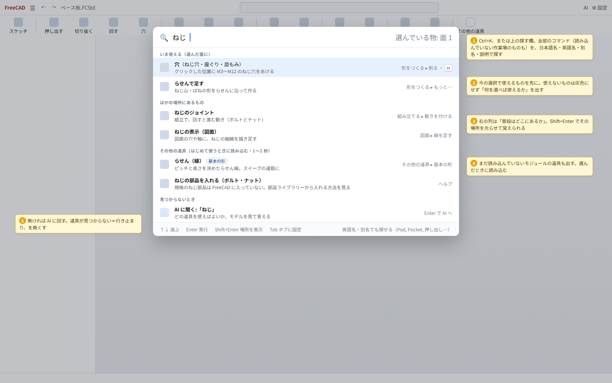
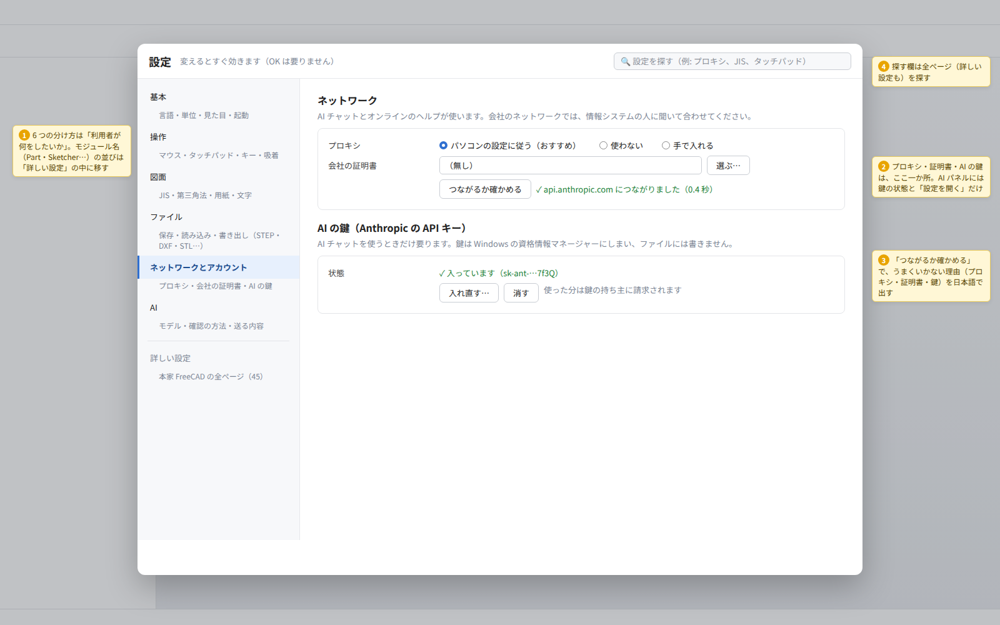
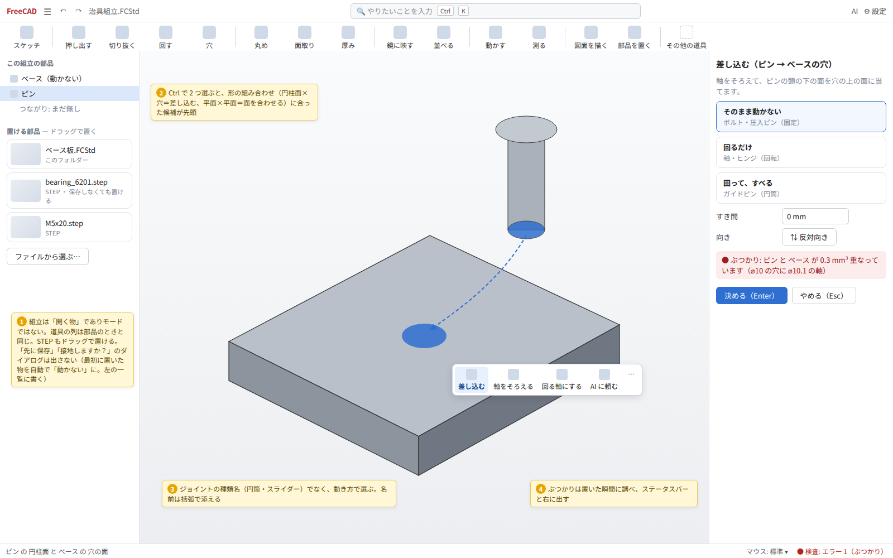
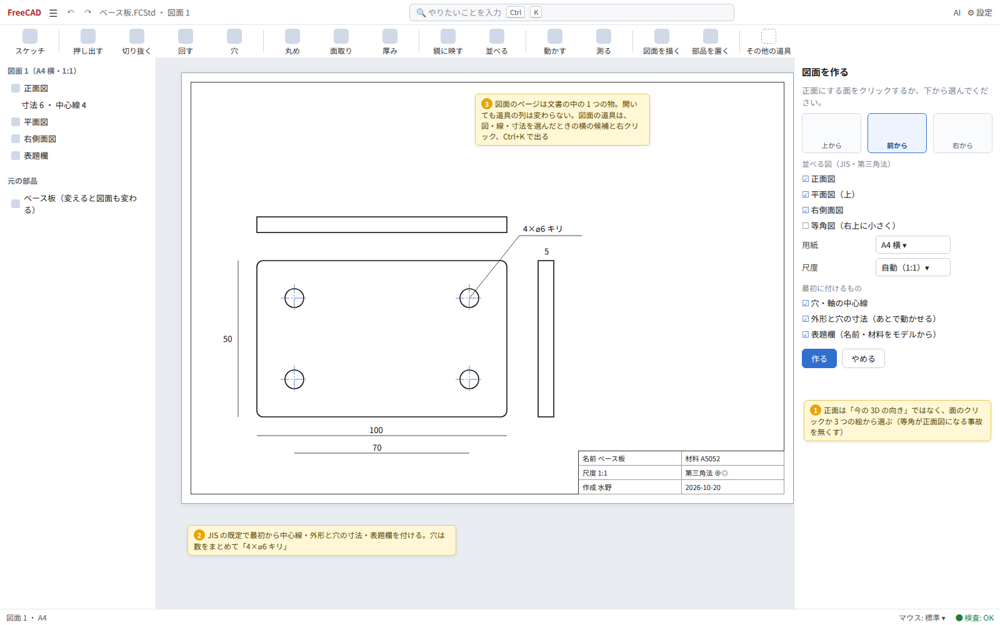
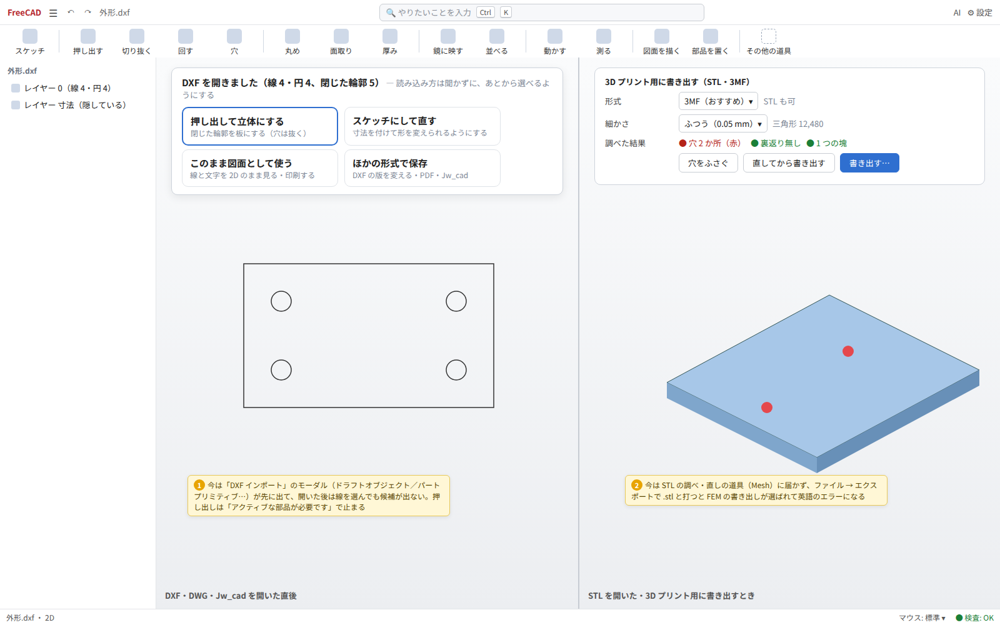

# 統合画面の作り直し（設計案）

調査日 2026-10-20 / 対象 `~/freecad-src` ブランチ `unified-ui`（作業中の「くっつける」「点から点へ動かす」を含むビルド）
改訂 2026-10-20: 翔太さんの決定（0 章）を反映。0 章と食い違う記述は 0 章が正しい

目標（翔太さんの言葉）:
「会社の人が説明なしで使える。初めて CAD を使う人でも、高度なものまで、あまり迷わずに、直感的な操作がそのまま正解になる UI」

いまの向き（作業場を切り替えない一つの画面、選んだ物の横に次の操作、平易な日本語、設計の検査、AI チャット、
マウス操作の単純化）は正しい。足りないのは「作りかけ」の部分で、作業場を外したときに届かなくなった道具（約 636 個、
[missing-operations.md](../missing-operations.md)）、コマンドを探す手段が無いこと、設定がばらばらなこと、
足していった機能どうしの言葉と置き場所がそろっていないこと。この文書は、実際に通しで使ってみた結果から、
画面全体の形と、小さく出せる順番を決める。

---

## 0. 決まったこと（2026-10-20）とモードを設けない

### 0.1 12 章の問いへの答え

| # | 問い | 決定 |
|---|---|---|
| 1 | 道具の並びの作り方 | 本家のツールバーの仕組み（ToolBarManager・ToolBarItem）の上に作る。リボンの部品は新しく作らない |
| 2 | 専門の道具箱（CAM・FEM・BIM…） | 「その他の道具」から戻す。配布物のビルド（release.yml → package/bundle/build.sh）は既定の BUILD_* が全部 ON なので FEM・CAM・BIM・Robot・OpenSCAD・点群・リバースエンジニアリング・検査が入っている（手元の build/release も同じ） |
| 3 | 1 文字の近道 | 入れる。本家の近道と重なるときはこちらを優先。**日本語入力の変換中・文字の欄にフォーカスがあるときは効かない**（QInputMethod の preedit と focusWidget で判定） |
| 4 | 「拘束」 | 言葉は「拘束」のまま、初出と道具の説明に「形の決まり（寸法・平行・直角など）」と添える。8 章の「決まり」はやめる |
| 5 | 数値の入れ方 | 選んだ物の横の候補の中の数値欄が既定。細かい設定は「…」で作業パネルを開く |
| 6 | はじめての人への見本と手順 | こちら（実装する側）で作る |

### 0.2 モードを設けない（「GUI にモードは設けたくない」）

**この節がほかの全部の節より優先する。** 以前の案の「仕事のタブ（形をつくる・組み立てる・図面・調べる…）を状態で自動に切り替える」は、
名前を変えたモードなのでやめる。画面はいつも一つで、次の 3 つだけで道具に届く。

1. **選んだ物** → その横の候補（コンテキストバー、6.4）と右クリック。何ができるかは選んだ物が決める
2. **打った言葉** → Ctrl+K の検索（6.6）。本家の全モジュールの全コマンドに届く
3. **いつも同じ道具の列** → 作る道具のうち一番よく使うものだけを、1 列・名前付きで。**何をしていても並びも中身も変わらない**

決めごと:

- **図面・組立・スケッチは「開く物」「選ぶ物」であって、モードではない。** 図面のページを開いても、組立を選んでも、道具の列・メニュー・
  パネルの配置は変わらない。図面の道具は図面の物（図・線・円・寸法）を選んだときの候補と右クリック、検索で出る
- **利用者が知っていないといけない状態を作らない。** 「アクティブなボディ」「先端」「作業場」「編集モード」を言葉にも出さず、
  前提にもしない。必要なら裏で自動で決める（押し出すと部品が無ければ作る、など）
- **避けられない作業中の状態（スケッチを描く・道具の作業パネル）は「その場の手順」として見せる。** 3D 画面の上端に
  手順の帯（何をしているか・その手順の道具・✓ 終わる／✕ やめる）を出し、周りの画面（道具の列・作った順・検索）はそのまま。
  ✕ と Esc は必ず始める前に戻す。別の画面に切り替えない（m8）
- **手順の途中で道具の列のほかの道具を押してもよい。** 今の手順を終えて（スケッチなら閉じて）から、その道具に進む。
  「モードを抜けてから」を利用者に覚えさせない
- **本家の画面の部品は消すつもりで外す。** メニューバー・本家のツールバー・作業場の切り替え・本家のスケッチャーのツールバーは出さない。
  機能は消さず、検索・「その他の道具」・候補・右クリックから届く。残す入口は「☰」（ファイル・設定・ヘルプ・その他の道具）と
  元に戻す・やり直しだけ。本家の画面に戻したい人向けに、設定 → 詳しい設定 に「本家のメニューとツールバーを出す」を 1 つだけ置く

以下の節で「タブ」と書いてある所は、この節に合わせて読み替える（6.1〜6.3・6.7・6.11・9・11 章は書き直した）。



---

この文書の中の画像:

- `current/` … いまのビルドで仕事を通しでやったときの画面（仮想画面 1600x1000・ライト）
- `m1-start.png` ほか … 新しい画面の案（HTML で描いたもの。元は `mockups/*.html`、黄色の札は説明で本物には出ない）

---

## 1. 誰が、何をするか

### 使う人

| 人 | 例 | 欲しいこと | 困ること |
|---|---|---|---|
| A. はじめて CAD を触る社員 | 物流・倉庫の現場の人、事務の人 | 治具・棚の板・ブラケットを作って 3D プリントや外注に出す | 「ボディ」「スケッチの拘束」「ワークベンチ」を知らない。英語のダイアログで止まる |
| B. 2D CAD を使ってきた人 | AutoCAD・Jw_cad で図面を描いてきた人 | 手元の DXF/DWG/JWW から立体にする、JIS の図面を出す | 3D の作り方（スケッチ→押し出し）と図面の作り方が分からない |
| C. 他の 3D CAD を使ってきた人 | SolidWorks・Fusion の経験者 | 組立・干渉・図面まで一通り | 道具の場所。英語名（Pad, Pocket）で探したい |
| D. 上級者・作る人 | 翔太さん、マクロを書く人 | 本家のほぼ全部の道具、Python | 統合のために消えた道具・情報（内部名） |

A の人が説明なしで最初の部品を作れて、B・C の人が自分の知っている言葉で道具にたどり着けて、
D の人が何も失わない、を同時に満たす。

### 主な仕事（多い順の見込み）

1. 穴のあいた板・ブラケットのような簡単な部品を作る
2. あとから寸法を変える・途中に手順を足す
3. 図面（JIS・三面図・寸法）を出す ― PDF・DXF・印刷
4. 3D プリント用に書き出す（STL・3MF）、もらった STL を直す
5. STEP 部品を並べて組み立て、ぶつかりを調べる
6. DXF・DWG・Jw_cad の図面を開いて直す・立体にする
7. 設計の検査で間違いを見つけて直す、AI に頼む

---

## 2. いまの画面を通しで使ってみた

いまのビルドを仮想画面で起動し（設定は一時フォルダ、ライト）、初めての人の手順で 7 つの仕事をした。
GUI は Python とクリックで動かし、各段階を撮った。手数は「クリック・キー入力のまとまり」で数えた。

### 2.1 簡単な部品（穴あき板・角の丸め）

| 段階 | 画面 | 見たこと |
|---|---|---|
| 起動直後 | [t0-01](current/t0-01-first-start.png) | 言語・単位・テーマだけ。良い |
| スタート | [t0-02](current/t0-02-start-page.png) | 「新しい部品」「ファイルを開く」の 2 つだけ。組立・図面・DXF から始める口が無い。文書が無いのにツールバーの押し出し・丸め…が押せる見た目 |
| 新しい部品 → 描く場所 | [t1-01](current/t1-01-pick-plane.png) | 平面をクリックするだけで良い。ただし平面の名前が XY・XZ・YZ で、初めての人には「床・正面・横」の方が分かる。ツリーにはまだ置いていない「スケッチ」が先に出ている |
| スケッチ | [t1-02](current/t1-02-sketch-empty.png), [t1-03](current/t1-03-rectangle.png) | スケッチの道具は**アイコンだけ**で名前が無い（モデルの道具には名前がある）。右のパネルは「拘束」「要素」の一覧とフィルターが大半を占める。「1-一致」「5-水平方向」… は初めての人には読めない |
| スケッチを閉じる | [t1-05](current/t1-05-after-sketch.png) | 横に「押し出す・回転・編集・AI に頼む」が出る。良い。左のプロパティ欄に「取り付けの方式」「円弧近似の許容差 1e-06」が出る |
| 押し出し | [t1-06](current/t1-06-pad-panel.png) | パネルがモデルの上に重なり、モデルが右に切れる。「開始: 輪郭平面」「タイプ: 寸法」「方向/辺: スケッチ法線」「変更時に再計算」「最終結果を表示」と、最初の 1 回に要らない項目が 9 つ |
| 辺を選ぶ | [t1-09](current/t1-09-edge-contextbar.png) | 辺 1 本をクリックすると「丸め・面取り・点から点へ・AI に頼む」。4 本の縦の辺をまとめて選ぶ手段は Ctrl で 1 本ずつだけ。「点から点へ」が辺に出るのは意味が分かりにくい |
| 丸め | [t1-10](current/t1-10-fillet-panel.png) | 選んだ辺が「辺 1・辺 2・辺 5・辺 8」と番号で並ぶ。パネルがモデルに重なる |

### 2.2 あとから直す（寸法を変える・途中に手順を足す）

| 段階 | 画面 | 見たこと |
|---|---|---|
| 面をダブルクリック | [t2-01](current/t2-01-dblclick-face.png) | 押し出しの編集が開く（良い）。ただし後の丸めが消えた状態で見える理由の説明が無い。**外形の 80 を変えたいのに、そこへ行く道（スケッチを開く）が無い** |
| 木の右クリック | [t2-02](current/t2-02-tree-rightclick.png) | 「抑制状態を切り替え」「式アクション」「リンクアクション」「依存オブジェクトを追加選択」「再計算を指定」など 25 項目。**「ここに手順を差し込む（先端を設定）」が無い**（missing-operations の 1 章）。「スケッチを編集」も無い（木の ▸ を開いて探す） |
| スケッチの寸法を変える | [t2-03](current/t2-03-edit-sketch-under-fillet.png), [t2-04](current/t2-04-dimension-dialog.png) | 寸法をダブルクリックするとモーダルの小窓。「名前」「参照」の欄がある。「まだ決まっていない所: 14 か所」と出るが、何をすれば決まるかは出ない |
| 変えた後 | [t2-05](current/t2-05-after-dim-change.png) | 板は伸びたが、穴は元の位置のまま（穴に寸法が付いていない）。初めての人の多くはこうなる。設計の検査は「情報」で 1 行出すだけ |

### 2.3 STEP を組み立てる

| 段階 | 画面 | 見たこと |
|---|---|---|
| 新しい組立 | [t3-01](current/t3-01-new-assembly.png) | メニュー 組立 → 新しいアセンブリ（メニュー名は「組立」、コマンドは「アセンブリ」） |
| 部品を挿入 | [t3-02](current/t3-02-insert-dialog.png), [t3-03](current/t3-03-insert-panel.png) | 一覧に出るのは「開いている文書」だけ。STEP は先に別の文書として開いておく必要がある。STEP の中身の名前が **「Open CASCADE STEP translator 8.0 1」** のまま出る |
| 挿入しようとする | [t3-03b](current/t3-03b-must-save-english.png) | **英語のモーダル**「The current document must be saved before inserting external parts.」 |
| 1 つ目を置く | [t3-04](current/t3-04-ground-dialog-english.png) | **英語のモーダル**「Do you want to ground the first inserted part automatically?」Yes / Always / Never / No。「ground」は CAD の専門用語 |
| 置いた後 | [t3-05](current/t3-05-assembly-placed.png) | 左の木に plate・Asm・base・pin と**開いている文書が全部並ぶ**。ピンはベースに半分めり込んだ位置 |
| ピンの面と穴の面を Ctrl で選ぶ | [t3-06](current/t3-06-two-faces-contextbar.png) | **横の候補が出ない**。ツールバーの「くっつける」「点から点へ」も灰色 |
| ジョイント | [t3-07](current/t3-07-joint-panel.png) | 組立 → ジョイント → 円筒ジョイント。パネルに題が無く、選んだ物が「…translator 8.0 1.Face7」と内部名で出る。「高度なオフセットを表示」「制限」 |
| ぶつかりを調べる | [t3-08](current/t3-08-interference-check.png) | 設計の検査は「どこにも接していない部品（浮いていないか）」を 2 件。すき間ばめのピンも「浮き」に見える |

### 2.4 図面（JIS）

| 段階 | 画面 | 見たこと |
|---|---|---|
| 新しいページ | [t4-01](current/t4-01-new-page.png) | ページが別のタブで開くが、ツールバーはモデルの道具のまま。図面の道具はメニューにだけある |
| 三面図 | [t4-02](current/t4-02-projection-group.png) | 「投影グループ」のパネル。**正面の向きが「今の 3D 画面の向き」（等角 [0.41 -0.71 0.57]）になる**。拡大縮小率は「ページ 1:1」 |
| 作った結果 | [t4-03](current/t4-03-page-views.png) | **正面図が斜めの絵になり、ページからはみ出す**。初めての人はここで詰む |
| 向きを直す（Python で） | [t4-04](current/t4-04-page-fixed-direction.png) | 正面だけ直り、側面図は古いまま。GUI で直す道は「方向」の矢印ボタン |
| 円を選ぶ・右クリック | [t4-05](current/t4-05-drawing-edge-selected.png), [t4-06](current/t4-06-drawing-rightclick.png) | 横の候補は出ない。右クリックに「円の中心線」はある。ステータスバーは「選択済み Unnamed.ProjItem.Edge11」と**内部名に戻る** |
| 直径寸法 | [t4-07](current/t4-07-diameter-dim.png) | 「⌀6」。JIS の「4×⌀6 キリ」のような穴の寸法、穴の中心線の一括、表題欄の記入はメニューに無い |

### 2.5 DXF・DWG・Jw_cad

| 段階 | 画面 | 見たこと |
|---|---|---|
| 開く | [t5-00](current/t5-00-open-dialog.png), [t5-01](current/t5-01-dxf-import-dialog.png) | 開くたびに**モーダル**「別名でインポート: 編集可能なドラフトオブジェクト / 編集可能なパートプリミティブ / 個別のパート形状（推奨）/ 結合されたパート形状（高速）」と英語「File contains approximately 0 geometric entities.」（数も 0 のまま） |
| 開いた後 | [t5-02](current/t5-02-dxf-opened.png) | 長方形が線 4 本の別々の物（Shape, Shape001…）になる。プロパティに英語の「Internal / Original Layer」 |
| 線を選ぶ | [t5-03](current/t5-03-dxf-edge-selected.png) | 横の候補が出ない（行き止まり） |
| 押し出そうとする | [t5-04](current/t5-04-dxf-extrude-active-body-dialog.png) | **「パートデザインを使用するには、ドキュメント内にアクティブな部品が必要です…パートデザインの移行機能…」**。README の「読み込んだ立体はそのまま押し出せる」は STEP の話で、DXF の線では本家のダイアログが残る |
| 中身の無い（壊れた）DXF | — | 何も言わずに空の文書が開く（エラーはレポートにだけ） |

### 2.6 3D プリント用に書き出す

| 段階 | 画面 | 見たこと |
|---|---|---|
| ファイル → エクスポート | [t6-01](current/t6-01-export-dialog.png) | 書き出せる形式が 62 拡張子（IFC・FEM・VTK・Z88… を含む）。種類の既定は 3MF |
| 名前を plate.stl にして保存 | [t6-02](current/t6-02-after-export.png) | **英語のエラー「No FEM mesh for export selected」**。.stl を受け持つのが Mesh と FEM の 2 つあり、FEM が選ばれた。ファイルはできない |
| STL を開いて選ぶ | [t6-03](current/t6-03-stl-selected.png) | 横の候補が出ない。メッシュを調べる・穴をふさぐ・立体にする道具はどこにも無い（missing-operations の 6 章） |

### 2.7 AI と設計の検査

| 段階 | 画面 | 見たこと |
|---|---|---|
| AI パネル | [t7-01](current/t7-01-ai-panel.png) | 開くと右に大きく場所を取り、閉じるまで残る。下に「AI のコードをたずねずに実行する」のチェックが常に見える |
| 鍵なしで送る | [t7-03](current/t7-03-ai-send-no-key.png) | 「AI の準備がまだです。claude-agent-sdk（下のボタンで入ります）…」。利用者に部品名（claude-agent-sdk）を見せている（配布版では入っているので出ない想定。自前ビルドの話） |
| 設計の検査 | [t7-02](current/t7-02-design-check.png) | 一覧は良い。パネルがモデルの真ん中に重なる。ボタン名が「AI に相談」（他は「AI に頼む」） |
| 設定 | [t8-01](current/t8-01-preferences.png) | 11 の分類・45 ページ。ネットワークと AI チャットは「標準」の中。「設定を検索」欄は本家に既にある |

### 2.8 メニュー

[t0-03](current/t0-03-model-menu.png)（形）、[t0-04](current/t0-04-assembly-menu.png)（組立）。言葉の混ざり方の例:

- 形 → 足す: 押し出し・回転・**加算ロフト・加算パイプ・加算らせん・加算プリミティブ**（PartDesign の直訳が残る）
- 並べる・鏡像 → **マルチ変換**、形 → **ほかの形の一部を参照**
- スケッチ → 拘束 → **並行拘束**（「平行」の誤り）、**屈折拘束**、**駆動拘束/参照拘束の切り替え**
- 組立 → **接地状態の切り替え**、**アセンブリを求解**、ジョイントは種類名（円筒・スライダー・ボール）
- 図面 → **照合番号（バルーン）**、木では「**投影図群**」、パネルは「**投影グループ**」、メニューは「三面図」（同じ物に 3 つの名前）
- 編集 → 作成 → **データム**・**リンクアクション**、表示 → その他の表示 → **テクスチャーマッピング**…
- ヘルプに英語のままの開発者向け項目（開発者ハンドブック・Python モジュールドキュメント）

---

## 3. 大きな問題（10）

重い順。各行の画像は `current/` の中。

| # | 問題 | どこで | 画像 |
|---|---|---|---|
| 1 | **道具を探す手段が無い。** 約 636 個がメニューにも無く、検索も無い。「先端を設定（途中に手順を差し込む）」「メッシュを直す」「中心線をまとめて」「文字を形に」など、仕事の途中で要るものも含む | 全体 | t2-02, t6-03 |
| 2 | **よく使う仕事が英語のモーダルや本家の概念で止まる。** STL 書き出しが FEM の英語エラー、組立の「保存が必要」「ground しますか」、DXF の押し出しで「アクティブな部品が必要」、DXF を開くたびの読み込み方ダイアログ | 組立・DXF・書き出し | t6-02, t3-03b, t3-04, t5-04, t5-01 |
| 3 | **図面の最初の一歩で壊れた図ができる。** 正面図の向きが今の 3D の向き（等角）になり、尺度 1:1 でページからはみ出す。JIS の穴寸法・中心線・表題欄の記入は届かない | 図面 | t4-02, t4-03, t4-07 |
| 4 | **選んだ物の横の候補が、モデルの外で切れる。** 組立の 2 面、図面の線・円、DXF の線、STL、寸法では何も出ない。「選べば次が出る」がこの画面の約束なのに、場所によって破れる | 組立・図面・DXF・STL | t3-06, t4-05, t5-03, t6-03 |
| 5 | **あとから直す道が細い。** 面のダブルクリックで押し出しは開くが、外形の寸法（スケッチ）へは木を開いて探す。手順を途中に差し込めない。スケッチの「決まっていない所」は数だけで、穴が置き去りになる | 履歴・スケッチ | t2-01, t2-03, t2-05 |
| 6 | **モードを利用者が知っている前提が残る。** スケッチ中はツールバーが切り替わるのに、図面のページではモデルの道具のまま。開いている文書が全部 1 本の木に並び、どれが今の物か分かりにくい | 図面・木 | t4-01, t3-05 |
| 7 | **言葉がそろっていない。** 加算ロフト・マルチ変換・接地・求解・データム・投影図群/投影グループ/三面図、並行拘束（誤字）。「AI に相談」と「AI に頼む」。ステータスバーは 3D では日本語の名前、図面では内部名 | メニュー・パネル | t0-03, t0-04, t4-05 |
| 8 | **作業パネルが重くて重なる。** 最初の 1 回に要らない項目が多く、パネルがモデルの上に重なってモデルが切れる。選んだ物は「辺 1・辺 5」「…Face7」と番号・内部名 | 押し出し・丸め・ジョイント | t1-06, t1-10, t3-07 |
| 9 | **設定がばらばら。** ネットワークと AI の鍵は「標準」の下、AI パネルには常に「たずねずに実行」、マウス方式は選べない（タッチパッドの人が困る）、本家のモジュール名の分類が 11 | 設定・AI パネル | t8-01, t7-01 |
| 10 | **スケッチの道具に名前が無く、スケッチのパネルが専門的。** モデルの道具は名前付きなのに、スケッチは 40 個のアイコンだけ。パネルは拘束の一覧（1-一致…）が中心 | スケッチ | t1-02, t1-03 |

ほかに気づいたこと（小さい）:

- STEP の中の名前が「Open CASCADE STEP translator 8.0 1」になる（自分で書き出した STEP。製品名が入っていない STEP ではファイル名を使うべき）
- 押し出しのパネルを開くとき、モデルが画面に収まるように引かない（README の「視点を合わせる」は閉じた後）
- プロパティ欄が常に左下の半分を占める（「取り付けのオフセット」「円弧近似の許容差」）
- すき間ばめのピンが設計の検査で「浮いていないか」と出る（穴の中に軸がある組は「浮き」から外す）
- 壊れた DXF を開いても何も言わない

---

## 4. 初心者向けの CAD から学ぶこと

真似ではなく、なぜ迷わないのかの原則を取り出す。公開の資料と使った経験から。

| CAD | 迷わない理由 | ここで使う原則 |
|---|---|---|
| Fusion 360 | 上の「作業（デザイン・図面・製造）」切り替えと、下の**タイムライン**（履歴を横に並べ、終わりの印をドラッグして途中に戻る）。**S キーの道具検索**。右クリックの輪状メニュー。ジョイントは「部品の点を 2 つ選ぶ」 | 履歴の「ここまで」を目に見える線にする。全部の道具をキー 1 つで探せる |
| Onshape | 文書の中に「部品」「組立」「図面」の**タブ**が並び、行き来しても同じ文書。履歴の**巻き戻しバー**。**メイトコネクタ**（面を選ぶと原点が出る）。道具の検索（ツールバーの検索）。設定は少ない | 組立・図面を「別の作業場」でなく同じ文書の別の見方にする。合わせは「面と面」で決める |
| Shapr3D | **選んだ物で道具が決まる**（何も選ばない＝描く、面＝押す/引く、辺＝丸め）。モードがほぼ無い。履歴は裏で持ち、見せるのは必要なときだけ。図面は「正面を選ぶ」から自動で投影 | 選ぶ→候補→数値、を全部の場所で守る。最初の図面は自動で正しく |
| SketchUp | **押す/引く**、**推論**（点・辺・軸に吸い付く）、画面右下の**数値入力欄**（いつでも数字を打てば今の操作に入る）、「インストラクター」（今の道具の使い方を横に出す） | 数値は打てば入る。今の道具の説明をその場で |
| Tinkercad | 形を置いて重ねるだけ。穴は「穴の形」として置く。**作業平面が面に自動で吸い付く**。整列の道具 | 最初の部品はスケッチ無しでも作れる道を残す（箱・円柱を置いて穴を引く） |

共通している原則:

1. **選んだ物が文脈。** 何を選んだかで候補が変わり、候補の中で数値まで入る
2. **道具は全部、名前で探せる。** メニューの深さに頼らない
3. **作業場の切り替えでなく、同じ文書の中の物。** 部品・組立・図面は開く物（ここでは画面の切り替えもしない。0.2）
4. **履歴は目に見えて、途中に戻れる。** 「先端」のような言葉は要らない
5. **最初の結果が正しい。** 図面の最初の三面図、組立の最初の配置が「直す前提」になっていない
6. **専門の道具は奥に、でも見つかる。** 進んだ機能は「もっと…」と検索に

---

## 5. 設計の原則

この画面のすべての決めごとは、次の 9 つで判断する。迷ったら上の原則を優先する。

1. **直感的な操作がそのまま正解。** 画面の上の物をつかむ・選ぶ・数字を打つ、で目的に着く。ダイアログで「どの方式で」と聞かない（既定で正しく動かし、変えたい人には後から選ばせる）
2. **選んでから選ぶ。** 物を選ぶと横に候補（最大 6、先頭が一番ありそうな物）。候補の中で数値まで入れて Enter で確定。何も出ない選択を作らない（最低でも「測る」「隠す」「AI に頼む」）
3. **モードを作らない（0.2）。** 画面は何をしていても同じ形。スケッチを描く・作業パネルのような避けられない状態は、同じ画面の上の「その場の手順」（✓／✕）として見せる。「アクティブなボディ」「先端」「作業場」は言葉としても出さない
4. **全部、探せば届く。** Ctrl+K の検索は本家の全コマンド（読み込んでいないモジュールも）に届く。普段の場所も一緒に見せて、次からは場所で使えるようにする
5. **少しずつ見せる。** 最初は要る項目だけ。進んだ項目は「詳しく」で開く（開いたことは覚える）。全部の道具は検索と「その他の道具」に、毎日の道具は 1 列に
6. **元に戻すはいつも安全。** 1 回の操作（AI の 1 回、検査の「全部直す」も）＝元に戻す 1 段。やめる（Esc）で必ず前の状態
7. **言葉は平易な日本語で、一つの物に一つの名前。** 用語表（8 章）に無い言葉を画面に足さない。英語名は検索と括弧書きでだけ使う
8. **設定の置き場所は一つ。** 設定は「編集 → 設定」に集める（パネルの中には状態と「設定を開く」だけ）。分け方は利用者のしたいことで
9. **画面を占めるのは、今の仕事に要る物だけ。** パネルはモデルに重ねない（重なるならモデルを避けて引く）。使っていないパネルは畳む

---

## 6. 新しい画面の形

### 6.1 窓の配置



```
┌ 1 段目: [FreeCAD] ☰ ↶ ↷  文書名        [🔍 やりたいことを入力 Ctrl+K]                 AI  ⚙設定 ┐
├ 2 段目: いつも同じ道具の列（名前付き・1 列）                                     その他の道具   ┤
├──────────────┬───────────────────────────────────────────┬───────────────┤
│ 作った順（履歴）│ [その場の手順の帯: スケッチ 1 を描いています … ✓ 終わる ✕ やめる]│ 作業パネル     │
│ ── ここまで有効 │                3D 画面 / 図面のページ                       │（使う間だけ）  │
│ 選んだ物の要点  │        選んだ物の横に候補（数値欄つき）                     │ AI（開いたとき）│
├──────────────┴───────────────────────────────────────────┴───────────────┤
│ ステータス: カーソルの下の物 ・ 選んだ物の長さ/面積            マウス ▾  単位 ▾  ● 検査: OK      │
└──────────────────────────────────────────────────────────────────────────┘
```

- **本家のメニューバーとツールバーは出さない。** 1 段目は「☰」（6.2）・元に戻す・やり直し・文書名・検索・AI・設定だけ
- 2 段目は 6.3 の「いつも同じ道具の列」。スケッチ中も図面のページでも変わらない
- その場の手順の帯は、スケッチを描いている間と道具の作業パネルが開いている間だけ 3D 画面の上端に出る（m8）
- 左は「作った順（履歴）」と「選んだ物の要点」（長さ・半径・どの手順の面か）。本家のプロパティ欄は
  「詳しいプロパティ」として畳み、選んだ物を右クリック → 詳しいプロパティ、で開く
- 木に出すのは**今の文書だけ**。ほかの文書は下のタブで切り替える（いまは全部の文書が 1 本の木に並ぶ）
- 右は作業パネルと AI。重なるときはモデルを避けて視点を引く（作業パネルを開いた瞬間に）

### 6.2 ☰（メニューの代わり）

メニューバーの 5〜9 個の上位メニューはやめ、「☰」1 つにする。中身は道具ではなく、ファイルと画面全体のことだけ。

| 項目 | 中身 |
|---|---|
| 新しい部品・新しい組立・新しい図面 | |
| 開く・最近使ったファイル ▸・保存・名前を付けて保存・閉じる | |
| 読み込む…・書き出す ▸（3D プリント用・ほかの CAD へ・2D・画像・すべての形式） | |
| 印刷… | |
| その他の道具…（6.7） | 道具を種類ごとに一覧する窓 |
| 表示 ▸ | 向き・表示の仕方・パネル・全画面（本家の「表示」メニューの中身） |
| 設定…・キーの一覧・はじめての人へ・この版について・問題を知らせる | |
| 終わる | |

本家のメニューの項目はすべて検索（6.6）に入るので、☰ に無くても届く。

### 6.3 いつも同じ道具の列

作る道具のうち一番よく使うものだけを 1 列に、アイコンと名前で並べる。並びも中身も**状態で変わらない**。

| グループ | 道具（1 文字の近道） |
|---|---|
| 描く | スケッチ（S） |
| 形 | 押し出す（E）・切り抜く（C）・回す・穴（H） |
| 仕上げ | 丸め（F）・面取り・厚み |
| 並べる | 鏡に映す・並べる |
| 置く | 動かす（M）・測る（D） |
| 物 | 図面を描く・部品を置く（組立） |
| ほか | その他の道具…（6.7） |

- 今の選択で使えない道具も灰色にせず押せる。押すと「何を選べば使えるか」をステータスバーと候補の位置に出し、選ぶのを待つ
- スケッチを描いている間に押したら、スケッチを終えてからその道具に進む（0.2）
- 1 文字の近道は 3D 画面・作った順にフォーカスがあるときだけ効く。日本語入力の変換中と文字の欄では効かない（0.1 の 3）
- スケッチの描く道具（線・長方形・円…・寸法・拘束）は、この列ではなく手順の帯（m8）に名前付きで出る

### 6.4 選んだ物の横の候補（コンテキストバー）の規則

規則: 候補は最大 6。先頭が一番ありそうな物（強調）。最後は「…」（その選択で使える全部＝検索の絞り込み）。
数値の要る道具は先頭に数値欄を出し、Enter で確定（作業パネルは「…」→詳しく、で開く）。
「AI に頼む」は常に最後から 2 番目。何も当てはまらない選択でも「測る」「隠す」「AI に頼む」は出す。

| 選んだ物 | 候補（左から） | 数値欄 |
|---|---|---|
| 何も選ばない（画面の空き所をクリック） | 出さない。代わりに空き所の右クリックで「スケッチ・箱を置く・読み込む・貼り付け」 | — |
| 平らな面（部品の） | スケッチ・押し出す（足す/削るを向きで自動）・穴・厚み・くっつける・AI | 押し出しの長さ |
| 円柱の面（穴・軸） | 穴を変える（径・ねじ）・ねじにする・軸をそろえる・測る（径）・AI | 径 |
| 直線の辺 | 丸め・面取り・**同じ向きの辺も選ぶ**・測る・AI | 半径/距離 |
| 円の辺 | 丸め・面取り・**同じ大きさの円も選ぶ**・中心を使う（点から点へ）・測る・AI | 半径 |
| 点（頂点） | 点から点へ・ここにスケッチ・測る・AI | — |
| スケッチ（閉じた後） | 押し出す・切り抜く・回す・編集・AI（いまと同じ） | 長さ |
| 手順（木で押し出し・丸めなど） | 編集・**元のスケッチを編集**・**ここに差し込む**・一時的に無効・AI | — |
| 部品（ボディ・読み込んだ立体） | 動かす・くっつける・複製・鏡に映す・並べる・隠す | — |
| 2 つの面（別の部品・Ctrl） | 平面×平面: 面を合わせる・くっつける / 円柱×円柱・円柱×穴: **差し込む**・軸をそろえる / それ以外: 点から点へ・距離を測る（「くっつける」「点から点へ」は 0.5.8 のもの） | すき間 |
| 2 つの点（Ctrl） | 点から点へ（0.5.8）・距離を測る | — |
| 組立の中の部品 | 動かす・合わせる（次に面を選ぶ）・固定/解除・部品を開く・隠す | — |
| つながり（ジョイント） | 編集・一時的に無効・動かして試す・消す | — |
| 読み込んだ STL（メッシュ） | **調べて直す**・立体にする・倍率を変える・3D プリント用に書き出す | 倍率 |
| DXF/DWG/JWW の線 | **輪郭を押し出す**・スケッチにする・つないで面にする・レイヤーを隠す | 長さ |
| 図面の円（投影図の） | **穴の寸法**（同じ穴をまとめて「4×⌀6」）・直径・中心線・ねじの線 | — |
| 図面の直線 | 長さ寸法・中心線（2 本選んだとき）・線の太さ/種類 | — |
| 図面の 2 本の線 | 距離・角度・中心線 | — |
| 図面の投影図 | 寸法を自動で・断面図・部分拡大・尺度 | 尺度 |
| 寸法（図面） | ⌀・□・n× を付ける・公差・はめあい・小数の桁 | 公差 |
| 設計の検査の行 | 直す・その場所へ・わざと（無視）・AI | — |

規則は `ContextBar.cpp` の if 文の並びから、**表（データ）に移す**（`Mod/Unified/ContextRules.py` のような 1 か所。
選択の型 → 候補の列）。表にしておけば、試験で「選択の型ごとに候補が 1 つ以上ある」を全部確かめられる。

### 6.5 スタート画面



- 「何をつくりますか」: 新しい部品・新しい組立・図面を描く・ファイルを開く の 4 つ（どれも 1 回で仕事の最初の画面へ）
- やりたいことの検索欄（全画面の検索と同じもの）
- 最近のファイル（絵と種類つき）、ドラッグ＆ドロップで開く
- 右に「はじめての人へ」（5 分の手順 4 つ。押すと見本の文書が開き、右に手順が出る）と作例
- 「次回から表示しない」「初回起動設定を開く」は設定へ移す（いまは下の帯にある）

### 6.6 道具の検索（Ctrl+K）



- 開き方: Ctrl+K、上の検索欄、ヘルプ → 道具を探す、「もっと…」
- 探す対象: 本家の全コマンド（約 997。統合版で読み込んでいない作業場も）、日本語名・英語名・別名（Pad、Pocket、
  Extrude、押出、穴あけ、キリ…）・説明。設定の項目も「設定: …」として出す
- 並び: 言葉の一致の強さを先に、同じくらいなら「いま使える（今の選択で）」→「ほかの場所にあるもの（普段の場所付き）」→「その他の道具（はじめて使うときに読み込む）」
  →「見つからないとき: AI に聞く」
- 選ぶと実行。行の右に「どこにあるか」（道具の列・候補・右クリック・その他の道具）を出し、次からは場所でも使えるようにする
- しくみ: ビルドのときに全コマンドの目録（名前・訳・説明・属するモジュール・アイコン）を JSON に書き出して同梱する
  （`missing-operations.md` の調べ方と同じく、全作業場を読み込んだ画面なしの FreeCAD でたどる）。
  まだ読み込んでいないモジュールの道具を選んだら、そのモジュールを読み込んでから実行する（e3111a52d の
  「画面は統合版のままコマンドだけ登録」を使う）。読み込みは 1〜2 秒なので「読み込み中…」を出す
- 別名表は `docs/glossary.md` と `terms.py` に足す（英語名・本家の訳・旧名 → 今の名前）

### 6.7 「その他の道具」と 636 個の戻し方

3 段で戻す。README の「機能は消していない」を本当にする。

| 段 | 何を | 数（目安） | どこに |
|---|---|---|---|
| ① 毎日の場所へ | missing-operations で頻度「高」「中〜高」のもの: 先端を設定（→ 履歴の「ここまで有効」線と右クリック「ここに差し込む」）、手順の移動、Part の和・差・積・鏡像・拡大縮小、メッシュ→立体、リンク配列（並べる）、文字を形に、DXF→スケッチ、図面の中心線・スマート寸法・穴寸法・はめあい・表面性状・PDF、アセンブリのねじ・歯車・剛体グループ・シミュレーション | 約 40 | 候補・右クリック（道具の列は増やさない） |
| ② その他の道具 | 残りのモデリング・2D・メッシュ・図面・表・材料。種類ごとに: **基本の形**（箱・円柱・らせん・くさび…）、**形の加工**（オフセット・断面・輪切り・面から面へ・まとめる/ばらす・分割）、**メッシュ・STL**（調べる・穴をふさぐ・裏返り・間引き・展開）、**2D の作図**（Draft の線・文字・配列・寸法・レイヤー）、**図面の追加**（化粧線・ハッチ・溶接・破断図・表）、**曲面**、**歯車・軸**、**表・変数**、**材料** | 約 280 | 「その他の道具」の窓（種類ごとの一覧。はじめて使う道具のモジュールはそのとき読み込む） |
| ③ 専門の道具箱 | CAM（加工）・FEM（解析）・BIM（建築）・OpenSCAD・ロボット・点群・リバースエンジニアリング・検査 | 約 314 | 「その他の道具 → 専門の道具箱」。選ぶとそのモジュールを読み込み、道具の一覧を「その他の道具」の窓に出す（画面も道具の列も切り替えない。作業場は出さない） |

どの段の道具も検索（6.6）で届く。②③は「はじめて使うときに読み込む」ので起動は遅くならない。
アドオン管理は戻さない（作業場を足す仕組みのため）が、マクロの入手口はヘルプ → マクロを探す（ブラウザ）で案内する。

### 6.8 作業パネルの規則

- 開いた瞬間に、パネルを避けてモデルが見えるように視点を引く（いまは閉じた後だけ）
- 最初に見せる項目は 3 つまで（例: 押し出し＝長さ・向き・反対向き）。残りは「詳しく ▸」
- 選んだ物は番号でなく「押し出しの縦の辺 ×4」「ピンの円柱の面」と場所の言葉で
- 題を必ず付ける（ジョイントのパネルは題が無い）
- 確定は Enter、やめるは Esc。OK/キャンセルは上と下の両方に置かない（下に 1 組）
- プレビューの切り替え・「変更時に再計算」は出さない（常に入）

### 6.9 設定



| 分類 | 中身 |
|---|---|
| 基本 | 言語・単位・小数の桁・テーマ・文字の大きさ・起動時に開く物・スタート画面 |
| 操作 | マウスの方式（標準・タッチパッド・本家の各方式）・回転の中心・吸着・キーの割り当て・Esc でスケッチを抜けるか |
| 図面 | 規格（JIS）・第三角法・用紙・文字・寸法の書き方・表題欄 |
| ファイル | 保存（自動保存・バックアップ）・読み込み（STEP・DXF/DWG/JWW・STL・IGES・IFC… 形式ごと）・書き出し |
| ネットワークとアカウント | プロキシ・会社の証明書・つながるか確かめる・AI の鍵（0.5.7 の「ネットワーク」「AI チャット」ページをここへ移す） |
| AI | モデル・確認の方法（たずねずに実行は**ここ**へ。AI パネルからは外す）・送る内容（画面の画像・検査の結果）・記録 |
| 詳しい設定 | 本家の全ページ（いまの 11 分類 45 ページをそのまま） |

- 変えるとすぐ効く（OK・適用は要らない。閉じるだけ）
- 探す欄は「詳しい設定」まで含めて探す
- AI パネルに残すのは「鍵の状態」と「設定を開く」だけ。鍵が無いときの「API キーを入れる…」は、送ったときに
  設定のその場所を開く

### 6.10 組立



- 左に「置ける部品」（同じフォルダーの FCStd・STEP、最近使った部品）。ドラッグで置く。STEP は**保存しなくても**置ける
  （いまは「先に保存」の英語ダイアログ。保存していなければ置く前に黙って一時保存し、最初の保存で場所を聞く）
- 最初に置いた部品は自動で「動かない」にして、左の一覧に「（動かない）」と書く（いまの英語の「ground しますか？」は出さない）
- 2 つの面を Ctrl で選ぶと、形の組み合わせに合った候補（6.4）。「差し込む」は軸をそろえて当たり面を合わせる
- ジョイントは動き方の言葉で選ぶ（そのまま動かない＝固定、回るだけ＝回転、回ってすべる＝円筒…）
- 置いた・合わせた瞬間にぶつかりを調べ、ステータスバーと作業パネルに出す（設計の検査と同じ判定）。すき間ばめの軸は「浮き」にしない

### 6.11 図面



- 「図面を描く」（スタート・道具の列・部品の右クリック）→ 右に「図面を作る」: **正面にする面をクリック**するか、上から・前から・右から の
  3 つの絵から選ぶ（いまは今の 3D の向きをそのまま使い、等角が正面図になる）
- 並べる図（JIS・第三角法）・用紙・尺度（自動）
- 最初に付ける物（既定で入）: 穴・軸の中心線、外形と穴の寸法（同じ穴をまとめて「4×⌀6 キリ」）、表題欄（名前・材料・日付をモデルから）
- 図面のページは文書の中の物。開いても道具の列は変わらない。図面の道具は、図・線・円・寸法を選んだときの候補と右クリックで出る
- 書き出しは PDF・DXF（ページを選んだときの候補と ☰ → 書き出す）

### 6.12 読み込みと書き出し



- DXF・DWG・JWW を開くとき**読み込み方を聞かない**（既定＝「個別のパート形状」。変えたい人は設定のファイル → DXF）。
  開いた後の上部に「この図形でできること」（押し出して立体にする・スケッチにして直す・このまま図面として使う・ほかの形式で保存）
- 線を選んでも同じ候補（6.4）。押し出すときは自動で部品を作る（STEP と同じ扱い。「アクティブな部品が必要」を出さない）
- 中身の読めない DXF は「読める図形がありませんでした（DXF ではないファイルかもしれません）」と言う
- ファイル → 書き出す は目的別: 「3D プリント用（3MF・STL）」「ほかの CAD へ（STEP・IGES）」「2D（DXF・SVG・PDF）」「画像」「すべての形式…」。
  3D プリント用は細かさ・調べた結果（穴・裏返り・塊の数）・「直してから書き出す」を 1 つの画面で
- .stl は必ず Mesh の書き出しへ（FEM の書き出しは FEM の物を選んでいるときだけ）

---

## 7. 主な仕事の流れ（新しい画面で）

手数は「いま → 案」。いまの数は 2 章で実際にやったもの。

### 7.1 穴あき板（80×50×5、⌀6 の穴 4 つ、角 R3）

1. スタート → 新しい部品 → **床**をクリック（いま: 同じ。平面の名前を床・正面・横に）
2. 長方形（名前付き）→ 2 点 → 80 Tab 50 Enter
3. 閉じる → 横の候補の数値欄に 5 → Enter（いま: 押し出す → パネル → 長さ → OK）
4. 上の面をクリック → 「穴」→ 位置をクリック（4 回）→ 数値欄に ⌀6 → Enter
   （いま: スケッチに円 4 つ・寸法を手で付ける。案: 穴の道具は「同じ穴を n か所」と、縁からの距離をその場で出す）
5. 縦の辺を 1 本クリック →「同じ向きの辺も選ぶ」→ 数値欄に 3 → Enter
- 手数: いま 約 30 → 案 約 14

### 7.2 あとから直す

- 面をダブルクリック → その面を作った手順が開く（いま同じ）。開いたパネルの先頭に「元のスケッチを編集」
- 寸法の数字を直接ダブルクリック → その場で数字を打つ（モーダルの小窓にしない）
- 途中に足す: 履歴の青い線（ここまで有効）をドラッグで戻す → 足す → 線を一番下へ戻す。または木の手順を右クリック → ここに差し込む
- スケッチの「決まっていない所」を押すと、決まっていない点・線が光り、横に「寸法を付ける」「固定」の候補

### 7.3 STEP を組み立てる

1. スタート → 新しい組立（保存を聞かない）
2. 左の「置ける部品」から STEP をドラッグ（1 つ目は自動で動かない）
3. ピンの円柱の面 → Ctrl → 穴の面 → 横の候補「差し込む」→ 動き方（そのまま／回るだけ…）→ Enter
4. ぶつかりはステータスバーに常に出る。押すと一覧
- 手数: いま 約 18（英語ダイアログ 2 回・別文書で開く・メニュー 3 段）→ 案 約 7

### 7.4 JIS の図面

1. 部品を右クリック → 図面を描く（またはスタート → 図面を描く → 部品を選ぶ）
2. 正面にする面をクリック → 「作る」（中心線・外形と穴の寸法・表題欄が付いた三面図）
3. 足りない寸法: 線や円をクリック → 横の候補 → 置く
4. ページを選ぶ → 候補の「PDF に」
- 手数: いま 約 15＋向きの直し（GUI では矢印ボタンで手探り）→ 案 約 6

### 7.5 DXF から立体に

1. ファイルを開く → DXF（聞かれない）→ 上部の「押し出して立体にする」→ 長さ → Enter
2. 直したいときは「スケッチにして直す」→ 寸法を付ける
- いま: ダイアログ 2 回で止まる → 案 3〜4

### 7.6 3D プリント

1. ファイル → 書き出す → 3D プリント用 → 調べた結果を見る →（穴があれば）直してから書き出す
- いま: FEM の英語エラーで止まる → 案 3

### 7.7 AI と設計の検査

- ステータスバーの「検査」→ 一覧 → 行を選ぶと横に「直す・その場所へ・わざと・AI に頼む」
- AI パネルは右上の「AI」で開閉。開いていないときは場所を取らない。たずねずに実行は設定へ

---

## 8. 用語表

一つの物に一つの名前。左が画面に出す言葉、右は置き換える前・英語名（検索の別名にも入れる）。

| 画面の言葉 | 置き換える前・英語 | メモ |
|---|---|---|
| 部品 | Body・ボディ・パート | 「新しい部品」。Part（App::Part）は「組」（6 章）|
| 組立 | アセンブリ・Assembly | ☰・道具の列・コマンドとも「組立」（いまは「新しいアセンブリ」が混ざる）|
| 組 | 新しい組（部品をまとめる）・App::Part | |
| 作った順（履歴） | モデルツリー・フィーチャー | |
| ここまで有効 | 先端（Tip）・先端を設定 | 線で見せる。言葉は出さない |
| スケッチ | Sketch | |
| 描く場所 | 取り付け・アタッチメント・サポート | 「スケッチを貼る場所を変える」|
| 床・正面・横 | XY 平面・XZ 平面・YZ 平面 | 括弧で XY などを添える |
| 基準（面・線・点） | データム・Datum | |
| 拘束（形の決まり） | Constraint | 言葉は「拘束」のまま。初出・説明に「形の決まり（寸法・平行・直角など）」と添える（0.1 の 4）|
| 平行 | 並行拘束（誤字） | |
| 点をつなぐ | 一致拘束 | |
| 押し出す / 切り抜く | Pad / Pocket | いまどおり |
| 面を動かす | Push/Pull・プッシュプル | 面の矢印をドラッグ、または候補の数値欄。外へ＝足す、内へ＝削る（0.6.7）|
| 形の上の寸法 | 寸法の注記・Driving dimensions | 選んだ物の寸法を形の上に札で出す。クリックして打ち直す（0.6.7）|
| 回す / 回して削る | 回転・Revolution / 回転切り抜き・Groove | |
| ロフトで足す / ロフトで削る | 加算ロフト / 減算ロフト | |
| なぞって足す / なぞって削る | 加算パイプ / 減算パイプ（Sweep）| |
| らせんで足す / らせんで削る | 加算らせん / 減算らせん | |
| 箱・円柱などを足す / 削る | 加算プリミティブ / 減算プリミティブ | |
| 並べ方を組み合わせる | マルチ変換・MultiTransform | |
| 鏡に映す | 鏡像・ミラー | 作った物の名前は「鏡に映した形」|
| まっすぐ並べる / 円に並べる | 直線配列 / 円周配列（パターン） | 作った物の名前は「直線の並び」「円の並び」（0.7.0）|
| 測る | 測定 | |
| 動かす | 変形・動かす・回す | |
| 書き出す / 読み込む | エクスポート / インポート | |
| 円（中心から）・円（3 点）・長方形（中心から） | 中心点による円・3点による円・中心配置長方形 | スケッチの道具は「形（描き方）」。拘束の道具は「平行」「直角」「点をつなぐ」など（「拘束」は説明に）|
| 未反映 | （先端より後ろ） | 「ここまで有効」線より下の手順。灰色の斜体 |
| 詳しく ▸ | （作業パネルの全項目） | 道具のパネルで、最初の項目以外をしまう所。開いたことは道具ごとに覚える |
| 足し合わせ / 引き算 / 重なり | ブーリアン・和・差・積 | |
| 別の部品の形を使う | 形状バインダー・ほかの形を参照 | |
| 一時的に無効 | 抑制・Suppress | |
| 動かない（固定） | 接地・Ground | |
| つながり（ジョイント）| ジョイント | 種類は動き方で（固定・回るだけ・回ってすべる・すべるだけ・玉・距離…）|
| つながりを計算し直す | アセンブリを求解 | |
| 三面図 | 投影グループ・投影図群・ProjectionGroup | 3 つの名前を 1 つに |
| 部品番号（バルーン） | 照合番号 | |
| 中心線 | センターライン | |
| 調べる / 検査 | 形のチェック・設計の検査 | 「形が壊れていないか調べる」は検査の 1 項目に |
| 三角形の網（メッシュ）| メッシュ | 初出だけ括弧 |
| AI に頼む | AI に相談 | 統一 |
| 詳しいプロパティ | プロパティ・データ | |

---

## 9. 消す・まとめる・名前を変える

| 対象 | どうする | 理由 |
|---|---|---|
| 本家のツールバー全部（ファイル・表示・マクロ・スケッチャー…） | 出さない（元に戻す・やり直しだけ 1 段目へ） | 0.2。検索・☰・候補・ナビキューブにある |
| メニューバー | 出さない（☰ に置き換え） | 0.2。全項目は検索に入る |
| 作業場の切り替え・本家のスケッチャーのツールバー | 出さない | 0.2。スケッチの道具は手順の帯へ |
| 動かす・回す（変形）と 配置 | 1 つの「動かす」（ドラッグ＋数値欄） | 同じ目的の 2 つの入口 |
| 測定・質量プロパティ・形のチェック | 道具の列の「測る」と候補・検索へ | |
| AI の入口（メニュー・ツールバー・右上） | 右上と候補だけ | 3 か所は多い |
| 木に全部の文書 | 今の文書だけ | どれが今か分からない |
| 左下のプロパティ欄（常時） | 「詳しいプロパティ」として畳む | 初めての人に要らない情報が常に半分 |
| 右クリックの「式アクション」「リンクアクション」「依存オブジェクトを追加選択」「再計算を指定」「ツリー設定」 | 「詳しく ▸」の中へ | 25 項目は多い |
| スタートの「初回起動設定を開く」「次回から表示しない」 | 設定 → 基本 | |
| AI パネルの「たずねずに実行」 | 設定 → AI | 危ない切り替えを常に見せない |
| 作業パネルの「変更時に再計算」「最終結果を表示」 | 出さない（常に入） | |
| DXF 読み込みのダイアログ | 出さない（設定に移す） | 毎回聞く |
| 組立の「保存が必要」「ground しますか」 | 出さない | 2.3 |
| 英語のまま残る文（2.3〜2.6） | 訳す（UnifiedWording_ja.ts、実行時の文は prop_extra_ja.py の RUNTIME） | |

---

## 10. 使いやすさ（キーボード・タッチパッド・見え方）

- **タッチパッド**: マウスの方式を戻す（設定 → 操作、ステータスバーの「マウス ▾」）。初回起動で「マウス／タッチパッド」を聞く。
  タッチパッドの既定は 2 本指で回す・Shift＋2 本指で移動・つまんで拡大縮小（本家の Gesture/Touchpad 方式）
- **キーボード**: Ctrl+K 検索、Enter 確定・Esc 一段戻る（どこでも同じ）、Tab で候補の間を移る、道具の列に 1 文字の近道
  （スケッチ S・押し出す E・切り抜く C・穴 H・丸め F・動かす M・測る D。本家の近道より優先。日本語入力の変換中と文字の欄では効かない）、
  キーの一覧はヘルプと検索に
- **見え方**: 色だけで伝えない（検査のエラーは色＋記号＋文字）、文字の大きさを設定で変えられる（基本）、高 DPI でアイコンがにじまない
- **言葉**: 道具には必ず名前（アイコンだけにしない。スケッチの道具も）。ツールチップは「何が起きるか」を 1 文で

---

## 11. 段階的な実装（小さく出す）

どの段階も 1 つのリリース（0.6.x）で出せて、前の段階が無くても壊れない大きさにする。受け入れは仮想画面（xvfb）で
スクリプトから GUI を動かして撮り（`~/kantan-cad/tools/guictl` と `tests/ui/`）、撮った画像を `docs/ui-redesign/accept/<段階>/` に置き、
案の画像（m1〜m8）と 2 章の画像と見比べる。単体の試験（Python の unittest、FreeCAD の試験の仕組み）も段階ごとに足す。

0.5.7（ネットワーク・AI の設定ページ、Windows の引数、AI の SSL・プロキシ）と 0.5.8（「くっつける」「点から点へ動かす」）は
出た後の版を土台にし、機能は作り直さずに新しい画面の入口（検索・候補・☰）へつなぐ。

| 段階 | 中身 | 受け入れ（画像と試験で確かめること） |
|---|---|---|
| **P0 行き止まりを無くす**（0.6.0） | ① .stl の書き出しは Mesh へ（FEM は FEM の物のときだけ）② 組立の「保存が必要」「ground しますか」を出さない（自動で一時保存・最初の部品を固定）③ DXF 読み込みのダイアログを既定で出さない ④ DXF の線を押し出すとき自動で部品にする（「アクティブな部品が必要」を出さない）⑤ 三面図の正面を今の 3D の向きにしない（部品の一番大きい平らな面、なければ前）、尺度は自動 ⑥ 図面のステータスバーを表示名に ⑦ STEP の名前が無いときはファイル名 ⑧ 2.3〜2.6 の英語の文を訳す ⑨ 並行→平行、「AI に相談」→「AI に頼む」、ほか用語表とのずれ | t6-02・t3-03b・t3-04・t5-01・t5-04・t4-03 と同じ操作をスクリプトで行い、英語・モーダル・崩れた図が 1 つも出ないこと。STL ができて Mesh で読めること |
| **P1 道具の検索**（0.6.1） | Ctrl+K と 1 段目の検索欄。全モジュールの全コマンドの目録（ビルド時に画面なしで全作業場を読み込んで JSON に）、日本語名・英語名・別名・説明、選んだらモジュールを読み込んで実行、今の選択で使える物を先に、無ければ「AI に聞く」 | 「先端」「MoveTip」「STL 直す」「歯車」「中心線」「Pad」「IFC」で 1 件目が正しい物。読み込んでいないモジュールの道具（歯車・メッシュの穴埋め）を選んで実行できる。目録が本家のメニュー・ツールバーの 997 個を全部含む。起動が 0.1 秒以上延びない |
| **P2 本家の画面を外す**（0.6.2） | メニューバー・本家のツールバー・作業場の切り替えを出さない。1 段目（☰・元に戻す・やり直し・検索・AI・設定）と、いつも同じ道具の列（6.3）。「その他の道具」の窓（種類ごと、専門の道具箱はそこで読み込む）。1 文字の近道（日本語入力の変換中と文字の欄では効かない）。右クリックに「ここに差し込む・元のスケッチを編集・手順を移動」。設定に「本家のメニューとツールバーを出す」 | m2 と並べる。スケッチ中・図面のページ・組立を開いた状態で道具の列が同じであること（3 枚）。missing-operations の付録の全コマンドが検索か「その他の道具」で届く（届かない 0、自動で数える）。近道が変換中に効かない試験 |
| **P3 その場の手順**（0.6.3） | スケッチを描く間・作業パネルの間、3D 画面の上端に手順の帯（何をしているか・その手順の道具に名前・✓ 終わる・✕ やめる）。スケッチの道具は帯に出し、本家のスケッチャーのツールバーは出さない。手順の途中で道具の列を押したら手順を終えてから進む。Esc は必ず始める前に戻す | m8 と並べる。スケッチを開いても道具の列・作った順・検索が同じ位置にあること。✕ で前の状態に戻る試験 |
| **P4 候補の規則を表に・数値欄**（0.6.4） | 6.4 の表を実装（ContextRules にデータとして）、候補の中の数値欄を既定に（「…」で作業パネル）、同じ向きの辺・同じ大きさの円、組立の 2 面、図面の線・円・図・ページ、STL、DXF | 表の全行の型を自動で作って選び、候補が 1 つ以上出ることを試験で。画像は 2 面・図面の円・STL・DXF の 4 枚 |
| **P5 設定と AI パネル**（0.6.5） | 設定の 6 分類＋詳しい設定、すぐ効く、AI パネルから「たずねずに実行」と鍵のボタンを外す、マウスの方式（タッチパッド） | m4 と並べて同じ分け方。設定の検索で「プロキシ」「JIS」「タッチパッド」が 1 件目 |
| **P6 履歴と作業パネル**（0.6.6） | 履歴の「ここまで有効」線（ドラッグ）、今の文書だけの木、詳しいプロパティを畳む、作業パネルを開いた瞬間に視点を引く、項目を 3 つまで＋詳しく、場所の言葉で選んだ物を表示、寸法をその場で打つ | 7.2 の流れを撮る。パネルがモデルに重ならない |
| **P7 スタート画面と見本**（0.6.7） | 4 つの始め方、最近のファイル（絵）、はじめての人へ（見本の文書と手順はこちらで作る） | m1 と並べる。4 つとも 1 回で最初の画面に着く |
| **P8 図面の流れ**（0.6.8） | 図面を作るパネル（正面のクリック・3 つの絵）、中心線・外形と穴の寸法・表題欄を最初に、穴の寸法「n×⌀d キリ」 | 2.1 の板で 7.4 を通す。中心線 4・穴の寸法 1・外形寸法 2 が付いた A4 の PDF |
| **P9 組立の流れ**（0.6.9） | 置ける部品の一覧（STEP をドラッグ）、差し込む・面を合わせる（0.5.8 の数学を使う）、動き方の言葉、置いた瞬間のぶつかり、すき間ばめを浮きにしない | 7.3 を通す（英語 0・モーダル 0、手数 7 以内） |
| **P10 読み込み後の案内と 3D プリント**（0.6.10） | DXF/DWG/JWW を開いた後の「できること」、STL の調べる・直す・立体にする、目的別の書き出し、3D プリント用の画面 | 7.5・7.6 を通す（m7 と並べる） |

各段階の共通の確かめ方:

- 本家の試験（`LANG=C.UTF-8`、--hidden なし）が今と同じ数だけ通る
- `scan_english.py` で英語の残りが増えていない
- 新しい言葉が 8 章の用語表にある（無い言葉は足さない）
- 2 章の 7 つの仕事のうち、その段階で触った物を撮り直し、`accept/` に置く

---

## 12. 決めてほしいこと・確かめること（1〜6 は 0.1 で決定済み）

1. 道具の並びは、本家のツールバーの仕組みの上に作る形でよいか（リボンの部品を新しく作らない）
2. 「その他の道具」の専門の道具箱（CAM・FEM・BIM）を戻してよいか。戻すなら配布物のビルドに FEM/CAM を入れる（いまのリリースの構成を確かめる）
3. 1 文字の近道を入れるか（本家の近道と重なる物の扱い）
4. スケッチの「拘束」を画面で「決まり」と呼ぶか、「拘束」のまま説明を添えるか（会社の人に 2 案を見せて決めたい）
5. 押し出しの数値をその場で打つ方式（候補の数値欄）と、いまの作業パネルのどちらを既定にするか
6. 「はじめての人へ」の見本の文書と手順を誰が作るか（P7）

確かめが要ること（この調査では未確認）:

- タッチパッド方式・1 文字の近道が日本語入力のオンで効くか
- Windows の高 DPI（125%・150%）で道具の列・候補が崩れないか（Windows 機 192.168.10.2 で）

---

## 13. 実装の状況（2026-10-21、0.7.0 で作り直しの全段階が済み）

受け入れの画面と結果は `accept/P*/`（`tests/ui/p*_walkthrough.py` を仮想画面で動かして撮る。result.json が判定）。

0.6.2 の Linux の AppImage（公開したもの）で P0〜P10 の手順を全部通した（全項目合格）。

| 段階 | 版 | 状況 |
|---|---|---|
| P0 行き止まり | 0.6.0 | 済み。0.6.0 の AppImage でも P0 の手順を通した（STEP の名前だけ、本体の別の読み込み経路の漏れが見つかり 0.6.2 で直した） |
| P1 道具の検索 | 0.6.1 | 済み。目録はビルド時に画面なしの FreeCAD で作る（できないときはソースの写し） |
| P2 本家の画面を外す | 0.6.1 | 済み（☰・道具の列・その他の道具・1 文字の近道・右クリック） |
| P3 その場の手順 | 0.6.1 | 済み（スケッチと作業パネル。✕ はスケッチで描いた物も戻す）。スケッチの寸法は、カーソルの横の枠の無い小さな欄で打つ（0.6.2） |
| P4 候補の表・数値欄 | 0.6.1 | 済み（図面の線・円・ページ、STL、DXF の線、組立の 2 面も） |
| P5 設定と AI パネル | 0.6.2 | 済み（6 分類＋詳しい設定、すぐ効く、AI パネルの「たずねずに実行」は設定へ、初回起動でマウスの方式を聞く） |
| P6 履歴と作業パネル | 0.6.2・0.7.0 | 済み。今の文書だけの木・詳しいプロパティを畳む・パネルの横に全体（0.6.2）。0.7.0 で残りの 3 つ: 作った順の木の青い「ここまで有効」線（ドラッグで上へ＝途中に足す、一番下へ・ダブルクリックで全部有効、1 回で元に戻す 1 段、線より下は灰色の斜体と「未反映」、右クリック「ここに差し込む」「全部の手順を有効に戻す」。「先端」の言葉は出さない。HistoryLine.py・HistoryLineGui.py・Gui/Tree.cpp）、道具のパネルは大事な項目 3 つまで＋「詳しく ▸」（押し出し・切り抜き・回す・穴・丸め・面取り・厚み・鏡に映す・まっすぐ／円に並べる、スケッチの寸法の欄も。開いたことは道具ごとに覚える。TaskPanels.py・TaskPanelsGui.py）、選んだ物を場所の言葉で（「押し出しの縦の辺 ×4」「穴 ⌀6 の内側の面」。カーソルの下・選択中はステータスバー、候補の題、丸め・面取りの一覧。作った手順・上下横・内外・形の種類から。SelectionWords.py）。受け入れ `accept/P11/`（`tests/ui/p11_check.py`、71 項目） |
| P7 スタート画面 | 0.6.1 | 済み（4 つの始め方・検索・はじめての人へ 4 つ。見本はその場で作る） |
| P8 図面の流れ | 0.6.1 | 済み（三面図・中心線・穴の寸法「4×⌀6 キリ」・外形と厚み・表題欄・PDF）。正面にする面をクリックで選ぶパネルは未（あとから図の向きを変えられる） |
| P9 組立の流れ | 0.6.2 | 済み（STEP を置く・2 面で「差し込む」・動き方の言葉・すき間ばめを浮きにしない）。部品を置くパネルに、組立のフォルダーの FCStd・STEP・IGES を並べる（クリックで開く。0.6.3 予定）。ドラッグで置くのは未 |
| P10 読み込み後と 3D プリント | 0.6.2 | 済み（DXF・メッシュを開いた後の帯、目的別の書き出し、3D プリント用の検査と「直してから書き出す」） |
| 直接の操作: 面を動かす・形の上の寸法 | 0.6.7 | 済み。面の上の矢印をドラッグ（丸い数・ほかの面の高さにそろう、Esc で戻す、1 回で元に戻す 1 段）、候補の数値欄。押し出しの端の面は長さ、側面はスケッチの寸法、穴は径、読み込んだ立体は「面を動かす」の手順で編集できる形に。選んだ物の寸法を形の上の札に出し、クリックで打ち直す（式も可）。受け入れは `accept/pushpull/`（`tests/ui/pushpull_check.py`） |
| 用語のそろえ（0.7.0） | 0.7.0 | 済み。道具の列・スケッチの帯（とその他）・候補・Ctrl+K の上位に残っていた本家の訳を用語表に（押し出す・切り抜く・回す・鏡に映す・まっすぐ並べる・円に並べる・動かす・測る・円（中心から）・平行・点をつなぐ・書き出す…）。表は `src/Mod/Unified/Wording.py` の 1 か所、`tools/apply_wording.py` で UnifiedWording_ja.ts に書く。`FreeCADCmd -t TestWording` が本家の言葉の残り（中心点による・鏡像・配列・測定・エクスポート・先端・〜拘束…）を止める。古い名前は検索の別名に残す |

残り（0.7.0 の時点）: 右クリックの「式アクション」などを「詳しく ▸」へ（9 章）、図面の正面をクリックで選ぶパネル（P8）、組立で部品をドラッグして置く（P9）。使い勝手の試験（usability-0.6.9）の指摘は 0.7.1 で直した（`accept/U071/`、`tests/ui/u071_check.py`。残りは README の 0.7.1）。エンジンの実地試験（engine-demo）の指摘の P0 と画面の P1 の多くは 0.7.2 で直した（`accept/U072/`。残りは README の 0.7.2）。
